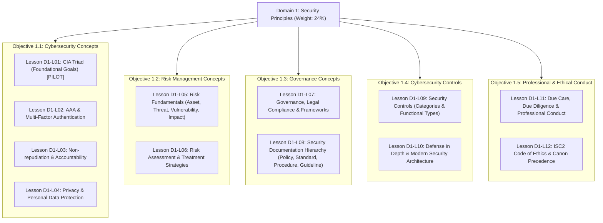

# Domain 1 Learning Slides — Comprehensive Curriculum & Storyboard Plan

**Task 57 · Curriculum Research, Source Review, Academic Accuracy, and Storyboard Planning**  
**Repository:** `SEC CERT TEST`  
**Certification Target:** ISC2 Certified in Cybersecurity (CC) — 2026 Exam Outline (Effective Sept 1, 2026)  
**Domain:** Domain 1: Security Principles (Published Weight: 24%)  
**Document Status:** Complete Planning Deliverable · Ready for Human Academic Review  
**Date:** 2026-10-24 (Asia/Bangkok)  

---

## 1. Executive Summary & Session Recovery Record

### 1.1 Context & Handoff Recovery
This document completes **Task 57: Domain 1 Learning Slides Curriculum Planning**, succeeding the interrupted session of the previous Codex agent. 

A thorough audit of the repository state and git history reveals:
- **Baseline Integrity:** The previous agent stopped at a token/usage limit before committing or writing any new files. No half-written or corrupted planning files were left behind.
- **Protected Baselines Maintained:** The pre-2026 question bank (583 questions), the new 2026 question bank (86 questions across Domains 1–3: 24 in D1, 39 in D2, 23 in D3), the 313 vocabulary entries (110 in D1, 101 in D2, 102 in D3), and the uncommitted native Slide Viewer foundation (Task 56) remain 100% intact and untouched.
- **Task 56 Status Respected:** Task 56 remains *partially complete pending manual browser acceptance* (native code and 26/26 Node static checks pass; human browser/device verification remains pending). Task 57 does not alter Task 56's status, nor does it publish any lessons to production or enable the Coming Soon card.
- **Scope of Task 57:** Strictly educational planning, source reconciliation, academic gap resolution, curriculum mapping, and slide storyboard design. No runtime slide decks, question bank edits, or UI modifications are performed.

---

## 2. Domain 1 Source Coverage & Evidence Inventory

Domain 1 source material in this repository consists of five distinct tiers of evidence, which must be cross-referenced to establish academic truth:

```
┌────────────────────────────────────────────────────────────────────────┐
│                      Domain 1 Evidence Hierarchy                       │
├────────────────────────────────┬───────────────────────────────────────┤
│ Tier 1: Authoritative Standard │ ISC2 CC 2026 Exam Outline (24%),      │
│                                │ NIST FIPS 199, NIST SP 800-53 r5,     │
│                                │ NIST SP 800-63B, ISO/IEC 27001.       │
├────────────────────────────────┼───────────────────────────────────────┤
│ Tier 2: Curated Project Data   │ Phase 2 Knowledge Map (43 KNOW items), │
│                                │ Phase 3 Curation Plan (39 units),     │
│                                │ Domain 1 Vocabulary (110 terms).      │
├────────────────────────────────┼───────────────────────────────────────┤
│ Tier 3: User Course Captures   │ 60 Slide Screenshots [S01]–[S60],     │
│                                │ Lecture Transcript Script - DOMAIN 1  │
│                                │ (98 timestamp blocks).                │
├────────────────────────────────┼───────────────────────────────────────┤
│ Tier 4: Local Study Guides     │ D1 sum.md (course-aligned summary),   │
│                                │ Domain 1.md (syllabus study guide).   │
├────────────────────────────────┼───────────────────────────────────────┤
│ Tier 5: SEC CERT TEST Authored │ Lesson blueprints, bilingual scripts, │
│                                │ and educational practice scenarios.   │
└────────────────────────────────┴───────────────────────────────────────┘
```

### 2.1 Complete Slide Capture Inventory ([S01]–[S60])
All 60 PNG slide captures stored in `content/isc2-cc-2026/sources/domain-1/slides/` (and mirror in `ISC2 Update 2026/Domain 1/`) have been cataloged:

| Capture IDs | Source Objective Grouping | Visual Readability & Technical Quality | Topic Content |
| :--- | :--- | :--- | :--- |
| **[S01]–[S03]** | Course Intro & Metadata | Fully readable. [S03] shows domain weights summing to 100% vs actual 99.9% outline values. | Exam timing (2h, 100–125 items, 700/1000 passing), domain percentages. |
| **[S04]–[S06]** | Objective 1.1: CIA & Confidentiality | Readable. [S05] erroneously puts "altering" under Confidentiality (SQ-13). [S06] NDA example bottom border close. | CIA diagram, Confidentiality definition, Encryption, Access Control, Passwords, NDA. |
| **[S07]–[S09]** | Objective 1.1: Integrity | Readable. [S07] has handwritten "hashing". [S08] is a cropped variant of [S09] (Integrity examples). | Unauthorized modification, Hashing (MD5, SHA), File Integrity Monitoring. |
| **[S10]–[S11]** | Objective 1.1: Availability | Readable. [S11] presents Cloud Storage Backups and DR failover broadly. | Service availability, Downtime reduction, Redundancy, Backups, UPS, Load Balancing. |
| **[S12]–[S14]** | Objective 1.1: AAA & MFA | Readable. [S13] covers 3 factors. [S14] presents "Somewhere You Are" (Location) alongside summary. | Identification, Authentication, Authorization, Accounting. MFA factor categories and location context. |
| **[S15]–[S19]** | Objective 1.1: Privacy | Readable. [S15] is cropped variant of [S16]. [S18] cites 7-year tax retention without jurisdiction. [S19] has ambiguous deletion phrasing. | Privacy definition, Data Subject, Controller vs Processor, Ownership, Inventory, Retention, Right to be Forgotten. |
| **[S20]–[S22]** | Objective 1.2: Risk Lifecycle & Identification | Readable. [S21] is cropped variant of [S22] (Identification examples). | 5-step Risk Lifecycle, Asset, Threat, Vulnerability, Potential Impact. |
| **[S23]–[S24]** | Objective 1.2: Quantitative Risk Analysis | Readable. [S23] has red annotation; displays ARO = 0.2 (once in 5 years). [S24] displays ALE formula and ARO = 2 example. | Exposure Factor (EF), Single Loss Expectancy (SLE), Annualized Rate of Occurrence (ARO), ALE. |
| **[S25]–[S28]** | Objective 1.2: Risk Response / Treatment | Readable. [S25] claims transfer shifts responsibility. [S27] is cropped variant of [S28]. | The 4 Treatments: Avoidance, Mitigation, Transfer, Acceptance. Cost/benefit and tolerance. |
| **[S29]–[S30], [S32]** | Objective 1.2: Risk Monitoring & Reporting | Readable. [S32] is a duplicate capture of [S30] with a video player overlay. | Continuous monitoring, reassessment triggers, stakeholder risk communication. |
| **[S31]** | Objective 1.2: Unreadable Fragment | **UNREADABLE (SQ-01):** 50×36 pixels, 374 bytes. Black thumbnail fragment. | Quarantined. No educational claims drawn from this file. |
| **[S33]–[S35]** | Objective 1.3: Governance & Legal | Readable. [S34] and [S35] are annotation variants (PCI-DSS and GDPR notes). | Governance direction/oversight, alignment with business goals, laws vs regulations. |
| **[S36]** | Objective 1.3: Unreadable Fragment | **UNREADABLE (SQ-01):** 43×22 pixels, 615 bytes. Black thumbnail fragment. | Quarantined. No educational claims drawn from this file. |
| **[S37]–[S39]** | Objective 1.3: Regulations, Frameworks, Guidelines | Readable. Mentions GDPR, HIPAA, PCI DSS, NIST CSF, ISO/IEC 27001, CIS Controls. | Mandatory regulations vs advisory guidelines; structured frameworks. |
| **[S40]–[S43]** | Objective 1.3: Policies, Standards, Procedures | Readable. [S43] illustrates password policy, standard, and procedure breakdown. | Policy (What/Why), Standard (Mandatory baseline), Procedure (Step-by-step How). |
| **[S44]–[S47]** | Objective 1.3: Standards & Exam Takeaways | Readable. [S44] covers ISO/IEC 27001 ISMS. [S45] covers CIS Controls. [S46]–[S47] give exam summary tips. | International standards, prioritized controls, documentation hierarchy takeaways. |
| **[S48]–[S52]** | Objective 1.4: Control Categories & Layers | Readable. [S48] lists 4 categories (Technical, Managerial, Operational, Physical). [S52] has handwritten "Defense in Depth". | Control implementation categories, examples, layered defense model. |
| **[S53]–[S56]** | Objective 1.4: Control Functional Types | Readable. [S53] lists 6 types (Preventive, Detective, Corrective, Deterrent, Compensating, Directive). [S55]–[S56] show overlap. | Functional types, CCTV multiple roles, contextual classification rules. |
| **[S57]–[S60]** | Objective 1.5: Ethics & Professional Conduct | Readable. [S58] Due Care, [S59] Due Diligence, [S60] The 4 ISC2 Canons. | Professional conduct, Due Care (Action) vs Due Diligence (Review), ISC2 Code of Ethics Canons. |

### 2.2 Lecture Transcript (`Script - DOMAIN 1.txt`) Audit
- **Total Duration:** ~1 hour 11 minutes (98 timestamp blocks).
- **Audio Overlaps:** 98 speech blocks contain repeated lines and overlapping timestamps (`TRANSCRIPT-OVERLAP`).
- **Phonetic & Speech-Recognition Errors (SQ-03):**
  - `00:11:10`: Transcript reads "correct and altered" → Corrected from slide [S07]: "correct and unaltered data".
  - `00:34:18`: Transcript reads "unpaged server" → Corrected from slide [S22]: "unpatched server".
  - `00:38:53`: Transcript reads "once every 5 years = 2" → Corrected from slide [S23]: "0.2" ($1/5 = 0.2$).
  - `00:48:26`: Transcript reads "HIPPA" → Corrected from slide [S37]: "HIPAA".
  - `00:53:23`: Transcript reads "ISO 101" → Corrected from slide [S44]: "ISO/IEC 27001".
  - `00:56:16`: Transcript states "procedure is also optional" (SQ-05) → Academic correction: Procedures are mandatory operational steps; guidelines are optional.
  - `01:08:41`: Transcript reads "principles" → Corrected from slide [S60]: "principals" (employers/clients).

### 2.3 Synthesis of Local Summaries (`D1 sum.md` vs `Domain 1.md`)
Comparing the two existing Markdown summaries in the repository reveals why previous reviewers noted discrepancies:
- `D1 sum.md` strictly mirrors the course lecture: It uses 4 control categories (Technical, Managerial, Operational, Physical), introduces "Somewhere You Are" under MFA, covers quantitative ALE math, includes GDPR privacy roles, but **completely omits Non-repudiation** because the lecturer did not cover it.
- `Domain 1.md` reflects independent exam syllabus research: It follows the official 3 control categories (Technical, Administrative, Physical), includes Non-repudiation, covers Zero Trust and Defense in Depth, focuses on qualitative risk analysis, but leaves out the course's quantitative math and GDPR deep-dives.
- **Academic Synthesis for Learning Slides:** We reconcile both documents against the official ISC2 CC 2026 outline and NIST standards:
  1. Teach the 3 official control categories as primary scope, while explaining operational implementation.
  2. Restore Non-repudiation as a mandatory core topic under Objective 1.1.
  3. Include qualitative risk analysis as primary, retaining basic ALE concepts as supporting insight.
  4. Include Zero Trust as clearly labeled "modern architectural context" rather than an invented exam objective.

---

## 3. Curriculum Structure Mapped to Official 2026 Learning Objectives

Domain 1 represents **24% of the ISC2 CC exam**. To ensure thorough coverage without creating cognitive overload, the domain is organized into **12 focused, modular lessons** mapped to the 5 official objectives:



### Curriculum Architecture Table

| Lesson ID | Canonical Lesson Title | Primary Objective | Estimated Slides | Core Learning Outcome |
| :--- | :--- | :---: | :---: | :--- |
| **D1-L01** | **CIA Triad — The Foundational Security Goals (Pilot)** | **1.1** | **8 slides** | Distinguish disclosure, alteration, and disruption; recognize that one incident can harm multiple goals. |
| **D1-L02** | **Identification, AAA & Multi-Factor Authentication** | **1.1** | **9 slides** | Master AAA functions; apply 3 independent factors (Know, Have, Are); classify location as context. |
| **D1-L03** | **Non-repudiation & Accountability** | **1.1** | **7 slides** | Explain how digital signatures and audit logs prevent denial of action; fill the raw lecture gap. |
| **D1-L04** | **Privacy & Personal Data Protection** | **1.1 / 1.3** | **8 slides** | Differentiate Privacy from Confidentiality; understand Data Subject, Controller, and Processor roles. |
| **D1-L05** | **Risk Components — Assets, Threats, Vulnerabilities & Impacts** | **1.2** | **8 slides** | Connect threat actors exploiting weaknesses to impact assets; distinguish threat from vulnerability. |
| **D1-L06** | **Risk Assessment & The Four Treatment Options** | **1.2** | **9 slides** | Compare qualitative vs quantitative risk; correctly apply Avoid, Mitigate, Transfer, and Accept. |
| **D1-L07** | **Security Governance, Frameworks & Regulatory Compliance** | **1.3** | **8 slides** | Align security with business goals; understand regulations (GDPR, HIPAA) and frameworks (NIST, ISO). |
| **D1-L08** | **The Documentation Hierarchy — Policies, Standards, Procedures & Guidelines** | **1.3** | **8 slides** | Differentiate mandatory What/Why (Policy), Baseline (Standard), How (Procedure), and Advisory (Guideline). |
| **D1-L09** | **Cybersecurity Controls — Implementation Categories & Functional Types** | **1.4** | **9 slides** | Differentiate Technical, Administrative, and Physical controls; analyze Preventive, Detective, Corrective. |
| **D1-L10** | **Defense in Depth & Modern Architecture (Context: Zero Trust)** | **1.4 / 1.1** | **8 slides** | Implement layered security controls; understand Zero Trust principles ("Never Trust, Always Verify"). |
| **D1-L11** | **Due Care, Due Diligence & Professional Conduct** | **1.5** | **7 slides** | Differentiate prudent action (Due Care) from investigative verification (Due Diligence). |
| **D1-L12** | **The ISC2 Code of Ethics & Canon Precedence** | **1.5** | **8 slides** | Master the 4 Canons; apply mandatory precedence when duties to the public conflict with employers. |

---

## 4. Lesson-by-Lesson Teaching Plan (D1-L01 to D1-L12)

### Lesson D1-L01: CIA Triad — The Foundational Security Goals (Pilot Lesson)
- **Objective:** 1.1 Understand cybersecurity concepts
- **Prerequisites:** None (Introductory lesson).
- **Key Terminology:**
  - `Confidentiality` (การรักษาความลับ): Prevention of unauthorized disclosure or viewing of data.
  - `Integrity` (ความถูกต้องครบถ้วน): Prevention of unauthorized modification, tampering, or deletion of data.
  - `Availability` (ความพร้อมใช้งาน): Assurance that systems, networks, and data are accessible to authorized users when needed.
  - `Unauthorized Disclosure` (การเปิดเผยโดยไม่ได้รับอนุญาต)
  - `Tampering / Unauthorized Modification` (การดัดแปลงแก้ไขโดยไม่ได้รับอนุญาต)
  - `Disruption / Downtime` (การหยุดชะงักของบริการ / เวลาหยุดทำงาน)
- **Pedagogical Narrative & Sequence:**
  1. *Orientation:* Introduce security as protecting business operations and data rather than merely installing software.
  2. *The Triad Pillars:* Define Confidentiality, Integrity, and Availability using simple, distinct real-world verbs (See / Trust / Reach).
  3. *Confidentiality in Focus:* Explore unauthorized disclosure (e.g., medical record leak). Contrast viewing from changing.
  4. *Integrity in Focus:* Explore unauthorized modification (e.g., payroll table alteration). Address SQ-13 explicitly (alteration is Integrity, not Confidentiality).
  5. *Availability in Focus:* Explore disruption (e.g., hospital power outage, ransomware denial of access).
  6. *Compound Impact Scenario:* Demonstrate how a single incident (ransomware exfiltrating, encrypting, and corrupting data) impacts all three pillars simultaneously.
  7. *Decision Checkpoint:* Interactive scenario reflection where learners diagnose which pillar is primarily impacted in a scenario.
  8. *Summary & References:* Key takeaways and direct mapping to NIST FIPS 199.
- **Common Misconceptions:**
  - *Trap 1:* Believing encryption fixes all security problems. (Encryption protects confidentiality; it does not prevent someone from deleting the file or disrupting the server).
  - *Trap 2:* Confusing alteration with disclosure. (Reading a salary is a Confidentiality breach; modifying a salary is an Integrity breach).
- **Source References:** [S04], [S05], [S06], [S07], [S08], [S09], [S10], [S11]; NIST FIPS 199 Section 3.

---

### Lesson D1-L02: Identification, AAA & Multi-Factor Authentication (MFA)
- **Objective:** 1.1 Understand cybersecurity concepts
- **Prerequisites:** Lesson D1-L01.
- **Key Terminology:**
  - `Identification` (การระบุตัวตน): Claiming an identity (Username, Employee ID).
  - `Authentication` (การพิสูจน์ตัวตน): Proving the claimed identity (Password, Biometric).
  - `Authorization` (การกำหนดสิทธิ์): Determining allowed actions (Read, Write, Execute).
  - `Accounting / Auditing` (การบันทึกและตรวจสอบ): Tracking user activities in logs for traceability.
  - `Multi-Factor Authentication (MFA)`: Authentication requiring 2 or more factors from *different* categories.
  - `Something You Know` (สิ่งที่คุณรู้ - Knowledge factor: Password, PIN).
  - `Something You Have` (สิ่งที่คุณมี - Possession factor: Smart card, Hardware token, Authenticator app).
  - `Something You Are` (สิ่งที่คุณเป็น - Inherence factor: Fingerprint, Facial scan, Retina).
  - `Contextual Attributes / Location Signals` (คุณลักษณะเชิงบริบท/สัญญาณตำแหน่งที่อยู่: IP, Geolocation).
- **Pedagogical Narrative & Sequence:**
  1. *The Identity Journey:* Trace a user entering a building or system from saying who they are (Identification) to showing their badge (Authentication), entering permitted rooms (Authorization), and appearing on visitor logs (Accounting).
  2. *AAA Step-by-Step Breakdown:* Contrast each AAA pillar with distinct questions: "Who are you?", "Prove it!", "What can you do?", "What did you do?".
  3. *The MFA Principle:* Explain why 2 passwords (Password + PIN) are NOT MFA (both are Something You Know).
  4. *The Three Classical Factors:* Detail Knowledge, Possession, and Inherence with enterprise examples.
  5. *Reconciling Location (Academic Issue B):* Teach Location (GPS, IP) as an *environmental context signal* in Adaptive/Conditional Authentication, NOT a standalone primary factor.
  6. *Scenario Walkthrough:* A remote employee logging in from an unfamiliar country triggers step-up authentication.
- **Source References:** [S12], [S13], [S14]; NIST SP 800-63B Section 5.1.1; KNOW-D1-008–012.

---

### Lesson D1-L03: Non-repudiation & Accountability (Curriculum Gap Filled)
- **Objective:** 1.1 Understand cybersecurity concepts
- **Prerequisites:** Lessons D1-L01, D1-L02.
- **Key Terminology:**
  - `Non-repudiation` (การไม่อาจปฏิเสธความรับผิดชอบได้): Assurance that the sender or performer of an action cannot deny having sent or performed it.
  - `Accountability` (ความรับผิดชอบตรวจสอบย้อนกลับได้): Linking an action to a specific individual or process.
  - `Digital Signature` (ลายมือชื่อดิจิทัล): Asymmetric cryptographic mechanism providing authentication, integrity, and non-repudiation.
  - `Audit Trail / Logs` (บันทึกการตรวจสอบ): Secure, tamper-evident logs establishing an unbroken chain of evidence.
- **Pedagogical Narrative & Sequence:**
  1. *The Denial Dilemma:* Present a scenario where a contractor claims: "I never approved that $1,000,000 transfer; someone else used my account!"
  2. *Defining Non-repudiation:* Explain non-repudiation as the legal and technical inability to deny an action due to irrefutable proof.
  3. *Mechanisms of Non-repudiation:* Show how Digital Signatures (combining private key authentication and cryptographic hashing) bind the sender to the specific content.
  4. *Non-repudiation vs Authentication:* Clarify the distinction: Authentication proves who you are *at the moment of login*; Non-repudiation proves *who performed a specific transaction* after the fact.
  5. *Supporting Accountability:* Explain why shared accounts destroy accountability and invalidate non-repudiation.
- **Source References:** Official ISC2 CC Outline 2026 Objective 1.1; NIST SP 800-32; ISO/IEC 7498-2; `Domain 1.md` Section 4.1.

---

### Lesson D1-L04: Privacy & Personal Data Protection
- **Objective:** 1.1 Understand cybersecurity concepts / 1.3 Governance
- **Prerequisites:** Lesson D1-L01.
- **Key Terminology:**
  - `Privacy` (ความเป็นส่วนตัว): The right of individuals to control how their personal information is collected, used, shared, and retained.
  - `Personally Identifiable Information (PII)`: Data that can identify a specific individual.
  - `Data Subject` (เจ้าของข้อมูลส่วนบุคคล): The living individual to whom the personal data relates.
  - `Data Controller` (ผู้ควบคุมข้อมูลส่วนบุคคล): The entity determining the purposes and means of processing personal data.
  - `Data Processor` (ผู้ประมวลผลข้อมูลส่วนบุคคล): The entity processing personal data on behalf of the controller.
  - `Data Minimization` (การลดการเก็บข้อมูลให้เหลือน้อยที่สุด)
  - `Right to be Forgotten / Erasure` (สิทธิในการขอให้ลบข้อมูล)
- **Pedagogical Narrative & Sequence:**
  1. *Confidentiality vs Privacy:* Teach the crucial difference: Confidentiality protects *any sensitive corporate or technical data*; Privacy specifically protects *individuals' personal data rights*.
  2. *Key Privacy Roles (GDPR & Global Standards):* Detail Data Subject (the user), Controller (the e-commerce company), and Processor (the cloud payroll provider).
  3. *Core Privacy Lifecycle Principles:* Collection limitation, purpose limitation, storage retention limits, and secure destruction.
  4. *Individual Rights:* Explain the right of access, correction, and erasure (Right to be Forgotten) subject to legitimate regulatory retention duties (tax, banking).
- **Source References:** [S15], [S16], [S17], [S18], [S19]; EU GDPR Articles 4, 5, 17; NIST SP 800-122; KNOW-D1-013–018.

---

### Lesson D1-L05: Risk Fundamentals — Assets, Threats, Vulnerabilities & Impacts
- **Objective:** 1.2 Understand risk management concepts
- **Prerequisites:** Lesson D1-L01.
- **Key Terminology:**
  - `Asset` (ทรัพย์สิน): Anything of value to the organization (data, systems, people, brand).
  - `Threat` (ภัยคุกคาม): Any circumstance or event with the potential to cause harm.
  - `Threat Actor` (ผู้ก่อภัยคุกคาม): The entity initiating or carrying out a threat (cybercriminals, insiders, nation-states).
  - `Vulnerability` (ช่องโหว่): A weakness in system design, configuration, implementation, or internal controls that can be exploited.
  - `Exploit` (การแสวงหาประโยชน์จากช่องโหว่): The technique, script, or action used to take advantage of a vulnerability.
  - `Risk` (ความเสี่ยง): The potential for loss, damage, or destruction of an asset resulting from a threat exploiting a vulnerability.
  - `Impact` (ผลกระทบ): The magnitude of harm resulting from a risk event.
- **Pedagogical Narrative & Sequence:**
  1. *The Risk Equation:* Introduce the fundamental security relationship: $\text{Threat} \times \text{Vulnerability} = \text{Risk}$.
  2. *Unpacking the Four Components:* Use a vivid enterprise analogy (Asset = Gold in vault; Vulnerability = Rusty lock; Threat = Bank robber; Impact = Financial bankruptcy).
  3. *Threat vs Vulnerability Distinction:* Reiterate that a threat cannot harm an asset if there is no vulnerability, and a vulnerability poses no risk if no threat exists to exploit it.
  4. *The 5-Step Risk Management Lifecycle:* Identification $\rightarrow$ Assessment $\rightarrow$ Treatment/Response $\rightarrow$ Monitoring $\rightarrow$ Reporting.
- **Source References:** [S20], [S21], [S22]; NIST SP 800-30 Rev. 1; ISO 31000; KNOW-D1-019–024.

---

### Lesson D1-L06: Risk Assessment & Treatment Strategies
- **Objective:** 1.2 Understand risk management concepts
- **Prerequisites:** Lesson D1-L05.
- **Key Terminology:**
  - `Qualitative Risk Assessment` (การประเมินความเสี่ยงเชิงคุณภาพ): Subjective rating based on Likelihood and Impact (High, Medium, Low).
  - `Quantitative Risk Assessment` (การประเมินความเสี่ยงเชิงปริมาณ): Numerical and monetary analysis using formulas (SLE, ARO, ALE).
  - `Single Loss Expectancy (SLE)`: Loss from a single event ($\text{Asset Value} \times \text{Exposure Factor}$).
  - `Annualized Rate of Occurrence (ARO)`: Estimated event frequency per year.
  - `Annualized Loss Expectancy (ALE)`: Annual projected monetary loss ($\text{SLE} \times \text{ARO}$).
  - `Risk Avoidance` (การหลีกเลี่ยงความเสี่ยง): Eliminating the activity or asset causing the risk.
  - `Risk Mitigation / Reduction` (การลดความเสี่ยง): Implementing controls to lower likelihood or impact.
  - `Risk Transfer / Sharing` (การโอนความเสี่ยง): Sharing financial burden (Insurance, warranties).
  - `Risk Acceptance` (การยอมรับความเสี่ยง): Acknowledging residual risk when mitigation cost exceeds asset value.
  - `Inherent Risk` (ความเสี่ยงที่แท้จริง) vs `Residual Risk` (ความเสี่ยงคงเหลือ).
- **Pedagogical Narrative & Sequence:**
  1. *Qualitative vs Quantitative:* Explain when organizations use qualitative matrices (fast, intuitive) vs quantitative dollar figures (business case for expensive controls).
  2. *Understanding the ALE Formula:* Demystify $\text{ALE} = \text{SLE} \times \text{ARO}$ conceptually. Address SQ-04 transcript error ($1/5 \text{ years} = 0.2$, not $2$).
  3. *The Four Risk Treatment Options:* Detail Avoidance, Mitigation, Transfer, Acceptance with clear workplace scenarios.
  4. *Risk Transfer Responsibility Boundary (SQ-07):* Emphasize that cyber insurance covers financial loss, but never transfers legal liability or reputation damage.
  5. *Inherent vs Residual Risk:* Visualizing how controls reduce inherent risk down to acceptable residual risk within organizational risk tolerance.
- **Source References:** [S23], [S24], [S25], [S26], [S27], [S28], [S29], [S30]; NIST SP 800-30; KNOW-D1-025–030.

---

### Lesson D1-L07: Security Governance, Frameworks & Regulatory Compliance
- **Objective:** 1.3 Understand governance concepts
- **Prerequisites:** Lesson D1-L01.
- **Key Terminology:**
  - `Security Governance` (การกำกับดูแลความมั่นคงปลอดภัย): Executive direction, leadership, and oversight ensuring security supports business strategy.
  - `Compliance` (การปฏิบัติตามข้อกำหนด): Adherence to mandatory laws, regulations, and contractual requirements.
  - `Regulations and Laws` (กฎหมายและระเบียบข้อบังคับ): Government-mandated requirements with legal penalties (GDPR, HIPAA).
  - `Industry Standards` (มาตรฐานอุตสาหกรรม): Contractual security requirements (PCI DSS).
  - `Security Frameworks` (กรอบการดำเนินงานด้านความปลอดภัย): Structured methodologies for managing security (NIST CSF, ISO/IEC 27001).
  - `NIST Cybersecurity Framework (CSF)`: Identify, Protect, Detect, Respond, Recover, Govern.
  - `ISO/IEC 27001`: International standard for an Information Security Management System (ISMS).
  - `CIS Controls`: Prioritized list of technical safeguards to stop prevalent cyber attacks.
- **Pedagogical Narrative & Sequence:**
  1. *What is Governance?:* Distinguish Governance ("Doing the right things" - Board/Executive direction) from Management ("Doing things right" - operational implementation).
  2. *Laws vs Industry Mandates:* Distinguish legislation (HIPAA, GDPR) from industry contractual standards (PCI DSS).
  3. *Why Use Frameworks?:* Explain how frameworks provide a common language and structured roadmap so organizations don't build security from scratch.
  4. *Key Framework Highlights:* Brief introduction to NIST CSF functions, ISO/IEC 27001 ISMS certification, and CIS Controls prioritization.
- **Source References:** [S33], [S34], [S35], [S37], [S38], [S44], [S45]; NIST CSF 2.0; ISO/IEC 27001:2022; KNOW-D1-031–034.

---

### Lesson D1-L08: The Security Documentation Hierarchy
- **Objective:** 1.3 Understand governance concepts
- **Prerequisites:** Lesson D1-L07.
- **Key Terminology:**
  - `Policy` (นโยบาย): High-level executive statement outlining security principles and business intent (Mandatory, High-level, "What" & "Why").
  - `Standard` (มาตรฐาน): Mandatory specific baseline rules, specifications, or technologies required across an organization (Mandatory, Specific, "What must be used").
  - `Procedure` (ขั้นตอนปฏิบัติ): Step-by-step instructions for executing tasks and processes (Mandatory, Operational, "How to do it").
  - `Guideline` (แนวปฏิบัติ / คำแนะนำ): Recommended advice, suggestions, or best practices (Advisory / Optional, Flexible).
- **Pedagogical Narrative & Sequence:**
  1. *The Documentation Pyramid:* Present the 4-tier hierarchy visually: Policy at the apex, Standards beneath, Procedures as the working steps, and Guidelines as advisory annexes.
  2. *Addressing the "Procedures are Optional" Myth (SQ-05):* Correct the transcript error; explain that Procedures are strictly mandatory for compliance and repeatability (e.g., standard employee termination checklist).
  3. *A Concrete Enterprise Example:*
     - Policy: "All employees must use strong authentication to protect corporate systems."
     - Standard: "Passwords must be at least 14 characters and combine 3 character types; MFA is required for external access."
     - Procedure: "Step 1: Open IT portal. Step 2: Request token. Step 3: Scan QR code into Microsoft Authenticator."
     - Guideline: "Use a passphrase of 4 random dictionary words to make memorization easier."
  4. *Exam Keyword Association:* Train learners to recognize exam clues: "Executive intent" $\rightarrow$ Policy; "Minimum required baseline" $\rightarrow$ Standard; "Step-by-step instructions" $\rightarrow$ Procedure; "Recommended best practice" $\rightarrow$ Guideline.
- **Source References:** [S40], [S41], [S42], [S43], [S46], [S47]; NIST SP 800-12; KNOW-D1-035–037.

---

### Lesson D1-L09: Cybersecurity Controls — Implementation Categories & Functional Types
- **Objective:** 1.4 Understand cybersecurity controls
- **Prerequisites:** Lessons D1-L01, D1-L05.
- **Key Terminology:**
  - `Security Control / Safeguard` (มาตรการควบคุม / มาตรการความปลอดภัย): A measure taken to manage, detect, or mitigate security risk.
  - `Technical / Logical Controls` (มาตรการทางเทคนิค): Hardware, software, and electronic safeguards (Firewall, MFA, Encryption, ACLs).
  - `Administrative / Managerial Controls` (มาตรการทางการบริหารจัดการ): Policies, procedures, employee training, risk assessments, and hiring vetting.
  - `Physical Controls` (มาตรการทางกายภาพ): Fences, locks, security guards, CCTV, mantraps, lighting, and environmental sensors.
  - `Preventive Controls` (มาตรการป้องกัน): Designed to stop an incident from occurring.
  - `Detective Controls` (มาตรการตรวจจับ): Designed to identify and alert on an incident in progress or after occurrence.
  - `Corrective Controls` (มาตรการแก้ไข): Designed to restore systems and remedy damage after an incident.
  - `Deterrent Controls` (มาตรการยับยั้ง): Designed to discourage attackers (Warning signs, visible cameras).
  - `Compensating Controls` (มาตรการชดเชย): Alternative safeguards used when primary controls are unfeasible.
- **Pedagogical Narrative & Sequence:**
  1. *The Two-Dimensional Control Matrix (Academic Issue A):* Clarify the distinction between *Implementation Category* (How it is built: Technical, Administrative, Physical) and *Functional Type* (When and what it does: Preventive, Detective, Corrective, etc.).
  2. *Reconciling 3 vs 4 Categories:* Show that the ISC2 CC 2026 outline uses 3 categories (Technical, Administrative, Physical), with "Operational" duties integrated within administrative procedures and day-to-day practices.
  3. *Functional Control Analysis:* Walk through an incident timeline:
     - Before: Preventive & Deterrent
     - During: Detective
     - After: Corrective & Recovery
  4. *Contextual Overlap (CCTV Case Study):* Explain how a single device serves multiple functions: A visible CCTV camera acts as a Deterrent; monitored CCTV acts as a Detective control; recorded footage used in post-incident investigation acts as a Corrective forensic tool.
- **Source References:** [S48], [S49], [S50], [S51], [S53], [S54], [S55], [S56]; NIST SP 800-53 Rev. 5; KNOW-D1-038–041.

---

### Lesson D1-L10: Defense in Depth & Modern Security Architecture
- **Objective:** 1.4 Understand cybersecurity controls / 1.1 Supplementary Context
- **Prerequisites:** Lessons D1-L02, D1-L09.
- **Key Terminology:**
  - `Defense in Depth` (การป้องกันแบบหลายชั้น): Layering multiple diverse security controls so that if one fails, others continue to protect the asset.
  - `Zero Trust Architecture (ZTA)` (สถาปัตยกรรมความมั่นคงปลอดภัยแบบซีโร่ทรัสต์): Modern security paradigm based on "Never Trust, Always Verify".
  - `Perimeter-based Security` (การรักษาความปลอดภัยแบบอิงขอบเขตเครือข่ายเดิม - Castle-and-Moat model).
  - `Least Privilege` (หลักการกำหนดสิทธิ์เท่าที่จำเป็น).
  - `Explicit Verification` (การตรวจสอบอย่างชัดแจ้งตามบริบท).
  - `Assume Breach` (การตั้งสมมติฐานว่าเกิดการบุกรุกแล้ว).
- **Pedagogical Narrative & Sequence:**
  1. *The Fallacy of the Single Shield:* Explain why relying on a single control (e.g., just a strong firewall) leads to catastrophic compromise once breached.
  2. *The Onion Model of Defense in Depth:* Illustrate layers protecting sensitive data: Physical security $\rightarrow$ Perimeter firewall $\rightarrow$ Internal network segmentation $\rightarrow$ Host endpoint protection $\rightarrow$ Application access control $\rightarrow$ Data encryption $\rightarrow$ User awareness training.
  3. *Zero Trust as Modern Supplementary Context (Academic Issue D):* Introduce the transition from the legacy "Castle and Moat" perimeter model to Zero Trust Architecture (NIST SP 800-207).
  4. *Three Core Zero Trust Tenets:* Verify explicitly; Use least privilege access; Assume breach.
  5. *Zero Trust vs Defense in Depth Distinction:* Zero Trust is an identity- and data-centric access philosophy ("Do not trust internal network traffic automatically"); Defense in Depth is a multi-layered implementation strategy.
- **Source References:** [S52]; NIST SP 800-207; `Domain 1.md` Section 9; KNOW-D1-041.

---

### Lesson D1-L11: Due Care, Due Diligence & Professional Conduct
- **Objective:** 1.5 Maintain professional and ethical conduct
- **Prerequisites:** Lessons D1-L01, D1-L07.
- **Key Terminology:**
  - `Due Care` (การใช้ความระมัดระวังอันสมควร - "The Prudent Person Rule"): Taking reasonable, responsible actions that a prudent professional would take to protect assets and people.
  - `Due Diligence` (การตรวจสอบอย่างรอบคอบ): The investigative, verification, and assessment processes used to ensure that controls are implemented and functioning effectively.
  - `Prudent Person Concept` (แนวคิดวิญญูชนผู้มีความรอบคอบระมัดระวัง).
  - `Negligence` (ความประมาทเลินเล่อ): Failure to exercise due care or due diligence.
- **Pedagogical Narrative & Sequence:**
  1. *Prudence in Cybersecurity:* Establish why cybersecurity professionals have legal and operational obligations to act responsibly.
  2. *Due Care vs Due Diligence Distinction:*
     - Due Care = **Action & Implementation** ("Doing the right thing" - installing patches, enforcing MFA, locking server room doors).
     - Due Diligence = **Verification & Investigation** ("Knowing the right thing is working" - reviewing audit logs, performing vulnerability scans, vetting third-party vendors).
  3. *Enterprise Analogy:* Buying smoke detectors and fire extinguishers is *Due Care*; testing the alarms every month and checking extinguisher pressure gauges is *Due Diligence*.
  4. *Professional Code of Conduct:* Professionalism, integrity, avoiding conflicts of interest, and maintaining competence.
- **Source References:** [S57], [S58], [S59]; KNOW-D1-042; Black's Law Dictionary (prudent person rule); ISC2 CBK.

---

### Lesson D1-L12: The ISC2 Code of Ethics & Canon Precedence
- **Objective:** 1.5 Maintain professional and ethical conduct
- **Prerequisites:** Lesson D1-L11.
- **Key Terminology:**
  - `ISC2 Code of Ethics` (ประมวลจริยธรรมของ ISC2): Mandatory ethical standard binding all ISC2 credential holders.
  - `Canon 1` (ข้อบังคับที่ 1): Protect society, the common good, necessary public trust and confidence, and the infrastructure.
  - `Canon 2` (ข้อบังคับที่ 2): Act honorably, honestly, justly, responsibly, and legally.
  - `Canon 3` (ข้อบังคับที่ 3): Provide diligent and competent service to principals (employers/clients).
  - `Canon 4` (ข้อบังคับที่ 4): Advance and protect the profession.
  - `Canon Precedence` (ลำดับความสำคัญของข้อบังคับทางจริยธรรม): The strict hierarchical priority where higher-numbered canons yield to lower-numbered canons in ethical conflicts.
- **Pedagogical Narrative & Sequence:**
  1. *Why Ethics Matters in Security:* Explain that security professionals hold privileged access to sensitive data and systems; technical skill without ethics is dangerous.
  2. *The Four Canons in Order:* Break down each canon with plain-language English and Thai translations.
  3. *The Precedence Rule (Academic Issue SQ-09):* Clarify the strict hierarchical order: Canon 1 (Society/Public) $>$ Canon 2 (Law/Honesty) $>$ Canon 3 (Employer/Client) $>$ Canon 4 (Profession).
  4. *Ethical Dilemma Case Study:* An employer directs a security engineer to conceal a massive data breach involving public medical records.
     - Employer's demand appeals to Canon 3 (loyalty to employer).
     - But Canon 1 (protecting society and public trust) and Canon 2 (acting legally and honestly) strictly override Canon 3!
     - The engineer cannot conceal the crime.
- **Source References:** [S60]; ISC2 Official Code of Ethics; KNOW-D1-043; `D1 sum.md` Sections 50–51; `Domain 1.md` Section 8.

---

## 5. Detailed Slide Storyboard Blueprint: Pilot Lesson (D1-L01)

This section provides the complete, production-ready storyboard for the **CIA Triad Pilot Lesson (D1-L01)**, designed according to the native Slide Viewer schema (`content/isc2-cc-2026/learning/schema.md`).

### Pilot Lesson Metadata
- **Lesson ID:** `lesson-d1-01-cia-triad`
- **Primary Objective:** `1.1`
- **Related Objectives:** `["1.4"]`
- **Title (EN):** The CIA Triad: Core Information Security Goals
- **Title (TH):** สามเหลี่ยม CIA: เสาหลักแห่งเป้าหมายความมั่นคงปลอดภัยสารสนเทศ
- **Target Slide Count:** 8 slides
- **Estimated Study Duration:** 10–12 minutes

---

#### Slide 1: Lesson Orientation & The Purpose of Security
- **Slide ID:** `slide-01-orientation`
- **Layout:** `title-bullets` (Orientation Layout)
- **Title (EN):** Why Do We Secure Information?
- **Title (TH):** ทำไมเราจึงต้องรักษาความมั่นคงปลอดภัยของข้อมูล?
- **Visual Description:** Clean visual banner with a high-contrast shield icon and a 3-part foundation block representing the CIA Triad. No decorative stock photography.
- **Bilingual Content Blocks:**
  - *Paragraph (EN):* Information security is not about installing firewalls or blocking users from working. Its true purpose is to protect an organization's critical assets so the business can achieve its mission safely.
  - *Paragraph (TH):* ความมั่นคงปลอดภัยสารสนเทศไม่ใช่เพียงการติดตั้งไฟร์วอลล์หรือการขัดขวางการทำงานของผู้ใช้ เป้าหมายที่แท้จริงคือการปกป้องทรัพย์สินสำคัญขององค์กร เพื่อให้ธุรกิจสามารถดำเนินงานได้อย่างปลอดภัยและบรรลุพันธกิจ
  - *Key Focus (EN):* Every security control you will learn in this certification exists to support one or more of three fundamental goals: **Confidentiality**, **Integrity**, and **Availability** (The CIA Triad).
  - *Key Focus (TH):* มาตรการความปลอดภัยทุกมาตรการที่คุณจะได้เรียนรู้ในการรับรองนี้ มีขึ้นเพื่อสนับสนุนเป้าหมายพื้นฐาน 3 ประการ ได้แก่ **การรักษาความลับ (Confidentiality)**, **ความถูกต้องครบถ้วน (Integrity)** และ **ความพร้อมใช้งาน (Availability)**
- **Citation / Traceability:** Official ISC2 CC Outline Objective 1.1; KNOW-D1-001; [S04].

---

#### Slide 2: The Three Pillars of the CIA Triad
- **Slide ID:** `slide-02-cia-overview`
- **Layout:** `comparison` (3-Column Architecture Card Layout)
- **Title (EN):** The Three Pillars of Information Security
- **Title (TH):** 3 เสาหลักแห่งความมั่นคงปลอดภัยสารสนเทศ
- **Visual Description:** An original SVG tripartite diagram showing an equilateral triangle with Confidentiality, Integrity, and Availability at each apex, interconnected by dual arrows. Beneath the diagram, three distinct cards summarize each pillar with an iconic action verb.
- **Bilingual Content Blocks:**
  - *Column 1 — Confidentiality:*
    - **Header:** Confidentiality (การรักษาความลับ)
    - **Action Verb:** "Who can SEE it?" (ใครเห็นข้อมูลได้บ้าง?)
    - **Principle:** Prevent unauthorized disclosure of sensitive data.
    - **คำอธิบาย:** ป้องกันการเปิดเผยข้อมูลแก่บุคคลหรือระบบที่ไม่ได้รับอนุญาต
  - *Column 2 — Integrity:*
    - **Header:** Integrity (ความถูกต้องครบถ้วน)
    - **Action Verb:** "Can I TRUST the data?" (ข้อมูลเชื่อถือได้หรือไม่?)
    - **Principle:** Prevent unauthorized modification, tampering, or deletion.
    - **คำอธิบาย:** ป้องกันการแก้ไข ดัดแปลง หรือทำลายข้อมูลโดยไม่ได้รับอนุญาต
  - *Column 3 — Availability:*
    - **Header:** Availability (ความพร้อมใช้งาน)
    - **Action Verb:** "Can I REACH it?" (เข้าถึงระบบได้เมื่อจำเป็นหรือไม่?)
    - **Principle:** Ensure authorized users have timely, reliable access to systems and data.
    - **คำอธิบาย:** รับรองว่าระบบและข้อมูลพร้อมให้ผู้มีสิทธิ์เข้าถึงได้เมื่อต้องการ
- **Citation / Traceability:** NIST FIPS 199 Section 3; KNOW-D1-001; [S04]; T@00:05:55.

---

#### Slide 3: Confidentiality — Protecting Against Unauthorized Disclosure
- **Slide ID:** `slide-03-confidentiality`
- **Layout:** `concept-split` (Concept & Example Layout)
- **Title (EN):** Confidentiality: Keeping Secrets Secret
- **Title (TH):** Confidentiality: การรักษาความลับของข้อมูล
- **Visual Description:** Two-panel card layout. Left panel: Conceptual definition with lock and eye icon (crossed out). Right panel: Enterprise example showing employee payroll data protection.
- **Bilingual Content Blocks:**
  - *Left Panel (Definition):*
    - **Core Concept (EN):** Confidentiality ensures that sensitive information is accessible **only** to authorized persons, entities, or processes. A breach occurs whenever unauthorized viewing takes place—even if no data is altered.
    - **Core Concept (TH):** Confidentiality คือการรับรองว่าข้อมูลที่เป็นความลับจะถูกเข้าถึงได้ **เฉพาะผู้ที่ได้รับอนุญาตเท่านั้น** การละเมิดความลับเกิดขึ้นทันทีที่มีการเปิดอ่านข้อมูลโดยไม่ได้รับอนุญาต แม้ข้อมูลนั้นจะไม่ถูกแก้ไขเลยก็ตาม
    - **Typical Safeguards:** Encryption (Data at rest & transit), Access Control Lists (ACLs), Multi-Factor Authentication, Data Classification, Non-Disclosure Agreements (NDAs).
  - *Right Panel (Enterprise Scenario):*
    - **Scenario (EN):** An unauthorized intern opens and reads an unencrypted spreadsheet containing executive salaries.
    - **Scenario (TH):** พนักงานฝึกงานเปิดอ่านไฟล์เงินเดือนของผู้บริหารที่ไม่ได้เข้ารหัสไว้โดยไม่ได้รับอนุญาต
    - **Analysis (EN):** No numbers were changed and the file was not deleted. However, Confidentiality was severely compromised because an unauthorized person saw restricted data.
    - **Analysis (TH):** ไม่มีการแก้ไขตัวเลขใด ๆ และไฟล์ไม่ถูกลบ แต่ Confidentiality ถูกละเมิดอย่างร้ายแรง เพราะผู้ไม่มีสิทธิ์ได้มองเห็นข้อมูลลับนั้น
- **Citation / Traceability:** KNOW-D1-002, KNOW-D1-003; [S05], [S06]; T@00:06:42.

---

#### Slide 4: Integrity — Protecting Against Unauthorized Modification
- **Slide ID:** `slide-04-integrity`
- **Layout:** `concept-split` (Concept & Example Layout)
- **Title (EN):** Integrity: Trusting Your Data
- **Title (TH):** Integrity: ความถูกต้องและน่าเชื่อถือของข้อมูล
- **Visual Description:** Two-panel card layout. Left panel: Conceptual definition with hash verification symbol. Right panel: Financial transaction tampering scenario.
- **Bilingual Content Blocks:**
  - *Left Panel (Definition):*
    - **Core Concept (EN):** Integrity ensures that data and systems remain accurate, complete, and protected against unauthorized modification, insertion, or deletion.
    - **Core Concept (TH):** Integrity คือการรับรองว่าข้อมูลและระบบมีความถูกต้อง ครบถ้วน และปลอดภัยจากการถูกแก้ไข ดัดแปลง แทรกแซง หรือลบทำลายโดยไม่ได้รับอนุญาต
    - **Crucial Boundary (SQ-13):** Note that *altering* data is strictly an **Integrity** issue, not Confidentiality.
    - **จุดเน้นสำคัญ:** การ *ดัดแปลงแก้ไข* ข้อมูลเป็นปัญหาของ **Integrity** โดยตรง ไม่ใช่ Confidentiality
    - **Typical Safeguards:** Cryptographic Hashing (SHA-256), Digital Signatures, File Integrity Monitoring (FIM), Strict Change Control, Versioning.
  - *Right Panel (Enterprise Scenario):*
    - **Scenario (EN):** An attacker intercepts a wire transfer request and changes the destination account number from Account A to Account B.
    - **Scenario (TH):** ผู้โจมตีดักจับคำสั่งโอนเงินและแก้ไขหมายเลขบัญชีปลายทางจากบัญชี A เป็นบัญชี B
    - **Analysis (EN):** The banking system is running perfectly and the money is transferred, but the transaction data was altered. This is a critical failure of Integrity.
    - **Analysis (TH):** ระบบธนาคารทำงานได้ตามปกติและเงินถูกโอนจริง แต่ข้อมูลการโอนถูกปลอมแปลงแก้ไข นี่คือความเสียหายร้ายแรงต่อ Integrity
- **Citation / Traceability:** KNOW-D1-004, KNOW-D1-005; [S07], [S08], [S09]; T@00:11:10; SQ-13 resolution.

---

#### Slide 5: Availability — Ensuring Systems and Data are Accessible
- **Slide ID:** `slide-05-availability`
- **Layout:** `concept-split` (Concept & Example Layout)
- **Title (EN):** Availability: Accessible When You Need It
- **Title (TH):** Availability: ความพร้อมใช้งานเมื่อต้องการ
- **Visual Description:** Two-panel card layout. Left panel: Definition with server uptime meter. Right panel: Denial of Service / hardware outage scenario.
- **Bilingual Content Blocks:**
  - *Left Panel (Definition):*
    - **Core Concept (EN):** Availability ensures that authorized users have reliable and timely access to information, applications, and networks whenever required for business operations.
    - **Core Concept (TH):** Availability คือการรับรองว่าผู้ใช้ที่ได้รับอนุญาตจะสามารถเข้าถึงข้อมูล แอปพลิเคชัน และเครือข่ายที่จำเป็นต่อการดำเนินธุรกิจได้อย่างต่อเนื่องและทันท่วงที
    - **Typical Threats:** Hardware failures, power blackouts, Denial of Service (DoS/DDoS) attacks, natural disasters, ransomware lockouts.
    - **Typical Safeguards:** Redundant power (UPS, generators), High-Availability clustering, Load Balancers, verified Data Backups, Disaster Recovery (DR) sites.
  - *Right Panel (Enterprise Scenario):*
    - **Scenario (EN):** A distributed denial-of-service (DDoS) attack floods an e-commerce website with 500 million junk requests per second, causing the web servers to crash on Black Friday.
    - **Scenario (TH):** การโจมตีแบบ DDoS ถล่มส่งทราฟฟิกขยะ 500 ล้านครั้งต่อวินาทีเข้าใส่เว็บขายสินค้าออนไลน์ ทำให้เซิร์ฟเวอร์ล่มในวันลดราคาใหญ่
    - **Analysis (EN):** Customer credit card data was not stolen (Confidentiality intact) and database prices were not changed (Integrity intact), but legitimate buyers cannot purchase goods. This is an Availability disaster.
    - **Analysis (TH):** ข้อมูลบัตรเครดิตลูกค้าไม่รั่วไหล และราคาสินค้าไม่ถูกแก้ แต่ลูกค้าจริงไม่สามารถซื้อสินค้าได้ นี่คือความเสียหายโดยตรงต่อ Availability
- **Citation / Traceability:** KNOW-D1-006, KNOW-D1-007; [S10], [S11]; T@00:13:58.

---

#### Slide 6: Compound Impact — One Incident, Multiple Breaches
- **Slide ID:** `slide-06-compound-impact`
- **Layout:** `scenario-flow` (Step-by-step Interactive Incident Breakdown)
- **Title (EN):** Real-World Complexity: Compound Impacts
- **Title (TH):** โลกความเป็นจริง: หนึ่งเหตุการณ์กระทบหลายด้าน
- **Visual Description:** Flowchart demonstrating how a single cyber attack cascades across all three security goals.
- **Bilingual Content Blocks:**
  - *Introduction (EN):* On certification exams and in the workplace, security incidents rarely affect only one pillar in isolation. An attack often violates multiple security goals simultaneously.
  - *Introduction (TH):* ทั้งในข้อสอบและการทำงานจริง เหตุการณ์ภัยคุกคามทางไซเบอร์มักไม่ได้กระทบเพียงเสาหลักเดียวอย่างโดดเดี่ยว การโจมตีหนึ่งครั้งมักละเมิดเป้าหมายความปลอดภัยหลายด้านพร้อมกัน
  - *The Ransomware Case Study:*
    - **Phase 1: Exfiltration (Confidentiality Harm):** Attackers copy sensitive patient records to their private servers $\rightarrow$ Unauthorized disclosure.
    - **Phase 2: Encryption (Availability Harm):** Attackers encrypt the hospital's primary database $\rightarrow$ Doctors cannot view patient histories or dispense medication.
    - **Phase 3: Database Corruption (Integrity Harm):** Incomplete encryption corrupts patient blood type records $\rightarrow$ Data can no longer be trusted.
  - *Lesson Takeaway (EN):* Always analyze the *specific effect* emphasized in a scenario to determine the primary goal affected.
  - *Lesson Takeaway (TH):* ในการวิเคราะห์สถานการณ์ ให้ดูที่ *ผลกระทบหลักที่เกิดขึ้นจริงในแต่ละบริบท* เพื่อระบุว่าหลักการใดถูกละเมิดอย่างเด่นชัดที่สุด
- **Citation / Traceability:** KNOW-D1-001; Curation U01–U04; NIST SP 800-61 Rev. 2.

---

#### Slide 7: Apply Your Knowledge — Practice Reflection Scenario
- **Slide ID:** `slide-07-scenario-reflection`
- **Layout:** `scenario-reveal` (Educational Reflection / Interactive Reveal)
- **Title (EN):** Scenario Reflection: What Principle is at Stake?
- **Title (TH):** ทดสอบความเข้าใจ: หลักการใดถูกละเมิด?
- **Visual Description:** A realistic enterprise scenario card with a clickable "Reveal Analysis" button. (Unscored educational practice, strictly decoupled from the quiz engine).
- **Bilingual Content Blocks:**
  - *Scenario Card (EN):*
    > A disgruntled database administrator alters the inventory database, secretly marking 50 high-end laptops as "defective and written off" so an accomplice can remove them unnoticed. The server remains online, and no customer data is leaked outside the company.
  - *Scenario Card (TH):*
    > ผู้ดูแลระบบฐานข้อมูลที่กำลังไม่พอใจองค์กร แอบแก้ไขฐานข้อมูลสต็อกสินค้า โดยเปลี่ยนสถานะแล็ปท็อปราคาแพง 50 เครื่องเป็น "ชำรุดและตัดจำหน่าย" เพื่อให้เพื่อนร่วมขบวนการขนย้ายออกไปได้ เซิร์ฟเวอร์ยังคงทำงานได้ตามปกติ และไม่มีข้อมูลลูกค้ารั่วไหลสู่ภายนอก
  - *Question Prompt (EN):* Which CIA Triad property has been directly violated by the administrator's action?
  - *Question Prompt (TH):* การกระทำของผู้ดูแลระบบดังกล่าว ละเมิดเป้าหมายความปลอดภัยข้อใดใน CIA Triad โดยตรงที่สุด?
  - *Interactive Reveal Analysis (EN):*
    - **Primary Answer:** **Integrity (ความถูกต้องครบถ้วนของข้อมูล)**.
    - **Reasoning:** The inventory records were tampered with and altered without authorization, making the asset ledger inaccurate and untrustworthy. Confidentiality was not the target of the harm, and Availability was unaffected because the database was never taken offline.
  - *Interactive Reveal Analysis (TH):*
    - **คำตอบหลัก:** **Integrity (ความถูกต้องครบถ้วน)**
    - **เหตุผล:** บันทึกสต็อกสินค้าถูกดัดแปลงแก้ไขโดยมิชอบ ทำให้ข้อมูลในระบบคลาดเคลื่อนและไม่สามารถเชื่อถือได้ แม้ระบบจะไม่ล่ม (Availability ปกติ) และไม่มีข้อมูลภายนอกรั่วไหล (Confidentiality ปกติ) แต่ความน่าเชื่อถือของข้อมูลถูกทำลาย
- **Citation / Traceability:** Original SEC CERT TEST educational scenario; Opportunity O01; Curation Unit U03.

---

#### Slide 8: Summary, Takeaways & Authoritative References
- **Slide ID:** `slide-08-takeaways`
- **Layout:** `summary-grid` (Key Takeaways & Citations Layout)
- **Title (EN):** Key Takeaways & Exam Strategies
- **Title (TH):** สรุปประเด่นสำคัญและเทคนิคการทำข้อสอบ
- **Visual Description:** Clean review table with three quick-reference strategy rows, followed by authoritative reference links and return button.
- **Bilingual Content Blocks:**
  - *Quick Decision Matrix (ตารางช่วยจำสำหรับสอบ):*
    - **Confidentiality:** Look for clues like *reading, viewing, disclosing, exfiltrating, snooping* $\rightarrow$ Safeguards: *Encryption, ACLs, Need-to-know*.
    - **Integrity:** Look for clues like *modifying, tampering, altering, forging, deleting* $\rightarrow$ Safeguards: *Hashing, Digital Signatures, Change Management*.
    - **Availability:** Look for clues like *downtime, crash, inaccessible, denial of service, blackout* $\rightarrow$ Safeguards: *Redundancy, Backups, UPS, DR sites*.
  - *Important Reminder (EN):* Never assume "Encryption is always the answer" (SQ-13). Encryption ensures confidentiality, but hashing ensures integrity, and backups ensure availability.
  - *Important Reminder (TH):* อย่าจำว่า "Encryption คือคำตอบสากลของทุกอย่าง" เพราะการเข้ารหัสช่วยด้านการรักษาความลับ แต่หากต้องการตรวจสอบความถูกต้องต้องใช้ Hashing และหากต้องการความพร้อมใช้งานต้องใช้ระบบสำรอง (Backups/Redundancy)
  - *Authoritative References:*
    - ISC2 Certified in Cybersecurity (CC) Exam Outline (2026), Domain 1, Objective 1.1.
    - NIST FIPS 199: Standards for Security Categorization of Federal Information and Information Systems (Section 3).
- **Citation / Traceability:** KNOW-D1-001; NIST FIPS 199; SQ-13 resolution.

---

## 6. Academic Discrepancies, Source Conflicts & Resolutions

This section provides thorough, peer-reviewed resolutions to the academic discrepancies identified between `D1 sum.md`, `Domain 1.md`, lecture materials, and the official ISC2 CC 2026 outline:

```
┌────────────────────────────────────────────────────────────────────────┐
│                   Academic Issue Resolution Summary                    │
├────────────────────┬─────────────────────────────┬─────────────────────┤
│ Issue Code & Topic │ Source Conflict / Drift     │ Authoritative       │
│                    │                             │ Resolution Strategy │
├────────────────────┼─────────────────────────────┼─────────────────────┤
│ A. Control         │ D1 sum.md lists 4 classes;  │ Adopt official 3    │
│    Categories      │ Domain 1.md lists 3.        │ categories; explain │
│                    │                             │ functional types.   │
├────────────────────┼─────────────────────────────┼─────────────────────┤
│ B. Location-Based  │ Treated as an equal 4th     │ Reclassify Location │
│    Authentication  │ factor in some course decks.│ as contextual/risk  │
│                    │                             │ signal (SP 800-63B).│
├────────────────────┼─────────────────────────────┼─────────────────────┤
│ C. Non-repudiation │ Completely absent in raw    │ Explicitly restore  │
│    Coverage Gap    │ lecture and D1 sum.md.      │ as core topic in    │
│                    │                             │ Lesson D1-L03.      │
├────────────────────┼─────────────────────────────┼─────────────────────┤
│ D. Zero Trust      │ Included in Domain 1.md     │ Position as labeled │
│    Placement       │ but absent from outline D1. │ modern architectural│
│                    │                             │ context (L10).      │
├────────────────────┼─────────────────────────────┼─────────────────────┤
│ E. SQ-13: CIA      │ S05 put "altering" under    │ Reassign alteration │
│    Boundary Trap   │ Confidentiality; "encrypt". │ strictly to         │
│                    │                             │ Integrity.          │
├────────────────────┼─────────────────────────────┼─────────────────────┤
│ F. Quantitative    │ Transcript has notation     │ Focus on qualitative│
│    ALE Math        │ error ("2" vs "0.2" ARO).   │ risk; correct math  │
│                    │                             │ conceptually.       │
├────────────────────┼─────────────────────────────┼─────────────────────┤
│ G. SQ-05: Procedure│ Transcript claims procedure │ Clarify: procedures │
│    "Optional" Myth │ is optional.                │ are mandatory steps;│
│                    │                             │ guidelines optional.│
├────────────────────┼─────────────────────────────┼─────────────────────┤
│ H. SQ-07: Transfer │ Slide implies transfer      │ Clarify: transfer   │
│    Responsibility  │ shifts all responsibility.  │ shifts financial    │
│                    │                             │ loss, not liability.│
├────────────────────┼─────────────────────────────┼─────────────────────┤
│ I. SQ-09: Ethics   │ Transcript implies choosing │ Enforce strict canon│
│    Precedence      │ honor over legality.        │ precedence: 1 & 2   │
│                    │                             │ override 3.         │
└────────────────────┴─────────────────────────────┴─────────────────────┘
```

### 6.1 Issue A: Security Control Categories (3 vs 4)
- **The Conflict:** `D1 sum.md` (following slide [S48]) lists 4 categories: Technical, Managerial, Operational, Physical. `Domain 1.md` lists 3 categories: Administrative (Managerial), Technical (Logical), Physical.
- **Authoritative Baseline:**
  - The **Official ISC2 CC 2026 Exam Outline (Objective 1.4)** explicitly specifies three categories:
    1. Technical (logical) controls
    2. Administrative (managerial) controls
    3. Physical controls
  - In NIST SP 800-53 (and historical SP 800-12), controls were grouped into Management, Operational, and Technical. In ISC2 CC, "Operational" controls (e.g., daily procedures, backups, operational training) are categorized primarily under **Administrative / Managerial** controls, with their physical and technical implementations assigned to their respective categories.
- **Pedagogical Resolution for Learning Slides:**
  Teach the **3 official ISC2 CC 2026 categories** as the primary framework. Present the distinction between **Implementation Class** (Who/what enforces it: People/policies = Administrative; Systems/code = Technical; Physical barriers = Physical) and **Functional Type** (What it does: Preventive, Detective, Corrective, Deterrent, Compensating). Include a brief note explaining that some older frameworks break out "Operational" controls separately, so learners are prepared when reading legacy or NIST materials.

---

### 6.2 Issue B: Location-Based Authentication Factors
- **The Conflict:** Course slide [S14] and `D1 sum.md` present "Somewhere You Are" (Location) under Multi-Factor Authentication, leading some students to believe GPS or IP address is an independent authentication factor equal to a password or fingerprint.
- **Authoritative Baseline:**
  - NIST SP 800-63B (*Digital Identity Guidelines*, Section 5.1.1) and standard authentication taxonomy recognize strictly **three primary authentication factor categories**:
    1. Something You Know (Memorized secret: Password, PIN)
    2. Something You Have (Possession: FIDO key, Smart card, Software authenticator)
    3. Something You Are (Inherence: Biometrics)
  - Location (IP address, GPS coordinate, Wi-Fi BSSID) and Behavior (keystroke dynamics) are **contextual / environmental attributes**. They can be spoofed (via VPNs, proxies, GPS mocking) and do not directly prove the identity of the human actor.
- **Pedagogical Resolution for Learning Slides:**
  In Lesson D1-L02, teach the three primary factors as the definitive requirements for MFA. Introduce Location and Time as **contextual signals used in Adaptive / Risk-Based Authentication (Conditional Access)**, where a sudden change in location (e.g., impossible travel from Bangkok to London in 30 minutes) triggers a step-up MFA challenge or blocks access, rather than serving as an independent factor by itself.

---

### 6.3 Issue C: Non-repudiation Coverage Gap
- **The Conflict:** The lecture video transcript and `D1 sum.md` have **zero mentions** of Non-repudiation. However, Non-repudiation is explicitly listed in the official ISC2 CC 2026 Exam Outline under **Objective 1.1**.
- **Pedagogical Resolution for Learning Slides:**
  Do not let this raw course omission persist. Dedicate **Lesson D1-L03** specifically to Non-repudiation and Accountability. Teach:
  - Technical definition: Assurance that the sender of a message or performer of an action cannot successfully deny the authenticity of their signature or transaction.
  - Mechanisms: Asymmetric cryptography, Digital Signatures (binding private keys to hashed content), and tamper-evident audit logs.
  - Exam distinction: Differentiate Authentication (verifying identity at logon) from Non-repudiation (proving who performed an action post-facto).

---

### 6.4 Issue D: Zero Trust Scope & Placement
- **The Conflict:** `Domain 1.md` includes an extensive section on Zero Trust, while `D1 sum.md` omits it. The official ISC2 CC 2026 outline does not list Zero Trust as a numbered heading in Domain 1 (it is formally introduced in Domain 3 IAM and Domain 4 Network Security).
- **Pedagogical Resolution for Learning Slides:**
  Zero Trust is a critical modern security paradigm that provides essential context for Defense in Depth and access control. However, to prevent learner confusion regarding official exam objectives:
  - Do NOT create a standalone Domain 1 lesson titled as an official objective.
  - Integrate Zero Trust into **Lesson D1-L10** as **clearly labeled "Modern Supplementary Architectural Context"** supporting Objective 1.4 (Controls) and Objective 1.1 (AAA).
  - Explicitly explain the shift from legacy perimeter security ("Castle-and-Moat") to NIST SP 800-207 Zero Trust ("Never Trust, Always Verify"), preparing learners for subsequent domains.

---

### 6.5 Issue E: SQ-13 (Confidentiality vs Integrity Boundary & "Encryption Trap")
- **The Conflict:** Slide [S05] improperly grouped "altering" under Confidentiality. Furthermore, the lecturer stated that encryption is the "go-to answer" whenever security is questioned.
- **Pedagogical Resolution for Learning Slides:**
  - In Lesson D1-L01 (Slides 3, 4, and 8), explicitly address this misconception: Alteration is strictly an **Integrity** violation.
  - Provide a clear comparative matrix:
    - Want to stop someone from *seeing/reading* data? $\rightarrow$ Confidentiality (Encryption, ACLs).
    - Want to detect if someone *changed/altered* data? $\rightarrow$ Integrity (Hashing, Digital Signatures).
    - Want to ensure users can *access* data? $\rightarrow$ Availability (Backups, Redundancy).
  - Explicitly warn students that encryption does not solve availability or integrity challenges.

---

### 6.6 Issue F: Quantitative Risk Math (ALE/SLE/ARO) vs Qualitative Exam Focus
- **The Conflict:** Transcript contains a speech-recognition/notation error: stating "once every 5 years = 2", whereas slide [S23] correctly shows $1/5 = 0.2$. Furthermore, course materials focus heavily on math formulas, whereas ISC2 CC is an entry-level exam prioritizing qualitative risk management.
- **Pedagogical Resolution for Learning Slides:**
  - In Lesson D1-L06, present the mathematical formula $\text{ALE} = \text{SLE} \times \text{ARO}$ correctly with verified numbers ($1/5 \text{ years} = 0.2$; $2 \text{ times a year} = 2.0$), but present it as **conceptual economic backing** for security investments (controls should not cost more than the annual loss they prevent).
  - Emphasize **Qualitative Risk Assessment** (Likelihood $\times$ Impact matrices, Inherent vs Residual Risk, and Risk Tolerance) as the primary practical skill required for the exam.

---

### 6.7 Issue G: SQ-05 (Procedure "Optional" Misconception)
- **The Conflict:** Transcript block `00:56:16` states that a procedure is "also optional", directly contradicting standard cybersecurity governance.
- **Pedagogical Resolution for Learning Slides:**
  - In Lesson D1-L08, clearly emphasize that **Procedures are MANDATORY step-by-step instructions**. If an employee fails to follow an established security procedure (e.g., user offboarding), they create severe security vulnerabilities and violate organizational standards.
  - Contrast Procedures with **Guidelines**, which are the *only* advisory/optional documents in the governance hierarchy.

---

### 6.8 Issue H: SQ-07 (Risk Transfer & Cyber Insurance Limits)
- **The Conflict:** Slide [S25] states that risk transfer "shifts responsibility". Learners often misinterpret this as meaning the organization is no longer liable if a breach occurs.
- **Pedagogical Resolution for Learning Slides:**
  - In Lesson D1-L06, teach that Risk Transfer (e.g., purchasing cyber insurance, outsourcing hosting to AWS) **transfers financial loss**, but **NEVER transfers legal liability, accountability, or reputational damage**. The organization remains fully accountable to its customers, regulators, and the public.

---

### 6.9 Issue I: SQ-09 (ISC2 Ethics Canon Precedence)
- **The Conflict:** Transcript block `01:08:41` suggests that in Canon 2, professionals might choose personal honor over legality, or balance employer loyalty equally with public safety.
- **Pedagogical Resolution for Learning Slides:**
  - In Lesson D1-L12, teach the strict, unbending **Hierarchical Precedence of the 4 Canons**:
    1. Canon 1: Protect society, the common good, and public trust.
    2. Canon 2: Act honorably, honestly, justly, responsibly, and legally.
    3. Canon 3: Provide diligent and competent service to principals (employers).
    4. Canon 4: Advance and protect the profession.
  - Explain that whenever a conflict arises between an employer's instruction (Canon 3) and public safety/the law (Canons 1 & 2), **Canons 1 and 2 ALWAYS override Canon 3**.

---

## 7. Visual Teaching, Presentation & Rights Principles

To ensure high educational impact and avoid the feel of text-heavy web articles, the Learning Slides must adhere to strict presentation design standards:

### 7.1 Presentation Archetypes & Component Layouts
Every slide must select a registered, semantic layout from `js/ui/learning/renderers.js` that best matches its cognitive goal:
1. `concept-split`: Two-panel card comparing a concept definition against a realistic enterprise scenario.
2. `comparison`: Multi-column side-by-side card grid comparing distinct terms (e.g., Confidentiality vs Integrity vs Availability; Policy vs Standard vs Procedure).
3. `scenario-flow`: Ordered flowchart illustrating chronological processes (e.g., Risk Lifecycle, AAA Sequence, Defense in Depth layers).
4. `scenario-reveal`: Interactive reflection slide presenting an enterprise scenario with an expandable explanation reveal (unscored, reflective learning).
5. `summary-grid`: Structured takeaway table with visual strategy matrices and exam keyword associations.

### 7.2 Visual Design & Motion Guidelines
- **Aspect Ratio:** Strictly 16:9 presentation canvas (`--slide-aspect: 16 / 9`) in desktop viewer; companion responsive reflow mode on mobile screens.
- **Typography:** English headings (Outfit/Inter, 24–28px), Thai explanatory sub-headings (Noto Sans Thai, 18–20px), body text (15–16px, line-height 1.6–1.7). No micro-text.
- **Color Discipline:** Calm neutral dark/light theme with a single prominent accent color (`#2563EB` Royal Theme Blue). Green checkmarks for valid practices; neutral slate borders for cards. Avoid aggressive multi-colored visual noise.
- **Purpose-Driven Animation:** Micro-animations are permitted ONLY when illustrating a mechanical or temporal concept (e.g., an animated data packet passing through firewall layers, or a hash mismatch trigger). No decorative floating icons.
- **Accessibility & Reduced Motion:** All animations must listen to `prefers-reduced-motion: reduce` and provide immediate static alternatives. All SVG diagrams must include full descriptive text equivalents in the companion reading view.

### 7.3 Media Rights & Attribution Ledger
- **Zero Third-Party Copyright Risk:** 100% of diagrams, flowcharts, and illustrations used in published slides must be **originally authored SVG code** or styled CSS components created within this repository.
- **No Lecture Screenshot Republication:** The 60 course screenshots ([S01]–[S60]) and transcript remain strictly internal reference material. No student-facing slides may embed or display raw proprietary lecture slides.
- **Traceable Attribution:** Every slide must maintain traceable metadata linking its core claims back to public standards (NIST FIPS 199, NIST SP 800-53, ISO/IEC 27001, ISC2 Official Outline).

---

## 8. Open Issues & Human Review Register

The following items are documented for explicit sign-off by human subject-matter experts / bilingual educators prior to Task 58 publication:

| Item ID | Topic / Open Question | Source Context | Proposed Recommendation | Human Review Status |
| :---: | :--- | :--- | :--- | :---: |
| **HR-D1-01** | Bilingual Terminology Standardization | Domain 1 Glossary | Standardize English-first terms with Thai glosses in parentheses: e.g., "Confidentiality (การรักษาความลับ)". | Pending Review |
| **HR-D1-02** | Quantitative ALE Calculation Scope | Objective 1.2 / [S23]–[S24] | Retain ALE math in Lesson D1-L06 as a conceptual economic principle, but exclude complex multi-variable calculations from quiz questions. | Pending Review |
| **HR-D1-03** | Non-repudiation Curriculum Inclusion | Objective 1.1 / SQ-16 | Approve Lesson D1-L03 as an essential curriculum addition to bridge the raw lecture gap. | Pending Review |
| **HR-D1-04** | Zero Trust Contextual Boundary | Objective 1.4 / NIST SP 800-207 | Approve labeling Zero Trust as "Modern Architectural Context" in Lesson D1-L10, avoiding confusion with official outline headings. | Pending Review |
| **HR-D1-05** | Rights Ledger & Original SVG Strategy | Content Guidelines Section 6 | Approve 100% original SVG / code-rendered visual assets without incorporating raw external course images. | Pending Review |

---

## 9. Readiness Assessment & Next Step Hand-off for Task 58

### 9.1 Readiness Assessment Checklist
- [x] **Source Inventory & Extraction Audit:** All 60 screenshots, transcript blocks, and existing Markdown files fully inventoried and cataloged.
- [x] **Academic Discrepancies Reconciled:** Control categories (3 vs 4), Location factors, Non-repudiation, Zero Trust, SQ-13, and Ethics precedence fully resolved with authoritative NIST/ISO/ISC2 citations.
- [x] **Curriculum Architecture Defined:** Domain 1 mapped into 12 comprehensive modular lessons spanning all 5 official objectives.
- [x] **Pilot Lesson Storyboard Authored:** Complete 8-slide bilingual storyboard for Lesson D1-L01 (CIA Triad) ready for production JSON formatting.
- [x] **Viewer Foundation Verified:** Native Slide Viewer foundation (Task 56) verified with 26/26 automated tests passing; manual browser acceptance items clearly isolated.
- [x] **Baseline Preservation:** Question banks (583 legacy, 86 new 2026), vocabulary (313 terms), and existing application state strictly preserved.

### 9.2 Recommended Next Task: Task 58
Upon human review and approval of this planning deliverable:
- **Proceed to Task 58:** *Learning Slides — Author & Publish Pilot Lesson (CIA Triad)*.
- **Scope of Task 58:**
  1. Author `content/isc2-cc-2026/learning/published/lesson-d1-01-cia-triad.json` according to the Pilot Storyboard in Section 5.
  2. Update `catalog.json` to register the published pilot under Domain 1, Objective 1.1.
  3. Verify that `hasPublishedLearning()` dynamically activates the fourth module card on the Version Selection Screen.
  4. Perform end-to-end integration verification using `tools/verify-learning-integration.mjs`.
  5. Conduct final human manual acceptance of fullscreen, responsive reflow, and keyboard navigation.
