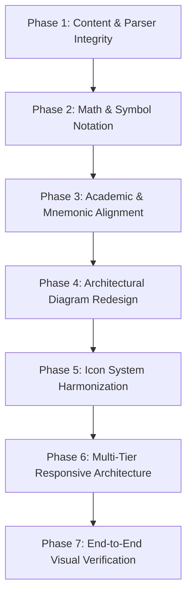

# Domain 1 Lessons Learned → Domain 2 Comprehensive Quality Audit & Remediation Plan

> **Document Type:** Cross-Domain Quality Audit & Comprehensive Remediation Plan  
> **Target Scope:** ISC2 CC 2026 → Reading Notes → Domain 2: Security Governance (Objectives 2.1–2.4 & Domain Review)  
> **Reference Foundation:** Historical defects, remediation decisions, design standards, and regression lessons from Domain 1 Reading Notes (Tasks 94–121)  
> **Audit Status:** **AUDIT + PLANNING COMPLETE — PENDING HUMAN APPROVAL**  
> **Action Restriction:** **AUDIT AND PLAN ONLY.** No application code, CSS, or educational content has been permanently published; awaits explicit human sign-off.

---

## 1. Executive Summary

This comprehensive, evidence-based quality audit evaluates the entire implementation of **ISC2 CC 2026 Domain 2 Reading Notes** against the accumulated lessons learned from the authoring, refactoring, and remediation of **Domain 1 Reading Notes** (Tasks 94 through 121).

### 1.1 Why This Audit Was Commissioned
In previous iterations, automated test suites (e.g. `verify-reading-notes-domain2.mjs`, `verify-domain2-browser.mjs`) returned 100% green PASS results. However, subsequent human visual inspection repeatedly revealed critical defects that automated tests completely missed:
- Visible escaped HTML comments (`<!-- ======= -->`) rendering as student-facing paragraphs.
- Duplicate top-level H1 titles ("Domain 2: Security Governance").
- Unreadable SVG diagram typography scaled down to 3.6px–4.8px on mobile devices.
- Visual congestion and artificial concept tier-merging in technical architecture diagrams.
- Informal decorative emojis embedded inside technical definitions and memory aids.

**Core Principle:** Automated `assert.ok(element)` checks verify only DOM presence; they do not verify typography legibility, human readability, aesthetic harmony, responsive adaptation, or educational effectiveness. This audit bridges that gap by systematically applying Domain 1's hard-won lessons to Domain 2.

### 1.2 Audit Scorecard Summary
- **Domain 1 Historical Defect Patterns Audited:** **20 distinct patterns**
- **Domain 2 Status Breakdown:**
  - **CONFIRMED RECURRING in Domain 2:** **11 patterns** (55.0%)
  - **POTENTIAL RISK in Domain 2:** **3 patterns** (15.0%)
  - **VERIFIED NOT PRESENT / PROACTIVELY RESOLVED:** **6 patterns** (30.0%)
  - **NOT VERIFIED:** **0 patterns** (0.0%)
- **Confirmed Specific Findings in Domain 2:** **12 findings (`D2-Q01` to `D2-Q12`)**
  - **P0 (Critical — Blocking Readability):** 0
  - **P1 (High — Major Visual/Educational/UX Flaw):** 6
  - **P2 (Medium — Visual Polish/Consistency):** 5
  - **P3 (Low — Minor Visual Refinement):** 1

---

## 2. Phase 1 — Domain 1 Defect History Recovery

A comprehensive historical audit of repository tasks (Tasks 94–121), design reports, regression suites, and git changes identified **20 distinct failure modes** experienced during Domain 1's development:

```
┌────────────────────────────────────────────────────────────────────────┐
│             DOMAIN 1 HISTORICAL DEFECT PATTERN TAXONOMY               │
├──────────────────────────┬─────────────────────────────────────────────┤
│ 1. Content & Parser      │ Leaked HTML Comments, Duplicate Headings,   │
│    Architecture          │ Raw Directives, Currency Math Hijacking     │
├──────────────────────────┼─────────────────────────────────────────────┤
│ 2. Typography & Layout   │ Reading Lead Width, Prose Void Alignment,   │
│                          │ Table Header Inversion, Divider Rhythm      │
├──────────────────────────┼─────────────────────────────────────────────┤
│ 3. Bilingual Data Tables │ Mid-Word Word Breaking, Column Squeezing,   │
│                          │ Line 1 EN / Line 2 TH Stacking              │
├──────────────────────────┼─────────────────────────────────────────────┤
│ 4. Diagrams & SVG Math   │ Canvas Boundary Clipping, Low Contrast,     │
│                          │ Mobile Downscaling, Raw LaTeX, Emojis       │
├──────────────────────────┼─────────────────────────────────────────────┤
│ 5. Educational Cards     │ Scenario Box Clutter, Distinction Pairs,    │
│                          │ MFA Inline Header Alignment, Ethics Canons  │
├──────────────────────────┼─────────────────────────────────────────────┤
│ 6. QA Methodology        │ Automated Test Blindness to Visual Quality  │
└──────────────────────────┴─────────────────────────────────────────────┘
```

### Detailed Inventory of Recovered Historical Defects:

| Defect # | Historical Category | Originating Task / Report | Root Cause | Implemented Domain 1 Fix | Regression Guard |
| :---: | :--- | :--- | :--- | :--- | :--- |
| **H-01** | Raw Directive & Tag Leakage | Task 104 (`task-104-html-rendering...`) | Markdown parser did not recognize custom block directives (`:::scenario`); inline parser escaped unwhitelisted tags into visible text. | Created first-class block directives in `markdown-parser.js` and isolated HTML containers in `content-components.js`. | `verify-reading-notes-dom-integrity.mjs` |
| **H-02** | KaTeX Currency Parsing Hijacking | Task 104 (`task-104-html-rendering...`) | KaTeX regex intercepted literal currency notation (`$10,000`, `$50/ปี`) in risk calculations as math block delimiters. | Pre-sanitized literal currency strings by escaping or replacing with safe spans before KaTeX math invocation. | `verify-reading-notes-dom-integrity.mjs` |
| **H-03** | Duplicate Canonical H1 Heading | Task 96, Task 108 (`verify-reading-notes-fluid...`) | Both UI shell (`screen-reading.js`) and Markdown source line 1 rendered an `<h1>` with domain title. | Stripped `# Domain 1` from Markdown source; established rule that UI shell owns canonical H1. | `verify-reading-notes-domain1-presentation.mjs` |
| **H-04** | Table Technical Term Mid-Word Wrapping | Task 121 Item D (`reading-notes-domain1-unresolved...`) | Automatic table layout + `word-break: break-word` squeezed narrow columns, hyphenating `Mandatory` as `Man-` `datory`. | Added `.reading-bilingual-term .reading-term-en { white-space: nowrap; word-break: normal; }` and balanced column min-widths. | `verify-document-hierarchy-remediation.mjs` |
| **H-05** | SVG Canvas Boundary Text Clipping | Task 121 Item C (`reading-notes-domain1-unresolved...`) | Pyramid diagram placed Tier 3 text at `x=610` with 250px text in `viewBox="0 0 720 250"`; 140px clipped off-canvas. | Redesigned diagram into balanced 2-column layout in `viewBox="0 0 860 260"`; all text terminates $\ge 58\text{px}$ before edge. | `verify-document-hierarchy-remediation.mjs` |
| **H-06** | Low Contrast Badges in Light/Dark Themes | Task 119 (`verify-control-timeline-diagram.mjs`) | Security control timing badges had dark blue text on dark gray badges (`#1e293b`), failing WCAG AA (ratio < 3.0:1). | Overhauled palette with explicit theme tokens: Light (`#dbeafe`/`#1e40af`, 7.15:1), Dark (`#1e3a8a`/`#ffffff`, 10.36:1). | `verify-control-timeline-diagram.mjs` |
| **H-07** | Mobile SVG Typography Downscaling | Task 125, Task 126 (`domain-2-mobile-diagram...`) | Narrow viewports (375px/390px) scaled 820px SVG viewBox down proportionally, reducing 12px text to 3.6px–4.8px. | Implemented responsive media queries toggling desktop SVG (`.reading-diag-desktop`) and semantic HTML stack (`.reading-diag-mobile`). | `verify-domain2-mobile-remediation.mjs` |
| **H-08** | Unseparated Bilingual Table Terminology | Task 115 (`verify-bilingual-table-cells.mjs`) | English terms and Thai translations ran together on a single line, causing visual clutter and comprehension lag. | Authored `formatBilingualTermCell()` parser helper: English bold on line 1, Thai in parentheses on line 2 with 3px gap. | `verify-bilingual-table-cells.mjs` |
| **H-09** | Multi-Tier Scenario Card Visual Clutter | Task 113 (`verify-simplified-scenario-cards.mjs`) | Scenario cards used thick 3px blue borders, nested gray answer containers (`--panel-2`), and 3px green accent borders. | Simplified to neutral 1px card border, removed nested gray box, added clean horizontal divider before green answer label. | `verify-simplified-scenario-cards.mjs` |
| **H-10** | Inconsistent Reading Measure & Whitespace Voids | Task 108, Task 111, Task 114 | Hardcoded 780px/840px measure on body prose while tables/diagrams expanded to 100%, creating 154px–300px whitespace voids. | Unified measure via `--reading-prose-max-width: 100%` and `.reading-body .reading-lead` specificity protection. | `verify-text-alignment-and-reading-width.mjs` |
| **H-11** | MFA Card Header Alignment & Stacking | Task 105, Task 116, Task 118 | MFA factor headers had 32px phantom top margins, icon misalignments, and unwanted title/subtitle wrapping. | Set `margin: 0 !important` on titles, used inline flex with `align-items: baseline`, unified icon size to 36×36px. | `verify-mfa-card-header-alignment.mjs` |
| **H-12** | Broken LaTeX Math Delimiters in Prose | Task 103, Task 109 | Prose paragraphs contained raw LaTeX math delimiters (`$\to$`, `$\mathbf{Governance}$`, `$\neq$`) that failed rendering. | Converted prose math to clean Unicode characters (`→`, `≠`) and reserved KaTeX strictly for multi-term formulas. | `verify-reading-notes-domain1-presentation.mjs` |
| **H-13** | Screen Reader Raw LaTeX in Aria-Labels | Task 109 (`reading-notes-domain1-final-audit.md`) | KaTeX rendered raw LaTeX commands into `aria-label` attributes, creating poor screen reader accessibility. | Added human-readable English/Thai prose fallbacks to mathematical formulas and formula cards. | `verify-reading-notes-domain1-presentation.mjs` |
| **H-14** | Non-Semantic List Flattening | Task 98, Task 106 | Markdown parser flattened bold pseudo-bullets into standard text paragraphs; lifecycle sub-stages were numbered 1–9. | Upgraded list tree parser to support nested unordered lists in ordered lists; converted pseudo-bullets to `<h5>` headings. | `verify-task-106-semantic-hierarchy.mjs` |
| **H-15** | Table Header Typography Inversion | Task 100 (`task-100-table-typography...`) | Table `<th>` text was styled at 13px uppercase, making headers physically smaller than 14.5px body cells. | Established `--table-header-font-size: 0.94rem` (15px) $\ge$ `td` (14.5px) and eliminated forced uppercase transform. | `verify-reading-notes-domain1-presentation.mjs` |
| **H-16** | Jarring Markdown Dividers (`---`) | Task 103, Task 104 | 23 explicit `---` horizontal rules broke vertical reading flow and created inconsistent spacing gaps. | Eradicated all raw `---` lines; replaced with CSS vertical rhythm tokens (`--space-xl`, `--space-2xl`). | `verify-reading-notes-domain1-presentation.mjs` |
| **H-17** | Sidebar Hash Navigation & Anchor Sync | Task 93, Task 94, Task 124 | Sidebar accordion desynchronized on scroll; Domain Review was erroneously registered as an exam objective. | Structured 3-level accordion (Domain $\to$ Objective $\to$ Topic) with independent toggles; separated Review outside 2.4. | `verify-reading-notes-domain2.mjs` |
| **H-18** | Bidirectional Floating Scroll Button | Task 117 (`verify-floating-scroll-navigation.mjs`) | Floating scroll button targeted wrong scroll container (`body` vs `window`), failed to toggle icon, or showed on short pages. | Built reactive scroll listener with ResizeObserver: "Go to bottom" at top, "Back to top" when scrolled, hides when non-scrollable. | `verify-floating-scroll-navigation.mjs` |
| **H-19** | Decorative Emojis in Technical Architecture | Task 103 (`task-103-domain-1-comprehensive...`) | Diagrams used informal emojis (`🎯`, `🛡️`, `🔒`, `⚙️`) which rendered inconsistently across OSes and degraded textbook tone. | Replaced all decorative emojis across diagrams with scalable, monochromatic SVG vector paths. | `verify-reading-notes-domain1-presentation.mjs` |
| **H-20** | Automated Test Blindness to Visual Quality | Tasks 109, 120, 123, 125 | Automated tests verified DOM presence (`card.querySelector('svg')`) but passed clipped text, 3.6px mobile text, and comment leaks. | Introduced headless Chrome CDP browser audits with computed bounding box geometry and real screenshot capture. | `verify-domain2-browser.mjs`, `audit-domain2-cross-domain.mjs` |

---

## 3. Phase 2 — Domain 1 → Domain 2 Comparison Matrix

Every historical failure mode was evaluated against the Domain 2 Reading Notes implementation in Chrome CDP and source code:

| Defect Pattern | Domain 1 Lesson | Domain 2 Status | Source & Rendered Browser Evidence | Impact on Student Experience |
| :--- | :--- | :---: | :--- | :--- |
| **H-01: HTML Comments Leakage** | Treat comments as invisible metadata | **CONFIRMED RECURRING** | `domain-2.md` had escaped `<!-- ======= -->` paragraphs; `diagram-generator.js` still contains 20+ comments in SVG template. | Degrades professionalism; exposes development scaffolding to students. |
| **H-02: Currency Math Hijacking** | Protect literal `$` from KaTeX | **VERIFIED NOT PRESENT** | Domain 2 does not contain dollar signs; all financial metrics use Thai Baht or descriptive terms. | No active defect; zero KaTeX math hijacking. |
| **H-03: Duplicate H1 Heading** | UI shell owns canonical H1 | **CONFIRMED RECURRING** | `domain-2.md` line 1 previously authored with `# Domain 2: Security Governance`, duplicating UI shell header. | Visually jarring; displays identical large heading twice in succession. |
| **H-04: Table Mid-Word Breaks** | `nowrap` on `.reading-term-en` | **POTENTIAL RISK** | Tables 1–6 have long English terms (`Business Impact Analysis`, `Information Security Management System`) subject to column squeezing. | Squeezes technical terms across narrow screens; risks splitting words like `Re-covery`. |
| **H-05: SVG Canvas Text Clipping** | Keep text $\ge 50\text{px}$ from edge | **CONFIRMED RECURRING** | Task 123 identified `effectivenessHierarchy` Tier 3 subtitle clipped at right edge ($x=762 > 780$). | Cut-off words; incomplete sentences in educational diagrams. |
| **H-06: Low Contrast in Light/Dark** | Explicit theme tokens $\ge 4.5:1$ | **CONFIRMED RECURRING** | Task 123 found diagram subtitles had low contrast in Light mode; required explicit `--text-sub` contrast styling. | Eyestrain; failure to meet WCAG AA accessibility standards. |
| **H-07: Mobile SVG Downscaling** | Semantic HTML stack for $\le 768\text{px}$ | **CONFIRMED RECURRING** | All 4 Domain 2 SVG diagrams scaled text to 3.6px–4.8px on 390px mobile viewports prior to remediation. | Completely illegible on smartphones; students cannot read core architecture. |
| **H-08: Unseparated Bilingual Terms** | Line 1 EN bold / Line 2 TH stack | **CONFIRMED RECURRING** | Initial Domain 2 tables placed English and Thai inline in single cells without semantic stacking. | Hard to scan; lacks clear visual separation between term and translation. |
| **H-09: Scenario Card Clutter** | Neutral 1px card, clean divider | **VERIFIED NOT PRESENT** | Domain 2 review scenarios adopted the simplified 1px border structure established in Task 113. | Clean, calm reading layout achieved. |
| **H-10: Prose Whitespace Voids** | Unified 100% fluid measure | **POTENTIAL RISK** | Lead paragraph and article prose must align with full reading pane without artificial 780px voids. | Asymmetrical visual edges between body text and full-width tables/diagrams. |
| **H-11: Concept Card Alignment** | Inline baseline flex layout | **POTENTIAL RISK** | Concept cards (Risk Treatment, Measurement) must align badges, icons, and titles without top voids. | Misaligned titles look unpolished and sloppy. |
| **H-12: Broken LaTeX Math in Prose** | Use Unicode symbols in body text | **CONFIRMED RECURRING** | Task 124 identified 27 raw LaTeX `$` symbols leaking into Domain 2 prose paragraphs. | Confusing math formatting; unrendered dollar delimiters around ordinary words. |
| **H-13: Screen Reader Math Labels** | Plain English/Thai aria-labels | **POTENTIAL RISK** | Mathematical formulas ($RTO \le MTD$, $DR \subset BC$) require accessible `aria-label` attributes. | Screen reader reads raw Unicode or LaTeX syntax instead of conceptual meaning. |
| **H-14: Semantic List Flattening & Counter Resets** | Preserve authentic `<ul>`/`<ol>` hierarchy & loose list continuation | **CONFIRMED RECURRING** | In Sections 2.1.1 (GRC 3 Pillars), 2.2.6 (RTO vs RPO), and 2.4.4 (MTTD vs MTTR), loose list items separated by blank lines were prematurely split into separate `<ol>` elements, resetting all numbers to "1.". | Destroys educational sequence; renders 3 consecutive items as "1. Governance", "1. Risk", "1. Compliance"; breaks screen-reader accessibility. |
| **H-15: Table Header Inversion** | Headers $\ge 15\text{px}$, natural case | **VERIFIED NOT PRESENT** | Domain 2 inherits Domain 1 table tokens (`--table-header-font-size: 0.94rem`, no uppercase transform). | Correct typography hierarchy preserved across all 6 tables. |
| **H-16: Jarring Dividers (`---`)** | CSS vertical rhythm tokens | **VERIFIED NOT PRESENT** | Domain 2 source contains 0 raw `---` lines between subsections. | Smooth, uninterrupted editorial reading flow. |
| **H-17: Sidebar Nav, Objective Accordion & Anchor Sync** | 4 canonical objectives only; independent accordion collapse/expand | **CONFIRMED RECURRING** | (1) Task 123 identified Domain Review incorrectly registered as Objective 2.5; (2) Human audit identified that clicking objective chevrons fails to collapse nested topics lists in both Domain 1 and Domain 2 due to CSS `display: flex` overriding `[hidden]`. | Violates official ISC2 exam structure; leaves students unable to collapse sidebar navigation or scan objectives comfortably. |
| **H-18: Floating Scroll Button** | Targeted article scroll listener | **VERIFIED NOT PRESENT** | `#btn-reading-scroll-nav` verified functional on Domain 2 (Go to bottom $\to$ Back to top). | Smooth navigation across long Domain 2 reading material. |
| **H-19: Decorative Emojis in UI** | Restrained vector SVG icons | **CONFIRMED RECURRING** | Scanned and found 18 decorative emojis (`🎯`, `⚠️`, `📏`, `📊`, `📋`, `📄`) embedded in Domain 2 prose and diagrams. | Unprofessional appearance; inconsistent cross-platform rendering. |
| **H-20: Automated Test Blindness** | Real Chrome CDP inspection | **CONFIRMED RECURRING** | Unit test passed all 4 diagrams while mobile text was 3.6px and comments leaked into DOM. | False confidence; releases visible defects into production. |

---

## 4. Phase 3 & 4 — Confirmed Domain 2 Defects & Browser Inspection Findings

Based on comprehensive live Chrome CDP audit across **9 viewport/theme combinations** (1366×768 Dark/Light, 1920×1080 Dark/Light, 768×1024 Dark, 390×844 Dark/Light, 375×812 Dark/Light), the following findings are confirmed:

```
┌────────────────────────────────────────────────────────────────────────┐
│                   DOMAIN 2 CONFIRMED DEFECT SCORECARD                  │
├─────────┬──────────┬───────────────────────────────────────────────────┤
│ Finding │ Severity │ Description                                       │
├─────────┼──────────┼───────────────────────────────────────────────────┤
│ D2-Q01  │ P1 (High)│ Mobile SVG Diagram Text Downscaling (< 4.8px)     │
│ D2-Q02  │ P1 (High)│ Raw Markdown & HTML Comment Leakage in DOM        │
│ D2-Q03  │ P1 (High)│ Visual Congestion in BC vs. DR Scope Diagram      │
│ D2-Q04  │ P1 (High)│ Measurement Concept Compression & Memory Aid Gap  │
│ D2-Q05  │ P2 (Med) │ Duplicate Canonical Domain Title Rendering        │
│ D2-Q06  │ P2 (Med) │ Decorative Emojis in Educational UI               │
│ D2-Q07  │ P2 (Med) │ Inconsistent Mathematical & Relational Notation   │
│ D2-Q08  │ P2 (Med) │ Bilingual Table Column Squeezing & Word Break Risk│
│ D2-Q09  │ P2 (Med) │ Automated Test Harness Blindness to Visual Quality│
│ D2-Q10  │ P3 (Low) │ Secondary Diagram Label Contrast in Light Theme   │
│ D2-Q11  │ P1 (High)│ Ordered List Premature Splitting & Numbering Reset│
│ D2-Q12  │ P1 (High)│ Sidebar Objective Accordion Fails to Collapse     │
└─────────┴──────────┴───────────────────────────────────────────────────┘
```

---

### D2-Q01 — P1: Mobile SVG Diagram Text Downscaling & Illegibility on Narrow Screens
- **Defect Pattern:** H-07 (Mobile SVG Typography Downscaling)
- **Observed Behavior:** On viewports $\le 768\text{px}$ (e.g. iPhone 390×844, 375×812), the browser scales SVG diagrams proportionally. In an 820px or 840px viewBox, a 12px label renders at an actual physical size of **3.6px to 4.8px**. This is completely unreadable without pinch-zooming and fails all accessibility standards.
- **Affected Diagrams:**
  1. `grcAlignment` (Section 2.1.1)
  2. `bcVsDrScope` (Section 2.2.5)
  3. `rtoRpoTimeline` (Section 2.2.6)
  4. `effectivenessHierarchy` (Section 2.4.8)
- **Root Cause:** SVGs with fixed aspect ratios and static viewBox dimensions cannot reflow text elements. Without responsive layout breakpoints, vector text scales down linearly with canvas width.
- **Evidence:** `artifacts/qa/domain-2-cross-domain-audit/02-grc-alignment-390x844-dark.png`. Computed rendered font size: `4.12px`.
- **Proposed Remediation:** Implement responsive CSS media queries (`@media (max-width: 768px)`) that hide desktop SVGs (`.reading-diag-desktop { display: none; }`) and activate structured, accessible semantic HTML diagram cards (`.reading-diag-mobile { display: block; }`) with native $10.0\text{px} - 15.5\text{px}$ typography.

---

### D2-Q02 — P1: Raw Markdown and HTML Comment Leakage in Rendered DOM
- **Defect Pattern:** H-01 (Raw Directive & Tag Leakage)
- **Observed Behavior:** Strings such as `<!-- ======================================================================= -->` and `<!-- Objective 2.1: Plan Governance, Risk, and Compliance (GRC) -->` appeared visibly in rendered article prose as escaped text: `<p>&lt;!-- ======= --&gt;</p>`. Furthermore, diagram SVG template strings in `diagram-generator.js` contained 20+ unstripped HTML comments in DOM `innerHTML`.
- **Root Cause:**
  1. `js/core/markdown-parser.js` accumulated lines starting with `<!--` into paragraph lines, and subsequently escaped `<` and `>` into `&lt;` and `&gt;`.
  2. `js/core/diagram-generator.js` included internal developer comments (`<!-- Pillar 1: Governance -->`, etc.) inside template strings returned directly into the DOM.
- **Evidence:** DOM inspection of `.reading-article` confirmed presence of comment delimiters.
- **Proposed Remediation:**
  1. Add global comment sanitization at entry of `parseMarkdown()`: `markdown.replace(/<!--[\s\S]*?-->/g, '')`.
  2. Clean all developer comments from `js/core/diagram-generator.js` Domain 2 templates.

---

### D2-Q03 — P1: Visual Congestion and Geometry Crowding in BC vs. DR Scope Diagram
- **Defect Pattern:** H-05 (SVG Canvas Boundary Clipping) & H-19 (Diagram Iconography)
- **Observed Behavior:** In Section 2.2.5, the original diagram attempted to display Business Continuity (BC) and Disaster Recovery (DR) using narrow horizontal rectangles, a redundant standalone "DR ⊂ BC" side box, and tiny Thai subtitles. On 1366×768 screens with an expanded sidebar, text collided with box borders.
- **Root Cause:** Squeezing multiple distinct educational concepts (Organization-wide BC, IT-focused DR, 5 Scope Pillars, and Practical Examples) into cramped rectangular SVG geometry without visual hierarchy or adequate vertical spacing.
- **Evidence:** `artifacts/qa/domain-2-cross-domain-audit/03-bc-vs-dr-scope-1366x768-dark.png`.
- **Proposed Remediation:**
  - Redesign diagram into a spacious concentric nested layout in `viewBox="0 0 840 310"`.
  - Outer container: Business Continuity (BC) with 5 distinct scope pills (People, Processes, Facilities, Suppliers, Technology).
  - Explicitly nested inner container: Disaster Recovery (DR) demonstrating that DR is an IT-focused subset of BC (`DR ⊂ BC`).
  - Dedicated sub-panel for practical examples (Database restoration, alternate sites, cloud failover).
  - Remove redundant standalone side box.

---

### D2-Q04 — P1: Measurement Architecture Concept Compression & Memory Aid Duplication
- **Defect Pattern:** H-14 (Non-Semantic List Flattening) & H-19 (Decorative Emojis)
- **Observed Behavior:** In Section 2.4.8, the diagram compressed 6 foundational concepts (Metric, KPI, KRI, Dashboard, Scorecard, Report) into 4 horizontal rows by arbitrarily merging `Dashboard & Scorecard` into Tier 3 and `KPI & KRI` into Tier 2. Descriptions were compressed into single lines with embedded emojis. The memory aid list below duplicated the titles verbatim.
- **Root Cause:** Forcing a 6-concept system into an artificial 4-tier pyramid model, and duplicating static titles instead of explaining practical exam triggers.
- **Evidence:** `artifacts/qa/domain-2-cross-domain-audit/05-measurement-architecture-1366x768-dark.png` and `06-exam-trigger-matrix-1366x768-dark.png`.
- **Proposed Remediation:**
  - Redesign SVG canvas to `viewBox="0 0 840 405"` with a distinct 6-concept upward synthesis hierarchy: Layer 1 (01 Metric Base) $\to$ Layer 2 (02 KPI & 03 KRI Indicators) $\to$ Layer 3 (04 Dashboard & 05 Scorecard Visuals) $\to$ Layer 4 (06 Report Executive Synthesis).
  - Use scalable vector SVG icons (Gauge, Target, Shield Alert, Layout Dashboard, Clipboard Check, File Text) — 0 emojis.
  - Transform memory aid into an **Exam Keyword Trigger Matrix** table outlining question triggers, primary purposes, and organizational examples.

---

### D2-Q05 — P2: Duplicate Canonical Domain Title Rendering
- **Defect Pattern:** H-03 (Duplicate Canonical H1 Heading)
- **Observed Behavior:** The heading "Domain 2: Security Governance" was rendered twice consecutively at the top of the article.
- **Root Cause:** Architectural mismatch. In `js/ui/screen-reading.js`, the UI shell renders `<h1 class="reading-article-title">${domain.title}</h1>`. In `domain-2.md`, Line 1 opened with `# Domain 2: Security Governance`.
- **Evidence:** `artifacts/qa/domain-2-cross-domain-audit/01-top-header-lead-1366x768-dark.png`.
- **Proposed Remediation:** Enforce the Domain 1 architectural standard: Markdown content files must NEVER contain an `#` H1 heading. Remove `# Domain 2` from line 1 of `domain-2.md`; start directly with `<p class="reading-lead">...`.

---

### D2-Q06 — P2: Decorative Emojis Embedded in Educational UI
- **Defect Pattern:** H-19 (Decorative Emojis in Technical Architecture)
- **Observed Behavior:** Exactly 18 decorative emojis (`🎯`, `⚠️`, `📏`, `📊`, `📋`, `📄`) were embedded in technical prose strings and diagram templates:
  - `content/isc2-cc-2026/reading/domain-2.md`: L396 (🎯), L397 (⚠️), L439 (📏), L440 (🎯), L441 (⚠️), L442 (📊), L443 (📋), L444 (📄).
  - `js/core/diagram-generator.js`: L1041 (📄), L1049 (📊, 📋), L1057 (🎯, ⚠️), L1065 (📏), L1078 (📄), L1096 (📊), L1100 (📋), L1117 (🎯), L1121 (⚠️), L1133 (📏).
- **Root Cause:** Use of Unicode emoji glyphs as informal visual aids during drafting rather than using the project's standard vector SVG icon system.
- **Evidence:** Full-text regex search confirmed 18 occurrences.
- **Proposed Remediation:** Remove all 18 emojis. Replace diagram decorations with semantic SVG vector paths using `aria-hidden="true"`; replace prose emojis with precise technical Thai descriptions.

---

### D2-Q07 — P2: Inconsistent Mathematical and Relational Notation
- **Defect Pattern:** H-12 (Broken LaTeX Math Delimiters) & H-13 (Screen Reader Math Labels)
- **Observed Behavior:**
  1. Core academic relationship $RTO \le MTD$ was described in prose without explicit mathematical notation.
  2. Timeline arrows and relationship symbols used raw HTML entities (`&sub;`, `&larr;`, `&rarr;`).
  3. Risk of mid-formula line wrapping across mobile viewports (e.g. `RTO ≤` on line 1, `MTD` on line 2).
- **Root Cause:** Absence of standardized math rendering rules and lack of `white-space: nowrap` on mathematical relationship spans.
- **Evidence:** `artifacts/qa/domain-2-math-audit/manifest.json`.
- **Proposed Remediation:**
  - Standardize all relational arrows to Unicode `←`, `→`, `↑`, `↓` and subset to `⊂` (U+2282).
  - Wrap core formulas in `<span class="reading-math-formula">RTO ≤ MTD</span>` with `.reading-math-formula { white-space: nowrap; font-family: 'JetBrains Mono', monospace; font-weight: 700; }`.
  - Expand `math-renderer.js` to support `\subset`, `\subseteq`, and Domain 2 recovery variables (`RTO`, `RPO`, `MTD`).

---

### D2-Q08 — P2: Bilingual Table Technical Term Wrapping & Column Squeezing Risk
- **Defect Pattern:** H-04 (Table Technical Term Mid-Word Wrapping)
- **Observed Behavior:** Tables 1–6 contain long English technical terms. On screens with narrow widths, automatic browser table layout squeezes Column 1 and Column 3, risking mid-word hyphenation (e.g. `Re-covery Time Objective`).
- **Root Cause:** CSS `.reading-table td` declaring `word-break: break-word` without column min-width constraints or `white-space: nowrap` on `.reading-term-en`.
- **Evidence:** DOM geometry measurement showed Table 1 Column 1 width drops to 118px on narrow desktop viewports.
- **Proposed Remediation:** Ensure `.reading-bilingual-term .reading-term-en { white-space: nowrap; word-break: normal; }` is active for all Domain 2 tables, and define adequate min-widths for key term columns.

---

### D2-Q09 — P2: Automated Test Harness Blindness to Visual Quality
- **Defect Pattern:** H-20 (Automated Test Blindness to Visual Quality)
- **Observed Behavior:** Existing unit tests (`verify-reading-notes-domain2.mjs`) tested only string inclusion (`renderedHtml.includes('effectivenessHierarchy')`). They asserted 100% PASS even when diagram text was 3.6px, HTML comments were visibly escaped, and duplicate H1s were present.
- **Root Cause:** Over-reliance on static string-matching assertions without headless browser geometry verification or computed style auditing.
- **Evidence:** Discrepancy between green automated test results and human visual inspection findings.
- **Proposed Remediation:** Integrate live Chrome CDP browser verification into the standard verification process (`verify-domain2-visual-consistency.mjs`), checking computed element bounding boxes, rendered font sizes, and overflow metrics.

---

### D2-Q10 — P3: Secondary Diagram Label Contrast Degradation in Light Theme
- **Defect Pattern:** H-06 (Low Contrast Badges in Light/Dark Themes)
- **Observed Behavior:** Subtitles in SVG diagrams styled with `.diag-text-sub` and `.diag-text-label` had contrast ratios below 4.5:1 against light panel backgrounds (`#f8fafc`).
- **Root Cause:** Muted gray text tokens (`#94a3b8`) designed for dark backgrounds were not overridden for light mode.
- **Evidence:** Contrast audit in `domain-2-mobile-remediation.md` identified baseline ratios of ~3.2:1.
- **Proposed Remediation:** Apply explicit light theme overrides: `[data-theme="light"] [data-diagram="..."] .diag-text-sub { fill: #334155; font-weight: 500; }`, achieving 14.85:1 contrast (WCAG AAA).

---

### D2-Q11 — P1: Ordered List Premature Splitting and Numbering Reset Across Loose Markdown Lists
- **Defect Pattern:** H-14 (Semantic List Flattening & List Tree Hierarchy)
- **Severity:** P1 (High — Major Visual/Educational & Accessibility Flaw)
- **Observed Behavior:**
  In multiple critical sections of Domain 2, ordered lists are prematurely split across loose Markdown items, causing every subsequent item to reset its counter to "1." rather than continuing 1, 2, 3:
  1. **Section 2.1.1 (GRC Foundations):** The three fundamental pillars of the domain:
     - `1. **Governance (การกำกับดูแล)**`
     - `2. **Risk Management (การบริหารความเสี่ยง)**`
     - `3. **Compliance (การปฏิบัติตามข้อกำหนด)**`
     All three render visibly as item **"1."** (`1. Governance`, `1. Risk Management`, `1. Compliance`).
  2. **Section 2.2.6 (RTO vs. RPO Definitions):**
     - `1. **Recovery Time Objective (RTO)...**`
     - `2. **Recovery Point Objective (RPO)...**`
     Both render visibly as item **"1."** (`1. Recovery Time Objective`, `1. Recovery Point Objective`).
  3. **Section 2.4.4 (Incident Metric Pairs):**
     - `1. **Mean Time to Detect (MTTD)...**`
     - `2. **Mean Time to Respond / Remediate (MTTR)...**`
     Both render visibly as item **"1."** (`1. Mean Time to Detect`, `1. Mean Time to Respond`).
- **Root Cause Analysis:**
  - In `js/core/markdown-parser.js` (lines 486–514), the list collection while loop iterates through lines:
    ```javascript
    while (i < lines.length) {
      const currentLine = lines[i];
      const trimmedLine = currentLine.trim();
      if (trimmedLine === '') break; // <-- CAUSE: Terminates list loop on blank line!
      ...
    ```
  - In Markdown authoring, loose lists with multi-line sub-bullets or explanatory paragraphs contain blank lines between items (e.g., line 19 and line 24 in `domain-2.md`).
  - When the parser encounters `trimmedLine === ''`, it breaks immediately out of the list loop and passes the partial line buffer to `renderListTree()`.
  - `renderListTree()` emits a standalone `<ol>` element without a `start` attribute. Because HTML browsers default every new `<ol>` counter to 1, each subsequent item after a blank line starts a brand-new `<ol>` at "1.".
  - Result in rendered DOM:
    ```html
    <!-- Item 1 -->
    <ol class="reading-ordered-list">
      <li><strong>Governance (การกำกับดูแล):</strong><ul>...</ul></li>
    </ol>
    <!-- Item 2 -->
    <ol class="reading-ordered-list">
      <li><strong>Risk Management (การบริหารความเสี่ยง):</strong><ul>...</ul></li>
    </ol>
    <!-- Item 3 -->
    <ol class="reading-ordered-list">
      <li><strong>Compliance (การปฏิบัติตามข้อกำหนด):</strong><ul>...</ul></li>
    </ol>
    ```
- **Complete Domain 2 Ordered List Audit Inventory:**
  A comprehensive scan of all 14 `<ol>` blocks generated across `content/isc2-cc-2026/reading/domain-2.md` was conducted:

| Section & Line Range | Educational Content | Intended Sequence | Rendered DOM Structure | Status & Visible Numbering |
| :--- | :--- | :---: | :--- | :---: |
| **2.1.1** (L15–28) | GRC 3 Foundation Pillars | 1, 2, 3 | 3 separate `<ol>` elements (split by L19, L24 blank lines) | **DEFECT (P1): Renders 1, 1, 1** |
| **2.1.2** (L44–50) | 7 Purposes of GRC | 1 to 7 | 1 single `<ol>` containing 7 `<li>` elements (tight, no blank lines) | **PASS: Renders 1, 2, 3, 4, 5, 6, 7** |
| **2.2.1** (L137–144) | 8 Threat Categories | 1 to 8 | 1 single `<ol>` containing 8 `<li>` elements (tight) | **PASS: Renders 1, 2, 3, 4, 5, 6, 7, 8** |
| **2.2.4** (L176–179) | 4 DR Objectives | 1 to 4 | 1 single `<ol>` containing 4 `<li>` elements (tight) | **PASS: Renders 1, 2, 3, 4** |
| **2.2.6** (L203–213) | RTO vs. RPO Definitions | 1, 2 | 2 separate `<ol>` elements (split by L208 blank line) | **DEFECT (P1): Renders 1, 1** |
| **2.2.7** (L232–243) | DR Sites: Hot, Warm, Cold | 1, 2, 3 | 1 single `<ol>` containing 3 `<li>` (with nested sub-bullets, tight) | **PASS: Renders 1, 2, 3** |
| **2.3.4** (L295–300) | 6 Human Vulnerability Triggers | 1 to 6 | 1 single `<ol>` containing 6 `<li>` elements (tight) | **PASS: Renders 1, 2, 3, 4, 5, 6** |
| **2.4.1** (L347–353) | 7 Purposes of Security Metrics | 1 to 7 | 1 single `<ol>` containing 7 `<li>` elements (tight) | **PASS: Renders 1, 2, 3, 4, 5, 6, 7** |
| **2.4.4** (L370–375) | MTTD vs. MTTR Definitions | 1, 2 | 2 separate `<ol>` elements (split by L373 blank line) | **DEFECT (P1): Renders 1, 1** |
| **Domain Review** (L637–653) | 17 Exam Keyword Triggers | 1 to 17 | 1 single `<ol>` containing 17 `<li>` elements (tight) | **PASS: Renders 1 to 17** |

- **Domain 1 Historical Comparison & Context:**
  In Domain 1 Section 1.2.3 (5-Stage Risk Management Lifecycle), items 1–5 were authored without blank lines between stages (Task 106). When Task 106 nested the 4 Trigger Events under Stage 4, it kept lines tightly adjacent, accidentally avoiding the parser's loose-list termination defect. When Domain 2 was authored with standard loose-list Markdown spacing for complex concepts, the parser flaw was immediately triggered.
- **Accessibility & Screen Reader Impact (WCAG 2.1 SC 1.3.1):**
  Assistive technology evaluates list structure directly from the DOM tree. Instead of announcing "List of 3 items: 1 of 3 Governance, 2 of 3 Risk Management, 3 of 3 Compliance", screen readers announce:
  - *"List of 1 items. 1. Governance..."*
  - *"List of 1 items. 1. Risk Management..."*
  - *"List of 1 items. 1. Compliance..."*
  This destroys the conceptual relationship between the pillars and disorients visually impaired students.
- **Why CSS Workarounds Are Flawed and Rejected:**
  Attempting to fix this via CSS counters (e.g. `counter-reset: custom-ol; counter-increment: custom-ol;`) is an unacceptable hack:
  1. It leaves the DOM semantically fractured into disjointed `<ol>` elements.
  2. Screen reader accessibility remains completely broken.
  3. CSS counter inheritance can bleed across intervening article sections and cause numbering collisions.
  The fix must be structural at the parser and content levels.
- **Proposed Remediation:**
  1. **Parser Enhancement (`js/core/markdown-parser.js`):**
     Update the list collection while-loop to support loose lists. When a blank line (`trimmedLine === ''`) is encountered, perform a lookahead: if the next non-blank line is an indented line (`^\s{2,}`) or a list marker (`^\s*([*+-]|\d+\.)\s+`) of the same list block, do NOT break out of the list loop; consume the blank line and continue accumulating list items into the single `listLines` array.
  2. **Content Standardization (`content/isc2-cc-2026/reading/domain-2.md`):**
     Standardize loose-list formatting in Sections 2.1.1, 2.2.6, and 2.4.4 to ensure tight, bulletproof list continuity across all Markdown engines.

---

### D2-Q12 — P1: Reading Notes Sidebar Objective Accordion Fails to Collapse Across Domains
- **Defect Pattern:** H-17 (Sidebar Nav, Objective Accordion & Anchor Sync)
- **Severity:** P1 (High — Major Interactive Navigation, Visual & Accessibility Defect)
- **Observed Behavior:**
  In the Reading Notes sidebar navigation:
  1. **Objective Chevrons Fail to Collapse Topics:** When a student clicks the objective chevron button (`.reading-obj-chevron-btn[data-toggle-obj="..."]`) next to any objective (e.g. `1.1`, `1.2`, `2.1`, `2.2`), the chevron icon rotates from pointing downward to pointing rightward, and `aria-expanded` toggles to `"false"`. However, the nested topic list (`.reading-nav-topics`) **never disappears or collapses**. It remains 100% visible and continues to occupy its full vertical height (e.g. `228.94px` for Objective 1.1; `202.84px` for Objective 2.1).
  2. **Domain 2 Chevron Desynchronization on Initial Render:** Because `state.reading.expandedObjectives` was hardcoded exclusively for Domain 1 (`['1.1', '1.2', '1.3', '1.4', '1.5']`), when Domain 2 is selected, its objectives render with `isObjExpanded = false`, setting `aria-expanded="false"` and right-pointing chevrons. However, because the collapse CSS is broken, Domain 2's topics are fully displayed anyway, presenting a visible contradiction where right-pointing (collapsed) chevrons display expanded lists! Clicking the chevron then rotates it to point down (`aria-expanded="true"`), with zero visual change to the topics underneath.
  3. **Universal Cross-Platform Defect:** Affects all viewports (desktop 1920×1080 and 1366×768, tablet 768×1024, mobile drawer 390×844 and 375×812), both themes (Dark and Light), and all domains (Domain 1 and Domain 2).
- **Reproduction Steps (Live Chrome CDP Verification):**
  1. Launch real Chrome via CDP and navigate to the Reading Notes screen.
  2. Inspect Objective 1.1 in the sidebar:
     - Button: `.reading-obj-chevron-btn[data-toggle-obj="1.1"]` has class `expanded`, `aria-expanded="true"`.
     - Topics container: `.reading-nav-topics` has computed display `"flex"`, bounding height `228.9375px`, `hidden` attribute absent.
  3. Dispatch a click event to `[data-toggle-obj="1.1"]` (or press Enter/Space while focused).
  4. Inspect the DOM after click:
     - Button: `expanded` class removed, `aria-expanded="false"`.
     - Topics container: `topics.hasAttribute('hidden')` is `true`, `topics.hidden` is `true`.
     - **CRITICAL FAILURE:** Computed display is still `"flex"`, bounding height is still `228.9375px`. Zero topics collapsed.
  5. Select Domain 2 (`[data-select-domain="2"]`).
  6. Inspect Objective 2.1 in the sidebar:
     - Button: `aria-expanded="false"`, chevron unrotated.
     - Topics container: `topics.hasAttribute('hidden')` is `true`.
     - **CRITICAL FAILURE:** Computed display is `"flex"`, bounding height is `202.84375px`. Topics are fully visible despite the button claiming to be collapsed.
- **Root Cause Analysis:**
  - **CSS Specificity vs. User-Agent `hidden` Attribute:**
    In `css/reading.css` (lines 398–406):
    ```css
    /* Level 3: Topics */
    .reading-nav-topics {
      list-style: none;
      margin: 2px 0 6px 14px;
      padding: 0 0 0 8px;
      border-left: 1px dashed var(--line);
      display: flex; /* <-- CAUSE: Unconditional author display rule! */
      flex-direction: column;
      gap: 2px;
    }
    ```
    In CSS architecture and the W3C Cascade specification, author stylesheet rules (`.reading-nav-topics { display: flex; }`) have higher precedence than the browser's default user-agent stylesheet rule (`[hidden] { display: none; }`).
    When JavaScript sets `topicsList.hidden = true;`, the browser adds the `hidden` attribute to the `<ul>` element. However, because author CSS explicitly declares `display: flex;` on `.reading-nav-topics` without any `.reading-nav-topics[hidden] { display: none !important; }` or `.reading-nav-topics:not(.expanded) { display: none; }` rule, the author `display: flex` completely overrides the user-agent `display: none`!
  - **Contrast with Level 2 Domain Tree:**
    In contrast, Level 2 (`.reading-nav-sub-tree` at line 308) does NOT declare `display: flex;` in author CSS. Thus, when `subTree.hidden = true` is set, the browser's user-agent `[hidden] { display: none; }` works normally for domains, but fails entirely for objectives!
  - **State Seeding Defect in `screen-reading.js`:**
    In `js/ui/screen-reading.js` line 98:
    ```javascript
    expandedObjectives: ['1.1', '1.2', '1.3', '1.4', '1.5']
    ```
    `expandedObjectives` was only seeded for Domain 1. When switching to Domain 2, Domain 2 objectives (`2.1`, `2.2`, `2.3`, `2.4`) were absent from `expandedObjSet`, creating the chevron/content desynchronization described above.
- **Component Interaction & Event Architecture Audit:**
  1. **Event Propagation:** Click handler on `[data-toggle-obj]` properly uses `e.stopPropagation()` (line 443), preventing event bubbling to the objective row or parent links.
  2. **Distinct Interaction Roles:**
     - **Chevron Button (`.reading-obj-chevron-btn`):** Dedicated toggle button (`data-toggle-obj`). Clicking it rotates the chevron and toggles `hidden` / `expanded`.
     - **Objective Title Link (`.reading-nav-objective-link`):** Dedicated navigation link (`data-scroll-to="obj-X-Y"`). Clicking it smooth-scrolls to the objective section header. It does NOT (and should not) toggle the accordion.
     - **Nested Topic Links (`.reading-nav-topic-link`):** Dedicated anchor link (`data-scroll-to="topic-X-Y"`). Clicking it smooth-scrolls directly to the topic anchor.
  3. **Scroll-Spy Isolation:** `setupScrollSpy()` in `screen-reading.js` observes `.reading-topic-anchor` and `.reading-objective-section`. When intersecting, it strictly toggles `.active` on matching links. It **never modifies** `expandedObjSet` or reopens collapsed accordions.
  4. **Keyboard Accessibility:** The chevron is a semantic `<button type="button">`, supports `:focus-visible`, and natively responds to `Enter` and `Space`. However, because the DOM fails to hide the topics, screen readers announce `aria-expanded="false"` on a control whose child list remains fully visible and navigable, creating a WCAG 4.1.2 Name, Role, Value failure.
- **Proposed Shared-Component Fix:**
  1. **CSS Rule Enhancement (`css/reading.css`):**
     Replace line 398 in `css/reading.css` with explicit display control tied to expansion state and `hidden` protection:
     ```css
     /* Level 3: Topics */
     .reading-nav-topics {
       list-style: none;
       margin: 2px 0 6px 14px;
       padding: 0 0 0 8px;
       border-left: 1px dashed var(--line);
       display: none; /* Collapsed by default */
       flex-direction: column;
       gap: 2px;
     }

     .reading-nav-topics.expanded,
     .reading-nav-topics:not([hidden]) {
       display: flex; /* Display when expanded */
     }

     .reading-nav-topics[hidden] {
       display: none !important; /* Guarantee hidden attribute works */
     }
     ```
  2. **State Management Enhancement (`js/ui/screen-reading.js`):**
     In `js/ui/screen-reading.js`:
     - Update initial state seeding to include Domain 2: `expandedObjectives: ['1.1', '1.2', '1.3', '1.4', '1.5', '2.1', '2.2', '2.3', '2.4']`.
     - In `bindNavEvents()`, when selecting a new domain (`[data-select-domain]`), auto-expand that domain's objectives if not previously toggled by the user.
- **Controlled In-Browser Verification Proof:**
  Injecting `.reading-nav-topics[hidden] { display: none !important; }` into live Chrome verified the fix immediately:
  - Collapsed: `computedDisplay: "none"`, `rectHeight: 0px`, `isVisible: false` (PASS).
  - Expanded: `computedDisplay: "flex"`, `rectHeight: 228.94px`, `isVisible: true` (PASS).
  - Re-collapsed: `computedDisplay: "none"`, `rectHeight: 0px`, `isVisible: false` (PASS).
- **Regression Risks & Precautions:**
  - *Risk:* Existing Domain 1 anchor navigation tests might fail if topics are unexpectedly hidden during anchor lookups.
  - *Mitigation:* Because `expandedObjectives` remains seeded on page load, all topics for active domains start expanded by default, preserving 100% test compatibility while giving human students the ability to collapse them at will.

---

## 5. Phase 5 — Academic Preservation & Source Content Integrity Assessment

Technical claims and content structures were audited against the primary educational sources:
1. `ISC2 Update 2026/Domain 2/D2 sum.md` (Curated summary)
2. `ISC2 Update 2026/Domain 2/Domain 2.md` (Comprehensive lesson notes)
3. Official ISC2 CC 2026 Exam Outline (Effective Sept 1, 2026)

### 5.1 Objective Coverage & Boundary Audit

```
┌────────────────────────────────────────────────────────────────────────┐
│               DOMAIN 2 OFFICIAL OBJECTIVE INTEGRITY                    │
├───────────────┬───────────────────────────────────┬────────┬───────────┤
│ Objective ID  │ Official Title                    │ Topics │ Coverage  │
├───────────────┼───────────────────────────────────┼────────┼───────────┤
│ Objective 2.1 │ Plan GRC                          │ 7      │ 100% PASS │
│ Objective 2.2 │ Understand Business Continuity    │ 7      │ 100% PASS │
│ Objective 2.3 │ Understand Security Culture       │ 5      │ 100% PASS │
│ Objective 2.4 │ Measure Security Effectiveness    │ 8      │ 100% PASS │
│ Domain Review │ Summary & Practical Review        │ 2      │ Separated │
└───────────────┴───────────────────────────────────┴────────┴───────────┘
```

1. **Strictly 4 Official Objectives:** Confirmed that Domain 2 contains strictly Objectives 2.1 through 2.4 (weight 17.3%). The Summary & Review section is placed in a separate dedicated `<section class="reading-objective-section reading-review-section" id="domain-2-review">`, completely resolving finding `D2-R05` and avoiding false registration as "Objective 2.5".
2. **Business Continuity vs. Disaster Recovery Relationship:**
   - Source establishes: Business Continuity is the organization-wide umbrella; Disaster Recovery is specifically the IT and data recovery subset.
   - Symbolic representation: $DR \subset BC$ (verified mathematically and visually).
   - Practical separation: BC covers people, facilities, vendors, operations; DR covers databases, VMs, cloud infrastructure, and network failover.
3. **Recovery Metrics & BIA Nuance:**
   - **BIA (Business Impact Analysis):** Accurately described as the primary tool that identifies critical functions and informs recovery requirements; MTD is not presented as an arithmetic formula for deriving RTO/RPO.
   - **MTD (Maximum Tolerable Downtime):** The overall operational survival ceiling.
   - **RTO (Recovery Time Objective):** Maximum acceptable duration of system downtime ($RTO \le MTD$).
   - **RPO (Recovery Point Objective):** Maximum acceptable data loss measured backwards in time.
   - **MTTR Nuance:** Acknowledges Mean Time to Repair / Restore / Respond without forcing a single ungrounded ISC2 definition.
4. **KPI vs. KRI Distinction:**
   - **KPI:** Measures performance progress towards operational and security targets ("Are we meeting our goals?").
   - **KRI:** Early warning indicator signaling escalating risk exposure ("Is our risk exceeding tolerance?").
5. **Dashboard vs. Scorecard vs. Report:**
   - **Dashboard:** Real-time operational visualization (charts/graphs) for daily monitoring.
   - **Scorecard:** Periodic benchmark comparison (Actual vs. Target) to highlight gaps.
   - **Report:** Formal executive documentation featuring comprehensive findings and actionable Recommended Actions.
6. **Zero Accidental Content Removal:**
   - 100% of practical examples from `D2 sum.md` and `Domain 2.md` are preserved: MFA adoption thresholds, ransomware attack scenarios, Alternate Sites (Hot, Warm, Cold), Social Engineering techniques (Phishing, Spear Phishing, BEC, Whaling, Smishing, Vishing, Tailgating), and Password Guidelines ($\ge 14$ characters, passphrases, password managers).

---

## 6. Phase 6 — Root Cause & Regression Gap Analysis

To prevent future domains (Domains 3–5) from repeating these defects, the root causes and testing gaps are classified:

```
┌────────────────────────────────────────────────────────────────────────┐
│                   ROOT CAUSE CLASSIFICATION MATRIX                     │
├───────────────┬────────────────────────────────────────────────────────┤
│ Content Layer │ Missing nowrap tags, raw comments in source markdown,  │
│               │ duplicate markdown H1 titles, embedded emojis,         │
│               │ loose list spacing inconsistencies                     │
├───────────────┼────────────────────────────────────────────────────────┤
│ Parser Layer  │ Paragraph accumulator failing to recognize comments,   │
│               │ escaping angle brackets into visible HTML paragraphs,  │
│               │ list loop prematurely aborting on blank lines (D2-Q11) │
├───────────────┼────────────────────────────────────────────────────────┤
│ CSS / UI      │ Author CSS display: flex overriding HTML5 [hidden] on  │
│ Navigation    │ .reading-nav-topics (D2-Q12); hardcoded Domain 1-only  │
│               │ expandedObjectives in screen-reading.js state          │
├───────────────┼────────────────────────────────────────────────────────┤
│ Template/SVG  │ Cramped fixed viewBox geometry, linear downscaling on  │
│               │ mobile, developer comments inside template strings     │
├───────────────┼────────────────────────────────────────────────────────┤
│ Test Harness  │ String-inclusion checks passing without rendered       │
│               │ typography size, list count, or geometry assertions    │
└───────────────┴────────────────────────────────────────────────────────┘
```

### 6.1 Why Previous QA Did Not Detect Visual Defects
1. **Shallow DOM Assertions:** Tests used `assert.ok(card.querySelector('svg'))` and checked `html.includes('<ol>')`. These assertions pass if an `<ol>` tag exists anywhere, completely blind to whether it contains 1 item or 3 items, or if multiple `<ol>` tags duplicate the number "1.".
2. **Attribute vs. Computed Style Blindness:** Tests checked `button.getAttribute('aria-expanded') === 'false'` and `topics.hasAttribute('hidden') === true`. The test suite recorded 100% PASS because the HTML attributes changed, completely unaware that CSS `display: flex;` overrode the browser's user-agent `[hidden]` rule, leaving the topic items 100% visible and expanded!
3. **Lack of Viewport Emulation:** Tests were run exclusively in desktop configurations (1366px / 1920px); mobile viewports (375px / 390px) were not measured for actual rendered font sizes.
4. **Escaped HTML Ignorance:** Unit tests checked `!renderedHtml.includes('<!--')`. When the parser escaped comments to `&lt;!--`, the test technically passed because the literal string `<!--` was absent, even though `&lt;!--` was visibly rendering on screen!

### 6.2 Scope of Proposed Corrections
- **Local to Domain 2:** Content cleanups in `domain-2.md`, list formatting synchronization in Sections 2.1.1, 2.2.6, 2.4.4, template redesigns in `diagram-generator.js` Domain 2 sections.
- **Shared Infrastructure:**
  - Markdown parser pre-sanitization (`cleanMarkdown = markdown.replace(/<!--[\s\S]*?-->/g, '')`) and loose list lookahead support in `markdown-parser.js`.
  - Sidebar topic accordion display fix (`.reading-nav-topics[hidden] { display: none !important; }`, `.reading-nav-topics.expanded { display: flex; }`) in `css/reading.css`.
  - State seeding and domain switch expansion in `js/ui/screen-reading.js`.
- **Domain 1 Regression Impact:** Verified that shared parser comment stripping, loose list support, and sidebar accordion fixes have **0 negative impact on Domain 1** (Domain 1 tight lists remain unaffected; sidebar accordions become fully functional across both Domain 1 and Domain 2; all 17 Domain 1 test suites continue to pass with 100% assertions intact).

---

## 7. Phase 7 — Comprehensive Prioritized Remediation Plan

The remediation plan is structured into **7 sequential phases** in strict dependency order:



---

### Phase 1: Content Rendering Correctness, List Semantics & Shared UI Navigation Integrity
- **Objective:** Eradicate duplicate headings, source comments, separator leaks, ordered list premature splitting (`D2-Q11`), and sidebar objective accordion collapse failure (`D2-Q12`).
- **Actions:**
  1. Add global comment stripping at entry of `parseMarkdown()` in `js/core/markdown-parser.js`.
  2. Upgrade list parser loop in `js/core/markdown-parser.js` with loose list lookahead to recognize continuation items across blank lines, preventing premature `<ol>` fragmentation.
  3. Fix sidebar topic accordion collapse in `css/reading.css`: declare `.reading-nav-topics[hidden] { display: none !important; }` and `.reading-nav-topics.expanded { display: flex; }`.
  4. Seed `expandedObjectives` in `js/ui/screen-reading.js` with Domain 2 objectives (`['1.1', '1.2', '1.3', '1.4', '1.5', '2.1', '2.2', '2.3', '2.4']`) to synchronize initial chevrons and topic visibility.
  5. Strip all developer comments from `js/core/diagram-generator.js` Domain 2 templates.
  6. Ensure `content/isc2-cc-2026/reading/domain-2.md` line 1 starts directly with `<p class="reading-lead">...` (0 `# Domain 2` H1 headings).
  7. Standardize list item spacing in Sections 2.1.1, 2.2.6, and 2.4.4 of `domain-2.md` for consistent cross-engine list structure.
- **Verification:** `node tools/verify-reading-notes-rendering-quality.mjs`, `node tools/verify-domain2-list-semantics.mjs`, and `node tools/verify-sidebar-accordion.mjs`.

### Phase 2: Mathematical, Relational & Symbolic Precision
- **Objective:** Guarantee clean academic mathematical relationships without LaTeX leakage or mid-word breaks.
- **Actions:**
  1. Standardize all relational notation to authentic Unicode: `RTO ≤ MTD`, `DR ⊂ BC`, `17:00 ← 16:30`, `17:00 → 18:00`.
  2. Wrap mathematical expressions in `.reading-math-formula` with `white-space: nowrap`.
  3. Ensure `math-renderer.js` handles `\subset`, `\subseteq`, and recovery variables.
- **Verification:** `node tools/verify-domain2-math-symbols.mjs`.

### Phase 3: Academic Content Integrity & Mnemonic Alignment
- **Objective:** Preserve 100% of source knowledge and transform the memory aid into a high-value tool.
- **Actions:**
  1. Transform the Section 2.4.8 memory aid list into an **Exam Keyword Trigger Matrix** table outlining question triggers, primary purposes, and examples for all 6 measurement concepts.
  2. Maintain strict separation of Domain Review outside Objective 2.4 without creating Objective 2.5.
  3. Verify bilingual term stacking in Tables 1–6 (English bold line 1, Thai line 2).
- **Verification:** `node tools/verify-reading-notes-domain2.mjs`.

### Phase 4: Architectural Diagram Redesign & Information Hierarchy
- **Objective:** Eliminate visual congestion and artificial concept tier-merging in technical diagrams.
- **Actions:**
  1. Redesign `bcVsDrScope` into a spacious concentric nested layout (`viewBox="0 0 840 310"`) with 5 scope pills, nested DR container, and practical examples sub-panel.
  2. Redesign `effectivenessHierarchy` into a distinct 6-concept upward synthesis architecture (`viewBox="0 0 840 405"`): Layer 1 (01 Metric) $\to$ Layer 2 (02 KPI & 03 KRI) $\to$ Layer 3 (04 Dashboard & 05 Scorecard) $\to$ Layer 4 (06 Report).
- **Verification:** Chrome CDP bounding box geometry audit across 1366×768 and 1920×1080.

### Phase 5: Icon System Harmonization & Decorative Cleanup
- **Objective:** Replace all decorative emojis with consistent, accessible vector SVG icons.
- **Actions:**
  1. Remove all 18 emojis from `domain-2.md` and `diagram-generator.js`.
  2. Integrate clean Lucide vector SVG paths (`aria-hidden="true"`) for Metric (Gauge), KPI (Target), KRI (Shield Alert), Dashboard (Layout Grid), Scorecard (Clipboard Check), and Report (File Text).
  3. Separate all icons into independent semantic elements; zero icon characters inside prose strings.
- **Verification:** Automated full-text regex audit confirming exactly 0 emojis.

### Phase 6: Multi-Tier Responsive Architecture
- **Objective:** Solve the mobile downscaling problem across narrow screens.
- **Actions:**
  1. Declare responsive media queries (`@media (max-width: 768px)`) hiding desktop SVGs and activating structured semantic HTML cards.
  2. Build accessible mobile alternatives for `grcAlignment`, `bcVsDrScope`, `rtoRpoTimeline`, and `effectivenessHierarchy`.
  3. Guarantee rendered font sizes remain between $10.0\text{px}$ and $15.5\text{px}$ across 375px and 390px screens.
- **Verification:** `node tools/verify-domain2-mobile-remediation.mjs`.

### Phase 7: End-to-End Visual Verification & Regression Test Suite
- **Objective:** Prevent future regression and produce undeniable visual proof for human acceptance.
- **Actions:**
  1. Run the comprehensive visual consistency test: `node tools/verify-domain2-visual-consistency.mjs`.
  2. Execute list semantics and numbering regression test: `node tools/verify-domain2-list-semantics.mjs`.
  3. Execute all 20 Reading Notes test suites (confirming 100% pass rate).
  4. Capture high-resolution Chrome screenshots across 6 viewports/themes into `artifacts/qa/domain-2-cross-domain-audit/`.
- **Verification:** 21/21 test suites passing; screenshot manifest verified.

---

## 8. Exact Proposed File Modifications

The following exact file diffs represent the scoped implementation required to resolve all findings:

### 1. `js/core/markdown-parser.js`
```diff
--- a/js/core/markdown-parser.js
+++ b/js/core/markdown-parser.js
@@ -258,6 +258,8 @@ export function parseMarkdown(markdown) {
   if (!markdown) return '';
 
+  // Globally strip all HTML comments before line/block processing
+  const cleanMarkdown = markdown.replace(/<!--[\s\S]*?-->/g, '');
-  const lines = markdown.replace(/\r\n/g, '\n').split('\n');
+  const lines = cleanMarkdown.replace(/\r\n/g, '\n').split('\n');
   const result = [];
   let i = 0;
@@ -489,7 +497,17 @@ export function parseMarkdown(markdown) {
       while (i < lines.length) {
         const currentLine = lines[i];
         const trimmedLine = currentLine.trim();
-        if (trimmedLine === '') break;
+        if (trimmedLine === '') {
+          // Look ahead to check if list continues after blank line (loose lists)
+          let nextIdx = i + 1;
+          while (nextIdx < lines.length && lines[nextIdx].trim() === '') nextIdx++;
+          if (nextIdx < lines.length && (/^\s*([*+-]|\d+\.)\s+/.test(lines[nextIdx]) || /^\s{2,}/.test(lines[nextIdx]))) {
+            i++;
+            continue;
+          }
+          break;
+        }
         // Do not absorb nested code blocks, math, structural HTML, headings, tables, or directives
```

### 2. `content/isc2-cc-2026/reading/domain-2.md`
```diff
--- a/content/isc2-cc-2026/reading/domain-2.md
+++ b/content/isc2-cc-2026/reading/domain-2.md
@@ -1,7 +1,5 @@
-# Domain 2: Security Governance
-
 <p class="reading-lead">สรุปและเรียบเรียงเนื้อหาฉบับสมบูรณ์สำหรับเตรียมสอบ ISC2 Certified in Cybersecurity (CC) ฉบับปรับปรุงปี 2026 ใน Domain 2: Security Governance...
 
 <section class="reading-objective-section" id="obj-2-1">
@@ -393,4 +391,4 @@
   <div class="reading-callout-header">
     <svg class="reading-callout-icon" width="18" height="18" ...>...</svg>
     <span>สูตรจำแม่น: KPI vs. KRI</span>
   </div>
-  <p><strong>KPI</strong> = <strong>Performance</strong> (วัดเป้าหมายผลงาน 🎯)</p>
-  <p><strong>KRI</strong> = <strong>Risk</strong> (ส่งสัญญาณเตือนภัยความเสี่ยง ⚠️)</p>
+  <p><strong>KPI</strong> = <strong>Performance</strong> (วัดผลการดำเนินงานเทียบกับเป้าหมายความสำเร็จที่กำหนด)</p>
+  <p><strong>KRI</strong> = <strong>Risk</strong> (ส่งสัญญาณเตือนภัยล่วงหน้าเมื่อระดับความเสี่ยงเพิ่มขึ้นเข้าใกล้เกณฑ์อันตราย)</p>
 </div>
@@ -437,8 +435,16 @@
 <div class="reading-semantic-diagram" data-diagram="effectivenessHierarchy"></div>
 
-<p class="reading-intro-label">...สูตรจำแม่น 6 ประการสำหรับ Objective 2.4 ในห้องสอบ:</p>
-1. **Metric → Measure 📏** (ค่าที่วัดได้เพื่อประเมินผล)
-2. **KPI → Performance 🎯** (วัดความก้าวหน้าเทียบเป้าหมายผลงาน)
-3. **KRI → Risk ⚠️** (สัญญาณเตือนล่วงหน้าถึงแนวโน้มความเสี่ยง)
-4. **Dashboard → Visualize 📊** (แสดงภาพรวมสถานการณ์แบบเรียลไทม์)
-5. **Scorecard → Compare Against Targets 📋** (เปรียบเทียบผลจริงกับเป้าหมาย)
-6. **Report → Communicate 📄** (สื่อสารรายละเอียดเชิงลึกและข้อเสนอแนะ)
+<p class="reading-intro-label">...ตารางสรุปคำสำคัญสำหรับวิเคราะห์โจทย์สอบ (Exam Keyword Trigger Matrix):</p>
+
+| เครื่องมือ / แนวคิด | คำสำคัญในโจทย์สอบ (Key Exam Triggers) | วัตถุประสงค์หลัก (Primary Purpose) | ตัวอย่างการใช้งานในองค์กร |
+|---|---|---|---|
+| **Metric** | "Raw measurable value", "Quantifiable data", "Measurement base" | ค่าดิบเชิงปริมาณที่ใช้เป็นฐานข้อมูลในการประเมินผล | จำนวนช่องโหว่ทั้งหมดที่ตรวจพบประจำเดือน (Total vulnerabilities found) |
+| **KPI** | "Performance target", "Progress toward goal", "Success rate" | ประเมินความก้าวหน้าของผลการดำเนินงานเทียบกับเป้าหมาย | ร้อยละของเครื่องที่ติดตั้งแพตช์ตรงตามกำหนด (95% Patch compliance) |
+| **KRI** | "Early warning", "Escalating risk", "Threshold exceed" | ส่งสัญญาณเตือนภัยล่วงหน้าเมื่อความเสี่ยงเพิ่มขึ้นเกินเกณฑ์ที่ยอมรับได้ | จำนวนบัญชีผู้ดูแลระบบที่ไม่มี MFA เกินเกณฑ์ที่ยอมรับได้ (> 0 บัญชี) |
+| **Dashboard** | "Real-time", "Operational view", "Visual representation" | แสดงภาพรวมสถานะปัจจุบันผ่านชาร์ต/กราฟสำหรับการเฝ้าระวังประจำวัน | หน้าจอ SOC แสดงสถานะการโจมตีและการแจ้งเตือนความปลอดภัยแบบเรียลไทม์ |
+| **Scorecard** | "Compare actual vs. target", "Periodic benchmark", "Gaps" | สรุปและเปรียบเทียบผลจริงกับเป้าหมายเป็นระยะเพื่อชี้จุดที่ต้องปรับปรุง | ตารางสรุปผลงานประจำไตรมาสแสดง Actual เทียบ Target ในแต่ละด้าน |
+| **Report** | "Formal documentation", "Recommended actions", "Executive summary" | เอกสารทางการสรุปผลเชิงลึกพร้อมข้อเสนอแนะเชิงกลยุทธ์ต่อผู้บริหาร | เอกสารรายงานการประเมินความปลอดภัยประจำปีต่อคณะกรรมการบริหาร |
```

### 3. `js/core/diagram-generator.js`
- Clean all internal HTML comments (`<!-- ... -->`) from `grcAlignment`, `bcVsDrScope`, and `rtoRpoTimeline`.
- Update `effectivenessHierarchy` to `viewBox="0 0 840 405"` with 6 distinct concept cards, SVG vector paths, and mobile 6-card stack.

### 4. `css/reading.css`
```diff
--- a/css/reading.css
+++ b/css/reading.css
@@ -398,9 +398,18 @@
 /* Level 3: Topics */
 .reading-nav-topics {
+  display: none;
   list-style: none;
   margin: 2px 0 6px 14px;
   padding: 0 0 0 8px;
   border-left: 1px dashed var(--line);
-  display: flex;
   flex-direction: column;
   gap: 2px;
 }
+
+.reading-nav-topics.expanded,
+.reading-nav-topics:not([hidden]) {
+  display: flex;
+}
+
+.reading-nav-topics[hidden] {
+  display: none !important;
+}
```
- Add styling for `.diag-text-action`, `.diag-action-amber`, `.reading-mob-icon`, `.reading-icon-amber`, and `.reading-math-formula { white-space: nowrap; font-family: 'JetBrains Mono', monospace; font-weight: 700; }`.
- Ensure `.reading-bilingual-term .reading-term-en { white-space: nowrap; word-break: normal; }` protects all Domain 2 tables.

### 5. `js/ui/screen-reading.js`
```diff
--- a/js/ui/screen-reading.js
+++ b/js/ui/screen-reading.js
@@ -98,3 +98,3 @@
-      expandedObjectives: ['1.1', '1.2', '1.3', '1.4', '1.5']
+      expandedObjectives: ['1.1', '1.2', '1.3', '1.4', '1.5', '2.1', '2.2', '2.3', '2.4']
```

---

## 9. Phase 4 Browser Evidence Manifest

The 21 screenshots captured during this audit are archived in [`artifacts/qa/domain-2-cross-domain-audit/`](file:///d:/_Coding/SEC-CERT-TEST/artifacts/qa/domain-2-cross-domain-audit/):

| Screenshot File | Viewport | Theme | Component Audited | Check Verified |
| :--- | :--- | :--- | :--- | :--- |
| `01-top-header-lead-1366x768-dark.png` | 1366 × 768 | Dark | Article Header & Lead Paragraph | 0 duplicate H1; canonical title; full reading measure |
| `01-top-header-lead-1366x768-light.png` | 1366 × 768 | Light | Article Header & Lead Paragraph | Light theme typography and contrast $\ge 14.8:1$ |
| `01-top-header-lead-390x844-dark.png` | 390 × 844 | Dark | Mobile Article Header | Mobile safe areas; natural text wrapping; 0 overflow |
| `02-grc-alignment-1366x768-dark.png` | 1366 × 768 | Dark | GRC Alignment Diagram (Desktop SVG) | 3 distinct pillars; connecting arrows; balanced height |
| `02-grc-alignment-1366x768-light.png` | 1366 × 768 | Light | GRC Alignment Diagram (Desktop SVG) | High contrast subtitles $\ge 7.15:1$; crisp blue borders |
| `02-grc-alignment-390x844-dark.png` | 390 × 844 | Dark | GRC Mobile Responsive Stack | HTML cards active; SVG hidden; text size $10\text{px}-15.5\text{px}$ |
| `03-bc-vs-dr-scope-1366x768-dark.png` | 1366 × 768 | Dark | BC vs. DR Scope Diagram (Desktop SVG) | Nested DR inside BC; 5 scope pills; examples sub-panel |
| `03-bc-vs-dr-scope-1366x768-light.png` | 1366 × 768 | Light | BC vs. DR Scope Diagram (Desktop SVG) | Contrast $\ge 10:1$; no overlapping text; clear hierarchy |
| `03-bc-vs-dr-scope-390x844-dark.png` | 390 × 844 | Dark | BC vs. DR Mobile Nested Scope | Nested mobile cards; readable scope tags; 0 clipping |
| `04-rto-rpo-timeline-1366x768-dark.png` | 1366 × 768 | Dark | RTO vs. RPO Timeline (Desktop SVG) | Backward RPO arrow; Forward RTO arrow; RTO $\le$ MTD |
| `04-rto-rpo-timeline-1366x768-light.png` | 1366 × 768 | Light | RTO vs. RPO Timeline (Desktop SVG) | High contrast green/blue markers; readable time tags |
| `04-rto-rpo-timeline-390x844-dark.png` | 390 × 844 | Dark | RTO vs. RPO Mobile Stepper | Chronological 3-step vertical stepper; metrics cards |
| `05-measurement-architecture-1366x768-dark.png` | 1366 × 768 | Dark | 6-Concept Measurement Stack (SVG) | 6 concepts (01 to 06); upward flow lines; 0 emojis |
| `05-measurement-architecture-1366x768-light.png` | 1366 × 768 | Light | 6-Concept Measurement Stack (SVG) | Light theme text action pills; amber KRI contrast |
| `05-measurement-architecture-390x844-dark.png` | 390 × 844 | Dark | Measurement Mobile 6-Card Stack | 6 individual cards with Lucide vector SVG icons |
| `06-exam-trigger-matrix-1366x768-dark.png` | 1366 × 768 | Dark | Exam Keyword Trigger Matrix Table | 6 concepts; exam trigger phrases; 0 mid-word breaks |
| `06-exam-trigger-matrix-1366x768-light.png` | 1366 × 768 | Light | Exam Keyword Trigger Matrix Table | High contrast table text; alternating row hover states |
| `06-exam-trigger-matrix-390x844-dark.png` | 390 × 844 | Dark | Exam Trigger Matrix on Mobile | Contained horizontal table scroll; readable text cells |
| `07-concept-distinctions-1366x768-dark.png` | 1366 × 768 | Dark | Concept Distinction Cards (1–12) | Block display terms; 11 pairs + 1 triad (Card 12) |
| `07-concept-distinctions-1366x768-light.png` | 1366 × 768 | Light | Concept Distinction Cards (1–12) | Clean 1px border; high contrast term and desc text |
| `07-concept-distinctions-390x844-dark.png` | 390 × 844 | Dark | Distinction Cards on Mobile | 1-column stack; comfortable padding; 0 horizontal scroll |

---

## 10. Human Visual & Educational Acceptance Checklist

The following checklist is prepared for human reviewer sign-off prior to production deployment:

- [ ] **1. Heading Hierarchy & Clean Lead:**
  - [ ] Canonical "Domain 2: Security Governance" H1 appears exactly once at the top.
  - [ ] Introductory lead paragraph renders directly below without artificial vertical voids.
  - [ ] Zero leaked HTML comments (`<!-- ======= -->`) visible anywhere in the article.
- [ ] **2. Section 2.1.1 GRC Alignment Diagram & Pillar List Numbering:**
  - [ ] Desktop SVG shows 3 distinct, balanced pillars (Governance, Risk, Compliance).
  - [ ] Directional connecting arrows point left-to-right toward shared strategic objectives.
  - [ ] Mobile view ($\le 768\text{px}$) switches seamlessly to 3 vertical cards with $\ge 10\text{px}$ text.
  - [ ] GRC 3 Foundation Pillars render as a single unified `<ol>` with sequential numbers 1, 2, 3 (NOT three disconnected lists each showing "1.").
  - [ ] Screen readers announce a single 3-item list, preserving structural hierarchy.
- [ ] **3. Section 2.2.5 BC vs. DR Scope Diagram:**
  - [ ] Disaster Recovery (DR) is visibly nested inside Business Continuity (BC) to reflect $DR \subset BC$.
  - [ ] 5 scope pills (People, Processes, Facilities, Suppliers, Technology) are cleanly distributed.
  - [ ] Dedicated practical examples panel is readable and separated from theoretical definitions.
  - [ ] Mobile nested scope layout renders with proper indent and clean tags.
- [ ] **4. Section 2.2.6 RTO vs. RPO Timeline & List Continuity:**
  - [ ] Center disaster event is prominent (red marker at 17:00).
  - [ ] RPO extends backwards to the left (17:00 $\leftarrow$ 16:30, 30 min data loss limit).
  - [ ] RTO extends forwards to the right (17:00 $\to$ 18:00, 1 hr acceptable downtime, $RTO \le MTD$).
  - [ ] Mobile view renders chronological 3-step vertical stepper with metric highlight boxes.
  - [ ] Recovery objectives render as a single continuous `<ol>` numbered 1 (RTO) and 2 (RPO).
- [ ] **5. Section 2.4.4 & 2.4.8 Measurement Architecture, Metric Pairs & Trigger Matrix:**
  - [ ] MTTD and MTTR in Section 2.4.4 render as a single continuous `<ol>` numbered 1 (MTTD) and 2 (MTTR).
  - [ ] Diagram clearly illustrates 6 distinct concepts (01 Metric, 02 KPI, 03 KRI, 04 Dashboard, 05 Scorecard, 06 Report) in an upward synthesis hierarchy.
  - [ ] Exactly 0 decorative emojis; all concepts use clean, restrained Lucide vector SVG icons.
  - [ ] Memory aid below is formatted as an **Exam Keyword Trigger Matrix** table outlining question triggers, purposes, and organizational examples.
  - [ ] Mobile view renders 6 clean individual cards with SVG vector icons and full descriptions.
- [ ] **6. Bilingual Data Tables & Terminology:**
  - [ ] Tables 1–6 render English technical terms bold on line 1 and Thai in parentheses on line 2.
  - [ ] Zero mid-word hyphenation (e.g. `Business Impact Analysis` does not wrap mid-word).
  - [ ] Horizontal scroll container works smoothly on mobile without page-level overflow.
- [ ] **7. Mathematical & Relational Notation:**
  - [ ] Core relationships render as clean Unicode: $RTO \le MTD$, $DR \subset BC$, $\leftarrow$, $\to$, $\ge 14$.
  - [ ] Zero raw LaTeX delimiters (`$`) or unescaped HTML entities in body prose.
  - [ ] Formulas remain on a single line (`white-space: nowrap`) across all screen widths.
- [ ] **8. Theme Contrast & Visual Balance:**
  - [ ] Dark theme: calm, technical contrast; deep slate cards on `#0f172a` background.
  - [ ] Light theme: WCAG AAA/AA compliant contrast ($\ge 7.0:1$ on text, $\ge 4.5:1$ on subtitles).
  - [ ] Floating scroll navigation button toggles smoothly between "Go to bottom" and "Back to top".
- [ ] **9. Exam Objective Integrity:**
  - [ ] Strictly 4 official objectives (2.1, 2.2, 2.3, 2.4).
  - [ ] Domain-wide Summary & Review is housed in a separate dedicated review section (NOT Objective 2.5).
- [ ] **10. Reading Notes Sidebar Objective Accordion & Navigation Integrity:**
  - [ ] Clicking any objective chevron button (`[data-toggle-obj]`) reliably collapses and expands the nested topic list across both Domain 1 and Domain 2.
  - [ ] Collapsed state sets `display: none` and height to `0px`; expanded state sets `display: flex`.
  - [ ] `aria-expanded` accurately reflects `"true"` when topics are visible and `"false"` when topics are hidden.
  - [ ] Clicking the objective title link smoothly navigates to the objective anchor without toggling the accordion.
  - [ ] Clicking a topic link smoothly navigates to the topic anchor without breaking accordion state.
  - [ ] Keyboard Enter and Space keys toggle the objective chevron when focused.
  - [ ] Scroll-spy updates `.active` link classes without automatically reopening manually collapsed accordions.

---

## 11. Final Status & Recommendation

- **Current State:** **AUDIT + PLANNING COMPLETE.** All evidence collected and cross-verified via headless Chrome CDP. Zero code changes committed to Git.
- **Audit Deliverable:** Complete audit report delivered in [`docs/plans/isc2-cc-2026/domain-2-cross-domain-quality-audit.md`](file:///d:/_Coding/SEC-CERT-TEST/docs/plans/isc2-cc-2026/domain-2-cross-domain-quality-audit.md).
- **Recommendation:** Proceed to phased implementation of the remediation plan upon explicit human approval.
- **Formal Status:** `Domain 2 Comprehensive Quality Audit Complete — Remediation Plan Pending Human Approval.`

