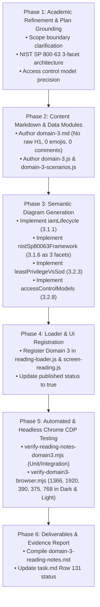

# Domain 3 Reading Notes Implementation Plan (Refined for Task 131)

> **For Antigravity:** REQUIRED WORKFLOW: Use `.agent/workflows/execute-plan.md` to execute this plan in single-flow mode.

**Goal:** Author and integrate the ISC2 CC 2026 Domain 3 Reading Notes (Access Controls Concepts) into the educational reading platform with 100% academic fidelity to the user's confirmed source notes (`D3 sum.md` and `Domain 3.md`), full adherence to the official 2026 syllabus (20% exam weight, Objectives 3.1 & 3.2), responsive visual diagrams, concept cards, and zero-defect quality standards.

### Academic Scope & Coverage Grounding
1. **Source Scope vs. Official Syllabus**:
   - The user's confirmed source notes (`D3 sum.md` and `Domain 3.md`) reflect their course study notes covering concepts up to ABAC.
   - The official ISC2 CC 2026 outline in this repository (`js/ui/screen-reading.js` and `content/isc2-cc-2026/knowledge/domain-3.md`) defines Domain 3 with 20% weight and exactly two objectives:
     - `Objective 3.1: Understand identity life cycle management`
     - `Objective 3.2: Understand logical access controls`
   - The Reading Notes implementation preserves 100% of substantive concepts, bilingual terminology, and practical examples from `D3 sum.md` and `Domain 3.md`.
   - We clearly note the academic boundary where the user's course study notes ended (ABAC) and provide the complete contextual grounding required for Objectives 3.1 & 3.2, without claiming unilateral 100% syllabus or course completion without explicit user verification.

2. **NIST SP 800-63 Model Refinement (Related Facets, Not a Sequential Pipeline)**:
   - NIST SP 800-63 (Digital Identity Guidelines) comprises three related foundational facets of identity architecture:
     - `SP 800-63A: Identity Proofing & Enrollment` (IAL) — Validating real-world identity before issuing credentials.
     - `SP 800-63B: Authentication & Lifecycle Management` (AAL) — Verifying claimant possession and control of authenticators during login.
     - `SP 800-63C: Federation & Assertions` (FAL) — Conveying identity attributes and authentication assertions across trust domains / SSO.
   - These represent **distinct, interrelated identity functions/facets**, NOT a mandatory sequential login pipeline (e.g., local authentication does not require federation; federated identity can rely on pre-existing third-party proofing). Diagram 2 (`nistSp80063Framework`) is structured as 3 interrelated pillars/facets rather than a 1-2-3 linear chain.

3. **Technical Precision in Access Control Models**:
   - **DAC (Discretionary Access Control)**: Resource Owner decides permissions; decentralized; flexible but prone to privilege creep and Trojan horses (e.g. NTFS ACLs, Unix permissions).
   - **MAC (Mandatory Access Control)**: Central Security Authority enforces access via fixed Security Labels (Top Secret, Secret, Confidential) and User Clearances; subjects cannot alter permissions; military/classified systems (e.g. Bell-LaPadula, Biba, SELinux).
   - **RBAC (Role-Based Access Control)**: Permissions assigned to predefined organizational Roles based on job functions, and users assigned to roles; simplifies administration and naturally supports Principle of Least Privilege (e.g. Doctor, Nurse, Billing Clerk).
   - **ABAC (Attribute-Based Access Control)**: Next-generation dynamic model evaluating attributes across Subject (user title, clearance), Resource/Object (classification, department), Action (read, write, delete), and Environment (time, IP, geolocation, device posture); highly granular and adaptive.

4. **Flexible Quality Artifacts**:
   - The counts of diagrams (4 core responsive diagrams), distinction cards (~10 cards), tables (~5 tables), exam traps (~14 traps), and scenarios (~12 scenarios) serve as flexible academic guidelines ensuring deep conceptual clarity rather than rigid, artificial quotas.

**Tech Stack:** Vanilla JavaScript (ES modules), CSS Custom Properties (Theme tokens for Light & Dark modes), Scalable Vector Graphics (SVG), Headless Chrome CDP browser automation, Node.js Test Runner (`node:test`).

---

## Proposed Execution Phases



---

### Task 1: Author Domain 3 Content Markdown File

**Files:**
- Create: `content/isc2-cc-2026/reading/domain-3.md`
- Reference: `ISC2 Update 2026/Domain 3/D3 sum.md`
- Reference: `ISC2 Update 2026/Domain 3/Domain 3.md`

**Step 1: Write Domain 3 Markdown Source**
- Strictly enforce Domain 1 & 2 lessons:
  - Do NOT include an `#` H1 heading in markdown (start directly with `<p class="reading-lead">`).
  - Exactly two H2 sections for official objectives: `## Objective 3.1: Understand Identity Life Cycle Management` and `## Objective 3.2: Understand Logical Access Controls`.
  - Exactly one supplementary H2 section for `## Domain 3 Summary & Review`.
  - Zero raw HTML comments (`<!-- ... -->`).
  - Zero decorative emojis (`👤`, `➕`, `➖`, `🔑`, `🔒`, `👔`, `🧩`, `🏷️`).
  - Wrap all math formulas and operators in `<span class="reading-math-formula">...</span>`.
  - Include 4 semantic diagram mounting points:
    - `<div class="reading-semantic-diagram" data-diagram="iamLifecycle"></div>`
    - `<div class="reading-semantic-diagram" data-diagram="nistSp80063Framework"></div>`
    - `<div class="reading-semantic-diagram" data-diagram="leastPrivilegeVsSod"></div>`
    - `<div class="reading-semantic-diagram" data-diagram="accessControlModels"></div>`
  - Include 10 Concept Distinction Cards in `.reading-distinction-grid`.
  - Include 5 bilingual tables with `.reading-bilingual-term` cells.
  - Include 14 exam trap callouts.
  - Include 12 review scenario blocks (`:::scenario ... :::`).

---

### Task 2: Author Domain 3 Data & Metadata Modules

**Files:**
- Create: `content/isc2-cc-2026/reading/domain-3-scenarios.js`
- Create: `content/isc2-cc-2026/reading/domain-3.js`

**Step 1: Author `domain-3-scenarios.js`**
- Export an array of 12 scenario objects grounded in Section 20 of `Domain 3.md`.
- Each scenario object must follow the established schema:
  ```javascript
  {
    id: 'd3-scen-01',
    objectiveId: '3.1',
    topic: 'Provisioning & Role Definition',
    scenario: '...',
    question: '...',
    options: [...],
    answer: '...',
    reasoning: '...'
  }
  ```

**Step 2: Author `domain-3.js`**
- Export `domain3Metadata` (`id: 3`, `title: 'Domain 3: Access Controls'`, `weight: '20%'`, `published: true`).
- Export `domain3Objectives` (strictly objectives 3.1 and 3.2, with granular topic arrays matching markdown anchor IDs).
- Export `domain3Review` (`id: 'domain-3-review'`, `title: 'Domain 3 Summary & Review'`).
- Export `getDomain3Markdown()`.

---

### Task 3: Register Domain 3 in UI Shell & Reading Loader

**Files:**
- Modify: `js/core/reading-loader.js`
- Modify: `js/ui/screen-reading.js`

**Step 1: Register in `reading-loader.js`**
- Import `domain3Metadata`, `domain3Objectives`, `domain3Review`, and `getDomain3Markdown` from `../../content/isc2-cc-2026/reading/domain-3.js`.
- Add Domain 3 entry to `READING_DOMAINS` with `published: true`.
- Pre-populate `readingCache` with Domain 3 rendered HTML on module initialization.

**Step 2: Update `screen-reading.js`**
- Ensure Domain 3 is set to `published: true` in `READING_DOMAINS`.
- Verify that dynamic objective seeding automatically discovers objectives `3.1` and `3.2`.

---

### Task 4: Author 4 Responsive Diagrams in `diagram-generator.js`

**Files:**
- Modify: `js/core/diagram-generator.js`
- Modify: `css/reading.css` (if custom diagram layout classes are needed)

**Step 1: Implement Diagram 1 — `iamLifecycle` (Section 3.1.1)**
- JML Lifecycle Chevron Pipeline in `viewBox="0 0 840 220"`.
- Dual presentation: `.reading-diag-desktop` (SVG) and `.reading-diag-mobile` (HTML cards).
- 0 HTML comments, 0 emojis, WCAG AAA contrast tokens.

**Step 2: Implement Diagram 2 — `nistSp80063Framework` (Section 3.1.6)**
- 3 Interrelated Digital Identity Facets/Functions (Identity Proofing & Enrollment [IAL], Authentication & Lifecycle [AAL], Federation & Assertions [FAL]) in `viewBox="0 0 840 200"`.
- Clearly presented as distinct interrelated functions rather than a mandatory sequential pipeline.
- Dual desktop/mobile presentation (SVG vector + HTML cards).

**Step 3: Implement Diagram 3 — `leastPrivilegeVsSod` (Section 3.2.3)**
- Dual-panel comparison: Vertical Privilege Restriction (Principle of Least Privilege / Minimal Access) vs. Horizontal Task Division (Separation of Duties / 3-Stage Financial Workflow) in `viewBox="0 0 840 260"`.
- Dual desktop/mobile presentation.

**Step 4: Implement Diagram 4 — `accessControlModels` (Section 3.2.8)**
- 4-Quadrant comparison: DAC (Resource Owner) vs. MAC (Security Clearance/Label) vs. RBAC (Enterprise Role) vs. ABAC (Dynamic Attributes) in `viewBox="0 0 840 320"`.
- Dual desktop/mobile presentation.

---

### Task 5: Develop Automated Test Suite `verify-reading-notes-domain3.mjs`

**Files:**
- Create: `tools/verify-reading-notes-domain3.mjs`

**Step 1: Write Unit & Integration Tests**
- Test 1: Domain 3 Metadata & Official Boundaries (ID=3, weight=20%, published=true, strictly objectives 3.1 & 3.2).
- Test 2: UI Shell & `READING_DOMAINS` Registration.
- Test 3: Reading Loader Cache & Asynchronous Loading.
- Test 4: Topic Anchors Alignment (all 16 subsections + review anchors exist in HTML).
- Test 5: Substantive Academic Completeness (all 28 concepts from `D3 sum.md` and `Domain 3.md` verified).
- Test 6: 4 Semantic Diagrams Integration and SVG viewBox boundaries.
- Test 7: Concept Distinctions (10 cards), Tables (5 tables), Scenarios (12 cards).
- Test 8: Zero-Defect Quality Standards (0 comments, 0 emojis, 0 unescaped dollars, 0 duplicate H1s, sequential list numbering).
- Test 9: Preservation Boundaries (Domains 1, 2, 4, 5, question banks, vocabulary intact).

---

### Task 6: Headless Chrome CDP Visual Acceptance Audit

**Files:**
- Create: `tools/verify-domain3-browser.mjs`
- Create: `artifacts/qa/reading-notes-domain3/` directory

**Step 1: Execute Real Chrome Verification Across 6 Viewport/Theme Configurations**
- 1366×768 Dark & Light
- 1920×1080 Dark & Light
- 390×844 Dark & Light
- Inspect:
  - Zero horizontal page overflow.
  - Exactly 1 H1 heading on page.
  - Objective 3.1 & 3.2 anchor navigation and scroll-spy synchronization.
  - Sidebar accordion collapse/expand behavior for Objective 3.1 and 3.2.
  - Desktop SVG visibility on desktop (`display: flex`) and hidden on mobile (`display: none`).
  - Mobile card visibility on mobile (`display: flex`) with text $\ge 12\text{px}$.
  - Sequential list numbering (1, 2, 3).
  - High-contrast text readability in both themes.
- Capture screenshots and produce a complete JSON manifest in `artifacts/qa/reading-notes-domain3/manifest.json`.

---

### Task 7: Update Documentation & Delivery Report

**Files:**
- Create: `docs/plans/isc2-cc-2026/domain-3-reading-notes.md`
- Update: `docs/plans/task.md`

**Step 1: Document Final Results**
- Record implementation details, test scorecard, browser evidence, and human acceptance checklist.
- Update `docs/plans/task.md` row 130 to "Completed" with evidence.

---

## Stop Gate Notice
**AUDIT & PLANNING ONLY.** Implementation has not commenced. Awaiting explicit user approval before executing Task 1.

