# ISC2 CC 2026 Domain 4 Reading Notes — Content Architecture & Implementation Plan

> **For Antigravity:** REQUIRED WORKFLOW: Use `.agent/workflows/execute-plan.md` to execute this plan in single-flow mode.

**Goal:** Implement textbook-grade, evidence-grounded bilingual Reading Notes for ISC2 Certified in Cybersecurity (CC) 2026 Domain 4 (*Network Security*, 21.3% exam weight) with 23 content subsections, 4 responsive semantic diagrams, 12 concept distinction cards, 16 exam traps, 10 comparison tables, and 12 scenario walkthroughs.

**Architecture:** Continuous long-form technical reader integrated with the established Reading Notes system. Consolidated Markdown source compiled via zero-dependency parser into semantic HTML; dynamic 3-level sticky sidebar navigation (Domain -> Objective -> Topic); dual-presentation responsive diagrams (pure SVG on desktop, semantic stacked HTML cards on mobile); zero raw H1 tags, zero decorative emojis, zero unparsed LaTeX leakage.

**Tech Stack:** Vanilla ES Modules, zero-dependency Markdown parser (`js/core/markdown-parser.js`), pure vector SVG & semantic HTML diagram generator (`js/core/diagram-generator.js`), CSS Custom Properties & Container Queries (`css/reading.css`), Node.js built-in test runner, real Chrome DevTools Protocol (CDP) automated browser testing harness.

---

## 1. Existing Reading Notes Architecture & Lessons Learned

### 1.1 Architecture Baseline
The Reading Notes feature currently provides authoritative coverage for Domains 1, 2, and 3:
- **Navigation Shell ([`js/ui/screen-reading.js`](file:///d:/_Coding/SEC-CERT-TEST/js/ui/screen-reading.js)):** Left sticky sidebar with accordion expand/collapse, active heading scroll spy, floating back-to-top / go-to-bottom utility button, and fluid reader column.
- **Content Loader ([`js/core/reading-loader.js`](file:///d:/_Coding/SEC-CERT-TEST/js/core/reading-loader.js)):** Asynchronous loader with hybrid Node.js synchronous cache pre-population and browser fetch resolution.
- **Markdown Engine ([`js/core/markdown-parser.js`](file:///d:/_Coding/SEC-CERT-TEST/js/core/markdown-parser.js)):** Supports directives (`:::distinction-grid`, `:::scenario`, `:::diagram`), custom callout banners (`> [!NOTE]`, `> [!WARNING]`), hierarchical ordered/unordered lists with blank line lookahead, and custom table cell rendering.
- **Responsive Diagram Engine ([`js/core/diagram-generator.js`](file:///d:/_Coding/SEC-CERT-TEST/js/core/diagram-generator.js)):** Emits responsive dual presentations: desktop SVG (`.reading-diagram-desktop`) and mobile HTML card stacks (`.reading-diag-mobile`).

### 1.2 Lessons Learned from Previous Domains & Defect Prevention

| Defect Identified in Previous Tasks | Root Cause | Mandatory Architectural Prevention for Domain 4 |
| :--- | :--- | :--- |
| **Section 3.2.8 SVG Rendering Collapse (Task 134)** | Invalid HTML `<strong>` tags inside SVG `<text>` triggered HTML5 parser breakout, collapsing labels into 3px vertical letter stacks. | **Rule 1: 100% Pure SVG Text.** Never embed HTML tags inside SVG `<text>` or `<tspan>`. Use discrete label and value text nodes with dedicated theme-aware CSS classes (`.diag-label`, `.diag-value`). |
| **Mobile Text Illegibility (Task 125, 126)** | Scaling complex desktop SVG diagrams down to 320px–390px rendered text at unreadable sizes (3px–4px). | **Rule 2: Responsive Duality.** Strict media query separation (`display: none !important`). On $\le 768\text{px}$, desktop SVG is hidden and dedicated semantic HTML mobile cards (`.reading-mob-tier-card`) are shown. |
| **Mobile Semantic Parity Gaps (Task 132 D3-Q02)** | Mobile HTML diagram omitted the Continuous Governance feedback ribbon present in the desktop SVG. | **Rule 3: Complete Mobile Parity.** Mobile cards must represent 100% of the conceptual entities and feedback loops present on desktop. |
| **Narrow Viewport Overflow (Task 132 D3-Q01)** | Rigid `minmax(340px, 1fr)` caused 50px horizontal overflow on 320px mobile screens. | **Rule 4: Fluid Grid Sizing.** Always use `minmax(min(100%, 320px), 1fr)` and single-column mobile collapse rules. |
| **Loose List Splitting (Task 126 D2-Q11)** | Intervening blank lines in Markdown caused `<ol>` lists to reset to "1." repeatedly. | **Rule 5: Tight List Formatting.** Author consecutive numbered list items without extraneous blank lines, relying on the parser lookahead engine. |
| **Superficial Test Passes (Tasks 127, 134)** | Tests only asserted `container.display !== 'none'`, missing collapsed geometry and colliding text. | **Rule 6: Deep Bounding-Box Geometry QA.** Automated test harness must evaluate `getBBox()`, asserting 0 zero-width text, 0 squished heights, and 0 pairwise text collisions. |

---

## 2. Proposed Domain 4 Content Architecture

Domain 4 will be structured into three official numbered objectives plus a dedicated Domain Review and Synthesis section, spanning **23 granular subsections**:

```mermaid
graph TD
    Domain4["Domain 4: Network Security (21.3%)"]
    Domain4 --> Obj41["4.1 Understand Network Security<br/>(10 Subsections)"]
    Domain4 --> Obj42["4.2 Understand Network Security Architecture<br/>(7 Subsections)"]
    Domain4 --> Obj43["4.3 Understand Cloud Security<br/>(6 Subsections)"]
    Domain4 --> Review["Domain 4 Review & Synthesis<br/>(Outside Objectives)"]

    Obj41 --> S411["4.1.1 Network Fundamentals & Topologies"]
    Obj41 --> S412["4.1.2 OSI 7-Layer Reference Model"]
    Obj41 --> S413["4.1.3 TCP/IP 4-Layer Architecture Mapping"]
    Obj41 --> S414["4.1.4 IPv4 Addressing, CIDR & NAT"]
    Obj41 --> S415["4.1.5 IPv6 Architecture, SLAAC & Dual-Stack"]
    Obj41 --> S416["4.1.6 Transport Protocols: TCP vs. UDP"]
    Obj41 --> S417["4.1.7 Ports, Multiplexing & Core Services"]
    Obj41 --> S418["4.1.8 Network Devices & Security Filtering"]
    Obj41 --> S419["4.1.9 Wireless Security: Wi-Fi, Bluetooth & VPN"]
    Obj41 --> S4110["4.1.10 Network Threats, Embedded Systems & IoT"]

    Obj42 --> S421["4.2.1 Network Segmentation & Blast Radius"]
    Obj42 --> S422["4.2.2 Firewall Security Zones & Trust Levels"]
    Obj42 --> S423["4.2.3 Demilitarized Zone (DMZ) Architecture"]
    Obj42 --> S424["4.2.4 Virtual Local Area Networks (VLANs)"]
    Obj42 --> S425["4.2.5 Micro-Segmentation & East-West Control"]
    Obj42 --> S426["4.2.6 Defense in Depth Layered Strategy"]
    Obj42 --> S427["4.2.7 Zero Trust Architecture (ZTA) in Networking"]

    Obj43 --> S431["4.3.1 Cloud Computing & 5 Characteristics"]
    Obj43 --> S432["4.3.2 Cloud Service Models (IaaS, PaaS, SaaS, FaaS)"]
    Obj43 --> S433["4.3.3 The Shared Responsibility Model"]
    Obj43 --> S434["4.3.4 Cloud Deployment Models"]
    Obj43 --> S435["4.3.5 Exam Distinction: Hybrid vs. Multi-Cloud"]
    Obj43 --> S436["4.3.6 Cloud Network Architecture & Security Controls"]

    Review --> R1["12 Concept Distinction Cards"]
    Review --> R2["16 Exam Traps & Misconceptions"]
    Review --> R3["12 Comprehensive Review Scenarios"]
```



### 2.1 Detailed Section Breakdown

#### Objective 4.1: Understand Network Security
- **4.1.1 Network Fundamentals & Topologies:** Definition; computer networks; LAN, WAN, WLAN, PAN, VPN; Collision domains vs. Broadcast domains; Intranet vs. Internet.
- **4.1.2 OSI 7-Layer Reference Model:** ISO 1984 7-layer framework; All 7 layers (Physical to Application); Layer responsibilities; PDU encapsulation & decapsulation process.
- **4.1.3 TCP/IP 4-Layer Architecture Mapping:** DoD 4-layer model (Network Access, Internet, Transport, Application); Head-to-head comparison and layer mapping table against OSI.
- **4.1.4 IPv4 Addressing, Subnetting, Classes & NAT:** 32-bit dotted-decimal; 4 octets; Classes A–E; RFC 1918 Private IP ranges; CIDR notation; NAT gateway mechanism and security limitations.
- **4.1.5 IPv6 Architecture, SLAAC & Dual-Stack Coexistence:** 128-bit hexadecimal; 8 blocks of 16 bits; elimination of broadcast (Unicast, Multicast, Anycast); built-in IPsec support; SLAAC auto-config; Dual-Stack coexistence.
- **4.1.6 Transport Layer Protocols (TCP vs. UDP):** TCP connection-oriented 3-way handshake (SYN, SYN-ACK, ACK), reliable delivery, flow control vs. UDP connectionless, lightweight, low-overhead datagrams.
- **4.1.7 Network Ports, Multiplexing & Core Services:** 16-bit port space (0–65,535); Well-known vs. Ephemeral client ports; Multiplexing mechanism; Essential services: HTTP (80), HTTPS (443), DNS (53), SSH (22), FTP (21), SFTP (22), FTPS (990), SMTP (25), IMAP (143), POP3 (110), RDP (3389), DHCP (67/68), SNMP (161/162); Port scanning risks (Nmap).
- **4.1.8 Network Devices & Security Filtering:** Hubs (L1), Switches (L2 MAC, frame switching), Routers (L3 IP, packet routing), Firewalls (packet filter, stateful, NGFW), IDS (passive alert) vs. IPS (active in-line drop), Proxy servers (forward/reverse).
- **4.1.9 Wireless Security: Wi-Fi, Bluetooth & VPN:** IEEE 802.11 standards (a/b/g/n/ac/ax, 2.4 vs 5 GHz); Wireless encryption evolution (WEP broken, WPA deprecated, WPA2 AES-CCMP, WPA3 SAE); Limitations of MAC filtering & hidden SSID; Bluetooth PAN pairing and discovery risks; Remote Access vs. Site-to-Site VPN.
- **4.1.10 Network Threats, Embedded Systems & IoT Security:** Attacks: DoS/DDoS, MITM, Spoofing, Sniffing, Lateral Movement; Embedded Systems & ICS/SCADA/OT (availability/safety priority, legacy constraints, difficulty patching); IoT risks (default passwords, weak auth, unpatched firmware, isolated IoT VLAN).

#### Objective 4.2: Understand Network Security Architecture
- **4.2.1 Network Segmentation & Blast Radius Reduction:** Purpose; dividing large networks; limiting attack spread; containment; reducing blast radius; stopping lateral movement; necessity of enforcing ACLs.
- **4.2.2 Firewall Security Zones & Trust Boundaries:** Logical grouping by trust level: Outside (untrusted), Inside (private), DMZ (limited trust), Management (restricted admin); Inter-zone traffic rules.
- **4.2.3 Demilitarized Zone (DMZ) Architecture:** Purpose and topology; isolating public-facing servers (Web, DNS, Mail Gateway, Reverse Proxy); Single-firewall multi-homed DMZ vs. Dual-firewall layered DMZ; Preventing direct internet-to-internal database communication.
- **4.2.4 Virtual Local Area Networks (VLANs) & Routing:** Layer 2 logical segmentation inside physical switches; broadcast domain containment; 802.1Q tagging; Inter-VLAN routing via Layer 3 switches/routers; Security enforcement via ACLs and firewall rules.
- **4.2.5 Micro-Segmentation & East-West Traffic Control:** Granular workload and device-level isolation; Software-Defined Networking (SDN) and host-based firewalls; Controlling lateral east-west communication between application tiers (Web tier -> App tier -> Database tier).
- **4.2.6 Defense in Depth Layered Strategy:** Multi-layered defensive design: Perimeter Security (Firewall, IDS/IPS) -> Network Security (VLAN, DMZ, ACL) -> Endpoint Security (EDR, Patching) -> Application Security (Secure Coding, WAF) -> Data Security (Encryption, Backups, Access Control); Eliminating single points of failure.
- **4.2.7 Zero Trust Architecture (ZTA) in Networking:** NIST SP 800-207 principles; "Never Trust, Always Verify"; Eliminating perimeter-based implicit trust; Context-based access decisions (Identity, Device Health, Application, Resource, Location, Context).

#### Objective 4.3: Understand Cloud Security
- **4.3.1 Cloud Computing Foundations & 5 Characteristics:** Definition; NIST SP 800-145 framework: On-Demand Self-Service, Broad Network Access, Resource Pooling (multi-tenancy with logical isolation), Rapid Elasticity (scalability), Measured Service (metered billing).
- **4.3.2 Cloud Service Models (IaaS, PaaS, SaaS, FaaS):** Detailed analysis of IaaS (Amazon EC2, Azure VMs), PaaS (Google App Engine, Azure App Service), SaaS (Microsoft 365, Google Workspace, Salesforce), and FaaS/Serverless (AWS Lambda, Azure Functions); Resource ownership and operational boundaries.
- **4.3.3 The Shared Responsibility Model:** CSP responsibility ("Security of the Cloud") vs. Customer responsibility ("Security in the Cloud"); Responsibility gradient across IaaS, PaaS, SaaS, FaaS; The Golden Rule: Customer *always* owns Data, User Access, and Configurations.
- **4.3.4 Cloud Deployment Models:** Public Cloud (multi-tenant shared infrastructure), Private Cloud (dedicated single-tenant on-prem or hosted), Hybrid Cloud (integration of private and public cloud workloads), Community Cloud (shared infrastructure for organizations with common compliance/regulatory needs), Multi-Cloud (leveraging multiple CSPs to eliminate vendor lock-in).
- **4.3.5 Critical Deployment Distinction (Hybrid Cloud vs. Multi-Cloud):** High-frequency exam distinction; Hybrid = private + public integration; Multi-Cloud = multiple cloud providers; Real-world architecture combining both.
- **4.3.6 Cloud Network Architecture & Security Controls:** Virtual Private Clouds (VPCs); Public and private cloud subnets; Cloud Firewalls, Security Groups (stateful) vs. Network ACLs (stateless); Cloud IAM integration; Layered defense in cloud environments.

#### Domain 4 Summary & Review (Dedicated Section Outside Objectives)
- **Domain 4 Key Takeaways & Synthesis:** Master summary table connecting Network Fundamentals, Security Architecture, and Cloud Security.
- **Concept Distinction Cards (12 Cards):**
  1. Hub vs. Switch vs. Router vs. Layer 3 Switch
  2. TCP vs. UDP
  3. IPv4 vs. IPv6
  4. Packet Filtering vs. Stateful Inspection vs. Next-Generation Firewall (NGFW)
  5. IDS (Detection/Alert) vs. IPS (Inline Prevention/Drop)
  6. Network Segmentation vs. VLAN vs. DMZ vs. Micro-Segmentation
  7. Blast Radius vs. Lateral Movement
  8. Traditional Perimeter Security vs. Zero Trust Architecture (ZTA)
  9. IaaS vs. PaaS vs. SaaS vs. FaaS
  10. Security OF the Cloud vs. Security IN the Cloud
  11. Hybrid Cloud vs. Multi-Cloud
  12. Security Group (Stateful) vs. Network ACL (Stateless)
- **Exam Traps & Common Misconceptions (16 Traps):**
  - Trap 1: Assuming private IP addresses provide encryption or security (NAT is not encryption).
  - Trap 2: Believing MAC filtering or hiding SSID provides strong Wi-Fi protection.
  - Trap 3: Thinking UDP is "broken" because it doesn't guarantee delivery (UDP is designed for speed/real-time).
  - Trap 4: Confusing IDS (passive out-of-band tap) with IPS (active in-line gatekeeper).
  - Trap 5: Assuming VLAN segmentation alone prevents unauthorized traffic (requires ACLs/firewall).
  - Trap 6: Believing a DMZ must always use two physical firewalls (can be multi-homed single firewall).
  - Trap 7: Believing Inside / Internal zones are automatically trusted (Zero Trust rejects this).
  - Trap 8: Assuming Micro-Segmentation replaces macro Network Segmentation (they complement each other).
  - Trap 9: Believing SaaS relieves the customer of all security responsibilities (Customer always owns Data and IAM).
  - Trap 10: Confusing Rapid Elasticity with Resource Pooling.
  - Trap 11: Equating Hybrid Cloud with Multi-Cloud.
  - Trap 12: Assuming Cloud Service Providers patch your IaaS Virtual Machine OS.
  - Trap 13: Believing IoT devices can simply be patched like enterprise laptops.
  - Trap 14: Confusing Denial of Service (single source) with Distributed Denial of Service (botnet/multiple sources).
  - Trap 15: Thinking Zero Trust means "trust nobody ever can do anything" (it means verify context before granting access).
  - Trap 16: Believing Community Cloud is open to the public like Public Cloud (it is restricted to member organizations with shared requirements).
- **Comprehensive Review Scenarios (12 Scenarios with Verified Answers & Step-by-Step Rationale):**
  - Scenario 1: Lateral Movement Prevention in Corporate Network (Network Segmentation)
  - Scenario 2: Public Web Service Isolation (DMZ Architecture)
  - Scenario 3: Workload-to-Workload Application Communication (Micro-Segmentation)
  - Scenario 4: Multi-Layered Threat Mitigation (Defense in Depth)
  - Scenario 5: Context-Based Internal Access Verification (Zero Trust)
  - Scenario 6: Virtual Machine OS Patching Responsibility (IaaS)
  - Scenario 7: Application Code Vulnerability in Managed Runtime (PaaS)
  - Scenario 8: Misconfigured Public Cloud Storage Bucket (Customer Responsibility in SaaS/IaaS)
  - Scenario 9: Sensitive Data in Dedicated Infrastructure with Public Bursting (Hybrid Cloud)
  - Scenario 10: Healthcare Regulatory Compliance Across Hospitals (Community Cloud)
  - Scenario 11: Avoiding Vendor Lock-In via AWS and Azure (Multi-Cloud)
  - Scenario 12: Smart Camera Isolation from Financial Systems (IoT Segmentation)

---

## 3. Four Responsive Semantic Diagrams Specification

All 4 diagrams will strictly implement the zero-breakout architecture established in Task 134: pure SVG text nodes with dedicated coordinates, theme-aware CSS classes, generous bounding-box safety margins ($\ge 60\text{px}$), and complete mobile HTML card stacks (`.reading-diag-mobile`).

### 3.1 Diagram 1: `osiVsTcpIpModel` (Section 4.1.3)
- **Educational Purpose:** Side-by-side mapping of the 7 OSI reference layers to the 4 practical TCP/IP layers, showing layer consolidation, protocol examples, and encapsulation flow.
- **Source References:** `D4 sum.md` lines 64–136; `Domain 4.md` lines 28–40; `DOMAIN 4.txt` lines 5–41.
- **Desktop SVG Layout (`viewBox="0 0 840 340"`):**
  - Left column (`x=30` to `x=380`): 7 OSI layers stacked vertically (7. Application, 6. Presentation, 5. Session, 4. Transport, 3. Network, 2. Data Link, 1. Physical).
  - Right column (`x=460` to `x=810`): 4 TCP/IP layers (Application [merging 7,6,5], Transport [4], Internet [3], Network Access [merging 2,1]).
  - Center connector lines (`x=390` to `x=450`): Clean dashed vector brackets showing exact layer mappings.
  - Zero HTML tags inside SVG text.
- **Mobile Presentation:** 4 semantic cards in `.reading-diag-mobile` grouping the consolidated layers with high-contrast layer badges and protocol lists.
- **Accessibility:** SVG has `role="img"` and `aria-label="OSI 7-Layer to TCP/IP 4-Layer Architecture Mapping"`.

### 3.2 Diagram 2: `dmzFirewallArchitecture` (Section 4.2.3)
- **Educational Purpose:** Architectural diagram illustrating the DMZ trust boundary: untrusted Internet -> External Firewall -> DMZ (Web/Mail/Proxy) -> Internal Firewall -> Private Internal Network (Database/Internal Systems).
- **Source References:** `D4 sum.md` lines 247–282; `Domain 4.md` lines 94–107; `DOMAIN 4.txt` lines 144–150.
- **Desktop SVG Layout (`viewBox="0 0 840 280"`):**
  - Left zone (`x=30` to `x=210`): Internet / Outside (Untrusted, red/amber tint).
  - External Firewall boundary (`x=230` to `x=270`): Vector firewall barrier.
  - Middle zone (`x=290` to `x=530`): DMZ (Limited Trust, blue/slate card containing Web Server, Email Gateway, Reverse Proxy).
  - Internal Firewall boundary (`x=550` to `x=590`): Second vector firewall barrier.
  - Right zone (`x=610` to `x=810`): Internal Network (Restricted/Private, emerald tint containing Internal DB, ERP, User Workstations).
  - Prohibited traffic arrow: Red crossed line showing direct Internet-to-Internal traffic is blocked.
- **Mobile Presentation:** 3 structured cards (Outside Untrusted, DMZ Public Services, Internal Private Network) separated by intermediate Firewall barrier cards.
- **Accessibility:** Explicit text explaining that public traffic is terminated in the DMZ and cannot reach internal systems directly.

### 3.3 Diagram 3: `defenseInDepthLayers` (Section 4.2.6)
- **Educational Purpose:** Visualizing the 5 concentric defensive rings protecting corporate data assets, showing that failure of an outer layer is caught by inner controls.
- **Source References:** `D4 sum.md` lines 343–366; `Domain 4.md` lines 131–143; `DOMAIN 4.txt` lines 164–171.
- **Desktop SVG Layout (`viewBox="0 0 840 280"`):**
  - 5 horizontal hierarchical bands with vector arrows and tier badges:
    1. Layer 1: Perimeter Security (Firewall, IDS/IPS, DDoS Mitigation)
    2. Layer 2: Network Security (VLANs, DMZ, Inter-VLAN ACLs)
    3. Layer 3: Endpoint Security (Anti-Malware, Patch Management, EDR)
    4. Layer 4: Application Security (Secure Coding, WAF, Input Validation)
    5. Layer 5: Data Security (Encryption at Rest/in Transit, Backups, Strict IAM)
  - Color gradient from perimeter slate to protected golden core.
- **Mobile Presentation:** 5-card vertical hierarchy stack (`.reading-mob-tier-card`) with tier numbers (01 to 05) and control tags.
- **Accessibility:** `aria-label="Defense in Depth 5-Layer Security Architecture"`.

### 3.4 Diagram 4: `cloudSharedResponsibility` (Section 4.3.3)
- **Educational Purpose:** Visualizing the shifting responsibility boundary across IaaS, PaaS, SaaS, and FaaS between Cloud Service Provider (CSP) and Customer.
- **Source References:** `D4 sum.md` lines 531–558; `Domain 4.md` lines 217–234; `DOMAIN 4.txt` lines 193–206.
- **Desktop SVG Layout (`viewBox="0 0 840 320"`):**
  - 4 vertical model columns: IaaS (`x=30`), PaaS (`x=230`), SaaS (`x=430`), FaaS (`x=630`).
  - 6 component rows:
    - Data & Information (Customer across all 4)
    - IAM & User Access (Customer across all 4)
    - Application Code & Logic (Customer in IaaS/PaaS/FaaS; CSP in SaaS)
    - OS, Middleware & Runtime (Customer in IaaS; CSP in PaaS/SaaS/FaaS)
    - Virtualization & Hypervisor (CSP across all 4)
    - Physical Infrastructure & Data Center (CSP across all 4)
  - Theme-aware fills: Blue/Indigo for CSP ("Security OF the Cloud") and Emerald/Teal for Customer ("Security IN the Cloud").
  - Safety margins: All text positioned with $\ge 65\text{px}$ clearance from box edges.
- **Mobile Presentation:** 4 dedicated service model cards with stacked responsibility badges (CSP vs. Customer).

---

## 4. Quality Assurance & Verification Plan

```text
================================================================================
DOMAIN 4 VERIFICATION MATRIX
================================================================================
1. Unit & Structural Verification (tools/verify-reading-notes-domain4.mjs):
   - Metadata validation (Domain 4, Network Security, 21.3% weight, published: true)
   - Objective validation: Exactly 3 objectives (4.1, 4.2, 4.3) + Review section
   - Parser integrity: 0 raw H1 tags, 0 unparsed LaTeX dollar signs ($), 0 decorative emojis
   - 0 Leaked development comments (<!-- ... -->)
   - All 23 topic section anchors verified (#sec-4-1-1 through #sec-4-3-6, #sec-domain-4-review)
   - Ordered list sequence: All <ol> blocks sequential (1, 2, 3...; 0 repeated "1.")
   - Math formula protection: .reading-math-formula nowrap spans for CIDR / formulas
   - All 12 Concept Distinction cards and 12 Review Scenario cards validated

2. Real Chrome CDP Multi-Viewport Geometry Suite (tools/verify-domain4-browser.mjs):
   - 23 Viewport/Theme Configurations:
     - 1920x1080 (Dark / Light)
     - 1366x768 (Dark / Light, Sidebar Expanded / Collapsed)
     - 1024x768 (Dark / Light)
     - 768x1024 (Dark / Light)
     - 390x844 (Dark / Light)
     - 375x812 (Dark / Light)
     - 320x568 (Dark / Light)
     - Breakpoints: 600px, 601px, 768px, 769px
   - Layout Checks:
     - Check 1: 0px horizontal page overflow across all 23 viewports
     - Check 2: Exactly 1 H1 heading present
     - Check 3: All 3 objectives + review rendered
     - Check 4: Deep Diagram Geometry:
       * getBBox() evaluation on every SVG <text> node
       * zeroWidth.length === 0
       * squishedHeight.length === 0
       * collisions.length === 0 (pairwise horizontal overlap detection)
       * Desktop SVG active on > 768px; Mobile cards active on <= 768px
     - Check 5: Distinction grid cards render with 0 clipping
     - Check 6: Review scenario cards render with clean answer dividers
     - Check 7: Ordered lists verified sequential in live DOM
     - Check 8: Sidebar objective accordions (4.1, 4.2, 4.3) collapse to 0px and re-expand

3. Cross-Domain Regression Safety Checks:
   - verify-reading-notes-domain1.mjs (10/10 PASS)
   - verify-reading-notes-domain2.mjs (9/9 PASS)
   - verify-reading-notes-domain3.mjs (10/10 PASS)
   - verify-reading-notes-foundation.mjs (9/9 PASS)
   - Core Data Preserved: 583 CC questions, 119 next-bank questions, 403 vocabulary terms
================================================================================
```

---

## 5. Step-by-Step Implementation Roadmap

When authorized for implementation (Task 138), the work will follow these 8 ordered, single-flow stages:

### Stage 1: Data Modules & Scenarios
- Author [`content/isc2-cc-2026/reading/domain-4-scenarios.js`](file:///d:/_Coding/SEC-CERT-TEST/content/isc2-cc-2026/reading/domain-4-scenarios.js) with all 12 review scenarios.
- Author [`content/isc2-cc-2026/reading/domain-4.js`](file:///d:/_Coding/SEC-CERT-TEST/content/isc2-cc-2026/reading/domain-4.js) with metadata, objectives (4.1, 4.2, 4.3), review section, and asynchronous Markdown loader.

### Stage 2: Consolidated Markdown Authoring
- Author [`content/isc2-cc-2026/reading/domain-4.md`](file:///d:/_Coding/SEC-CERT-TEST/content/isc2-cc-2026/reading/domain-4.md) covering all 23 subsections, 12 distinction cards, 16 exam traps, and 10 comparison tables.

### Stage 3: Responsive Semantic Diagrams
- Add 4 responsive diagram generators in [`js/core/diagram-generator.js`](file:///d:/_Coding/SEC-CERT-TEST/js/core/diagram-generator.js):
  - `osiVsTcpIpModel`
  - `dmzFirewallArchitecture`
  - `defenseInDepthLayers`
  - `cloudSharedResponsibility`
- Add theme-aware CSS styling classes in [`css/reading.css`](file:///d:/_Coding/SEC-CERT-TEST/css/reading.css).

### Stage 4: System Wiring & Publishing
- Update [`js/core/reading-loader.js`](file:///d:/_Coding/SEC-CERT-TEST/js/core/reading-loader.js) to publish Domain 4 (both Node.js cache and browser loader).
- Update [`js/ui/screen-reading.js`](file:///d:/_Coding/SEC-CERT-TEST/js/ui/screen-reading.js) (`READING_DOMAINS` entry 4: `published: true`, import `domain4Objectives`, `domain4Review`).

### Stage 5: Unit Verification
- Author and run [`tools/verify-reading-notes-domain4.mjs`](file:///d:/_Coding/SEC-CERT-TEST/tools/verify-reading-notes-domain4.mjs) (10 assertions).

### Stage 6: Real Chrome CDP Verification
- Author and run [`tools/verify-domain4-browser.mjs`](file:///d:/_Coding/SEC-CERT-TEST/tools/verify-domain4-browser.mjs) across 23 viewports, capturing high-resolution evidence screenshots into `artifacts/qa/reading-notes-domain4/`.

### Stage 7: Cross-Domain Regression Run
- Execute all regression test suites across Domains 1, 2, and 3, ensuring 0 regressions.

### Stage 8: Deliverables & Quality Report
- Compile final completion report: `docs/plans/isc2-cc-2026/domain-4-reading-notes-completion.md`.
- Update `docs/plans/task.md` with implementation status.

---

## 6. Human Acceptance Sign-off Criteria

Before declaring Domain 4 complete, human review will inspect:
1. **Academic Completeness:** All 23 topics faithfully cover `D4 sum.md`, `Domain 4.md`, and `DOMAIN 4.txt`.
2. **Diagram Readability:** All 4 diagrams render with clean typography, zero squished text, and zero collisions in both Dark and Light themes.
3. **Responsive Duality:** On screens $\le 768\text{px}$, desktop SVGs smoothly hide and legible mobile cards appear with 0px horizontal overflow.
4. **Sidebar Navigation:** Objectives 4.1, 4.2, and 4.3 expand and collapse smoothly via chevrons with 0px height collapse.
5. **Zero Regression:** All previous domains, question banks, vocabulary, and learning slides operate with zero defects.

