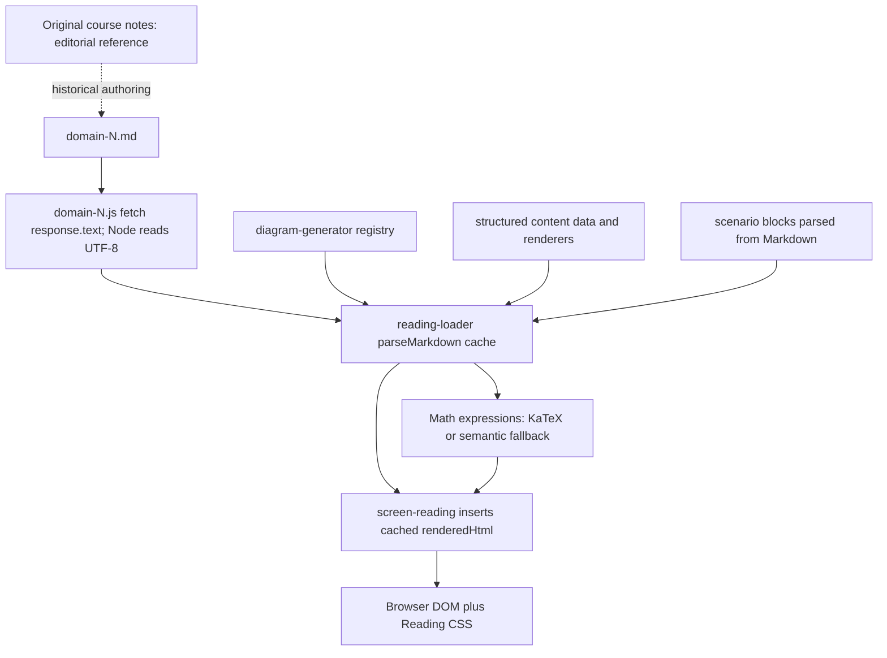

# Phase 3A.1 — Source fidelity and cross-domain visual audit

**Phase 3A.1 Supplemental Audit Complete — Pending Human Review**

Date: 2026-11-01 (Asia/Bangkok). Repository: `D:\_Coding\SEC-CERT-TEST`. Audit only: no production, content, CSS, renderer, existing test, original-note, navigation/progress or unrelated-module changes. No Human Acceptance approval or Phase 3B implementation.

## Coverage and reuse

All **94 subsections** were traced from current authored source through parser output and live browser DOM: D1 24, D2 29, D3 17, D4 24. `fidelity-coverage.json` has an individual record for each, including parser branches, heading/list structure, visible syntax candidates, math errors and table-shape comparison. This is a fidelity inspection, not a fresh fourteen-configuration visual acceptance claim.

The current source/runtime hashes match the Phase 3A baseline. All **1,680 inventoried Phase 3A QA files and four reports** were hash-verified; all four current Node-rendered HTML strings exactly match the prior rendered snapshots. The prior **1,316 inspections / 56 configurations**, all 24 diagram variants and the 15 term-fragmentation ranges can therefore be reused. Earlier reports were preserved rather than overwritten.

Fresh Chrome work comprised **14 domain/viewport/theme contexts**: all four domains at 1366×768 in Light/Dark, plus D4 at 1024×768, 768×1024 and 390×844 in both themes. These contain **332 whole-range DOM fidelity records**: 188 for all 94 at desktop in both themes, plus 144 additional D4 range records. Eight fresh DMZ states cover desktop, constrained desktop, tablet and phone. Four further D1 contexts capture the newly found table-note artifact at desktop/phone in both themes. There are 14 new product screenshots: ten risk/DMZ and four note images. Main/note audit runs recorded no runtime exceptions.

The unchanged Phase 3A evidence supplies the remaining required seven-width visual matrix; it was not regenerated. There is no source-subsection coverage gap. Fresh supplemental mobile/tablet fidelity scans were not performed for D1–3, and no fresh full 94×14 visual matrix is claimed. Native screen-reader pronunciation, physical touch devices and learner usability sessions remain untested.

## Actual runtime architecture

The original course notes are an editorial/provenance reference. They are **not loaded by the textbook at runtime**. No executable original-notes→JSON→textbook conversion pipeline was found in the active reader path. Authorship as AI-generated cannot be established from the current files alone.

The diagram is an audit description of the existing architecture, not a proposed production redesign. Relevant source: `content/isc2-cc-2026/reading/domain-1.js:83–96`, `js/core/reading-loader.js:19–69,101 onward`, `js/core/markdown-parser.js:285–367`, `js/ui/screen-reading.js:396–409`, and `js/core/math-renderer.js:25–118`.

Active branches differ:

| Authored representation | Runtime behavior | Fidelity implication |
|---|---|---|
| Ordinary Markdown paragraphs/lists/tables | Inline formatting, nested list tree and table renderer | Escape/format behavior differs from raw HTML. |
| Raw permitted HTML lines | Pass through with a limited inline-math substitution; no general parseInline call | Markdown-only escapes/emphasis inside HTML may remain visible. |
| `data-diagram` placeholder | Replace with registered SVG plus mobile HTML | Registry, not empty source placeholder, supplies instructional diagram content. |
| MFA / risk-treatment / control-category directive | Consume directive body; render fixed structured data through component functions | The data arrays are the active rendered payload; source body is not a lossless round-trip input. |
| Scenario directive | Parse fields and render grouped scenario/context/question/answer | Current 44 scenarios remain grouped, not flattened list items. |
| Math expression | KaTeX when available; semantic math otherwise | Preserve valid math escapes and test both paths separately from currency. |

The three structured directive bodies are intentionally skipped by current implementation. This is a source-of-truth/maintenance risk, not proof that current correct explanations were lost. Their abbreviated source labels and richer rendered data are not expected to be byte-identical. Future restructuring must inventory both payload and surrounding prose; editing only a discarded directive body would not change what learners see.

Targeted original-note passages across all eight originals are indexed in `original-note-trace.json`. This is not a new sentence-by-sentence academic-equivalence audit of every original note. D3’s fuller notes name JML at lines 20–22; the short summary does not use those JML labels. D4’s fuller notes, lines 92–108, give illustrative allowed/denied policy examples, firewall roles and a conceptual path, explicitly qualifying two firewalls as one possible DMZ form. Preserve those useful qualifications rather than imposing one universal route.

## Fidelity results

| Check | Result and qualification |
|---|---|
| Escaped currency | Five visible escaped dollar values at four D1 1.2.2 raw-HTML locations: lines **424, 445, 484, 508**. Line 508 has two values. Same result in both themes. |
| Unprocessed emphasis | One newly confirmed location: D1 1.5.2, line **951**, a raw HTML note retaining literal opening/closing `*`. Its CSS already supplies italic styling; the extra markers remain visible. |
| Other visible syntax | No further unintended heading markers, fences, LaTeX commands or escaped punctuation detected in the fresh scan. The lexical checks produce candidates requiring context review; absence is not a proof that every possible parser input is supported. |
| Code/ASCII diagrams | Current 94 source ranges contain no fenced code blocks, and no rendered preformatted ASCII diagrams were found. Original notes do contain code-style calculation examples; those files are not runtime content. No code-fence renderer repair is justified by the current corpus. |
| Nested lists | Current nested detail is retained. The OSI problem is authoring semantic layer headings as numbered list labels, not parser flattening. |
| Tables | All **22** source table row/column shapes match their DOM tables; headers retain column scopes. Structural conversion is correct even where CSS fragments terms. |
| Scenarios | **44** source scenarios, with grouped context/question/answer representation. No current Q/A-to-unrelated-list flattening established. |
| Mathematics | No KaTeX error nodes in the scan. Valid SLE/ALE escapes and operators render; fallback metadata limitations remain P3-Q-002, not a newly proven universal visible-math failure. |

### Verified currency root cause

`parseInline` unescapes literal currency at `markdown-parser.js:90–91`. The raw-HTML branch at **355–367** does not call that function. It substitutes paired unescaped math delimiters, then pushes the line unchanged. Consequently source `\$10,000` in a raw `
` or `
` reaches the DOM as the literal U+005C backslash followed by U+0024 dollar sign. It is neither JSON escaping nor a KaTeX calculation failure. The math renderer is not invoked for that escaped standalone currency token.

The original `ISC2 Update 2026/Domain 1/D1 sum.md:560–615` shows plain dollar amounts and the AV/EF/SLE example. `D1 sum.md:647–655` shows ALE notation. These support the intended readable values; they do not establish which person or generation process introduced the current HTML/Markdown mismatch. The eight originals are unchanged.

Simply removing every backslash is **unsafe even as a local plan**. A QA-only raw HTML paragraph with two plain currency values is interpreted by the raw-HTML math regex as a math-delimited span between those dollars. This is a demonstrated planning hazard, not a claim that the current escaped source already has this second symptom. `correction-planning-experiments.json` records it.

A narrow candidate is to use an HTML currency entity such as `&#36;` in those five raw-HTML currency positions, with semantic HTML emphasis for the table note. This keeps currency out of delimiter matching and preserves actual math notation. An alternative is an explicitly reviewed parser contract change with a wider regression scope. A detached Chrome DOM decoded the QA candidate entity markup into the intended two currency values with no math nodes (`planning-dom-results.json`). Neither approach has been implemented in production. Do not copy the entity strategy into real LaTeX expressions indiscriminately.

### Formula and arithmetic checks

The current worked examples remain mathematically consistent:

- AV 10,000 × EF 0.50 → SLE 5,000 per event.
- SLE 5,000 × ARO 2/year → ALE 10,000/year.
- SLE 5,000 × ARO 0.2/year → ALE 1,000/year.
- Diagram AV 100,000 × EF 0.40 → SLE 40,000; × ARO 0.5/year → ALE 20,000/year.
- Batch B economic counterexample: (10,000−9,000)−5,000 → net −4,000/year.

AV is a monetary asset value, EF a loss fraction/percentage with conversion, SLE money/event, ARO expected events/year, and ALE money/year. Different source/diagram examples use different stated assumptions; that is not inconsistent arithmetic. Retain those assumptions, units, valid formulas and legal/safety qualifications. Eleven audit reproduction/arithmetic checks passed; some checks intentionally demonstrate current defects and are not “fixed” regression tests.

## DMZ: exact location and fresh evidence

The diagram is **Domain 4 / 4.2.3 — Demilitarized Zone (DMZ) Architecture**, `topic-4-2-dmz-architecture`, source `domain-4.md:343–357`; registered at `diagram-generator.js:2398–2512`.

Three service rectangles at **2435, 2439, 2443** have only `class="diag-box"`. The generic `.diag-box` rule at `reading.css:1376–1380` supplies stroke/transition but no fill. Their actual computed fill is **black**. That behavior is consistent with [SVG fill's initial paint value](https://www.w3.org/TR/SVG2/painting.html#SpecifyingFillPaint).

| DMZ condition | Measured result |
|---|---|
| Light service titles | `rgb(23,32,51)` on black: **1.2908:1**, for Web Server / WAF, Mail Gateway (SMTP), Public DNS / Proxy. Severe readability failure. |
| Dark service titles | **18.795:1** on black. The same dark-on-black title failure is not present in Dark; other small/muted labels remain separate concerns. |
| Desktop 1366 | SVG **760×253.3 px**, wrapper **867 px**; minimum instructional text **8.14 px**. |
| Constrained desktop 1024 | SVG **525×175 px**; minimum text **5.62 px**. |
| Tablet 768 / phone 390 | Desktop SVG hidden; separate HTML zone stack visible. Hidden SVG dimensions/contrast are excluded from legibility conclusions. |
| Connectivity | Desktop SVG contains **no line/path/polyline/polygon connectors**; firewall columns and zones show adjacency. The accessible name asserts a traffic flow that is not explicitly drawn. |

Dark text on nearly black services is therefore confirmed specifically in **Light**, rather than assumed to be a Dark-theme defect. The fault was latent in Phase 3A contrast data but its missing-fill mechanism, exact three service labels and P1 impact were not isolated in that register. P3A1-DIA-001 refines P3-ACC-001 and escalates that existing family's highest priority to P1; it is not an additional global scaling defect.

The five-column layout also leaves ~107 px of unused inner horizontal width at 1366. Using all of it would improve scale only modestly and would not rescue the 1024 case. Prioritize labelled relationships, explicit paired fills, readable firewall text and content-aware adaptation. Do not infer that every packet visits every depicted service or must continue to the internal network. [NIST's DMZ descriptions](https://csrc.nist.gov/glossary/term/demilitarized_zone) support zones and firewall-controlled exchanges, not one universal packet itinerary.

## Cross-domain reconciliation and educational rules

The [addendum](reading-notes-phase3a1-findings-addendum.md) records three supplemental records: **one newly identified root-cause family**, plus **two refinements/extensions of existing families**. Do not add three blindly to the earlier thirteen. The consolidated model is **14 root families: P0 0, P1 3, P2 10, P3 1**, including the DMZ contrast priority escalation. The earlier reports remain historical evidence.

All six original user cases remain accounted for: BC/DR nesting (P3-VS-001), measurement hierarchy (P3-VS-002), keyword fragmentation (P3-TBL-001), JML scale and conditional transitions (P3-DIA-001/SEM-002), Network Fundamentals group labels (P3-TXT-001) and OSI layer headings (P3-SEM-001). DMZ adds the targeted records above. No prior academic correction is automatically reclassified as unfixed.

`diagram-classification.json` explicitly classifies all **24** registered/invoked diagrams by intended relationship and retains their prior actual text/viewBox measurements. No additional active textbook diagram payload or fenced ASCII replacement was found. Three structured HTML concept components are recorded separately; they are not additional SVG diagrams. Calculations, recovery windows and labelled provisioning examples can have valid sequences. Metrics versus communication forms, complementary controls and conditional JML events require different representations. Ethics priority provenance remains unresolved rather than being silently endorsed by a diagram audit.

All **15** previously mapped table-fragmentation ranges were reconciled through unchanged source/CSS/output and valid prior layout evidence. Their IDs are in the addendum/QA reconciliation. Matching table shape does not mean complete English terms are readable. Preserve word boundaries, mixed-language meaning, real headers and contained scrolling; no universal font shrinkage or card conversion.

The [updated roadmap](reading-notes-phase3a1-updated-remediation-roadmap.md) defines a limited relationship-based spacing hierarchy. D1's existing genuine subheadings/formula groups should not be flattened to match weaker D2–4 patterns. Network Fundamentals/OSI need source-semantic restructuring; marginal spacing alone cannot make a plain paragraph or numbered layer label into a heading. Local CSS should support the chosen roles rather than infer them from punctuation.

Thai language metadata, specific contrast pairs and diagram alternatives remain existing accessibility findings. The fresh article scan found no interactive educational controls inside these lesson bodies; decorative scope pills are not functioning buttons. It does not establish a new educational-control keyboard trap. Phase 2 navigation fixes are preserved, with no new keyboard implementation or wholesale retest. Existing table-scroll keyboard evidence remains valid.

## Preservation, files and limitations

The new baseline covers **23,027 existing files**, including all Phase 3A reports/evidence, original notes, A/B work and Phase 2. Final SHA-256 comparison found **zero changed baseline files**. HEAD and empty staged diff remain unchanged. New files are limited to the three requested reports and `artifacts/qa/reading-notes-phase3a1/`; its exact per-file inventory is in `changed-files.json` and `evidence-manifest.json`.

Created reports:

1. `docs/plans/isc2-cc-2026/reading-notes-phase3a1-source-fidelity-and-visual-audit.md`.
2. `docs/plans/isc2-cc-2026/reading-notes-phase3a1-findings-addendum.md`.
3. `docs/plans/isc2-cc-2026/reading-notes-phase3a1-updated-remediation-roadmap.md`.

QA includes reuse/preservation hashes, source inventory, 94-row fidelity coverage, table/scenario comparisons, 24-diagram classification, parser experiments, arithmetic/reproduction checks, fresh browser/note results and 14 screenshots. Source scans and tests were read-only. Initial QA-script escaping/hidden-geometry issues were corrected before results were accepted; no production fix was inferred from them.

No fresh full seven-width visual matrix, native screen-reader certification, universal LaTeX support guarantee, exhaustive ingestion/conversion-history audit or learner usability study is claimed. Pipeline/source correctness here concerns the active 94-range corpus; synthetic counterexamples are labelled as planning tests. AI authorship/conversion attribution cannot be confidently established. All proposed corrections remain pending human review.
