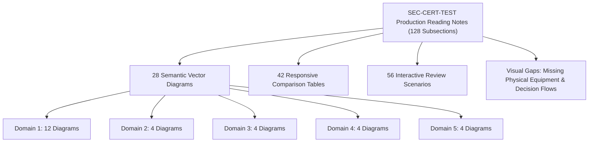
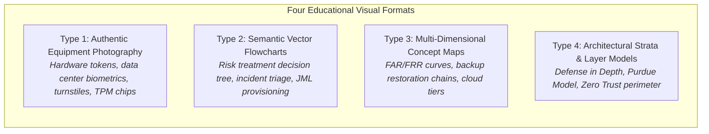
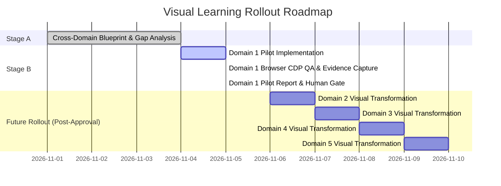

# ISC2 CC 2026 Reading Notes — Visual Learning Blueprint
## Cross-Domain Visual Pedagogical Architecture & Implementation Roadmap (Domains 1–5)

**Document Type:** Curriculum Design & Visual Pedagogy Architecture Specification  
**Scope:** Domains 1–5 | ISC2 Certified in Cybersecurity (CC) September 2026 Outline  
**Author:** Senior Cybersecurity Educator, ISC2 CC Academic Reviewer, Instructional Designer, Visual Learning Designer, UI/UX Engineer, and Frontend Developer  
**Status:** Stage A Complete — Scoping Baseline Established  
**Date:** November 2026  

---

## 1. Executive Summary & Educational Vision

The primary mission of the SEC-CERT-TEST Reading Notes is to guide students—ranging from complete cybersecurity novices to practicing IT professionals—toward mastery of the ISC2 Certified in Cybersecurity (CC) body of knowledge.

Historically, certification study materials lean heavily on dense paragraphs and textual bullet lists. While academically rigorous, purely textual exposition introduces severe cognitive friction for foundational cybersecurity concepts that are inherently **architectural, physical, sequential, or comparative**. A student attempting to understand the difference between *Something You Have* (FIDO2 Hardware Token) and *Something You Are* (Biometric Sensor) benefits substantially more from seeing authentic enterprise hardware than from reading another definition. Similarly, understanding the decision logic of *Risk Treatment (Avoid vs. Transfer vs. Mitigate vs. Accept)* is dramatically accelerated by a step-by-step visual decision flowchart.

### 1.1 The Visual Learning Philosophy
1. **Maximize Understanding, Not Image Count:** We do not decorate pages with generic stock photos or superficial icons. Every visual asset must serve a distinct, testable learning objective.
2. **Authentic Equipment & Real-World Grounding:** Abstract physical controls (mantraps, turnstiles, biometric scanners, hardware tokens, TPM chips) must be represented with authentic photography from accredited open-access archives (Wikimedia Commons, CC-BY, CC0, Public Domain).
3. **Dual-Presentation Semantic Architecture:** Complex flows must present responsive, vector-sharp SVGs on desktop/laptop displays ($\ge 880\text{px}$) and seamlessly transition to accessible, touch-friendly semantic HTML card stacks on mobile devices ($< 880\text{px}$).
4. **Bilingual Cognitive Synchrony:** Every visual must unify English exam-trigger keywords (*Disclosed, Altered, Downtime, Prudent Person*) with clear, natural Thai educational explanations.
5. **Universal Accessibility (WCAG AAA):** High contrast ratios ($\ge 7:1$ for core text, $\ge 4.5:1$ for secondary notes), full keyboard navigability, meaningful ARIA labels, descriptive alt text, and dark/light theme adaptability.

---

## 2. Comprehensive Inventory of Current Visual Assets (Domains 1–5)

The production Reading Notes platform currently features a solid foundational layout: 28 primary responsive diagrams, 42 comparison tables, 56 scenario cards, and structured section components across 128 granular subsections.

### 2.1 Domain-by-Domain Current Visual Inventory

| Domain | Exam Weight | Subsections | Primary Diagrams | Comparison Tables | Key Visual Learning Strengths | Visual Learning Deficits & Gaps |
| :--- | :---: | :---: | :---: | :---: | :--- | :--- |
| **Domain 1: Security Principles** | 26% | 24 | 12 (`threatChain`, `ciaTriad`, `loadBalancer`, `aaaLifecycle`, `privacyFlow`, `defenseInDepth`, `riskCalculationFlow`, `riskLifecycle`, `documentHierarchy`, `controlTimeline`, `dueCareDiligence`, `ethicsCanons`) | 8 | Strong conceptual diagrams (CIA, AAA, Timeline, Document Hierarchy). | **No real equipment photography** (MFA tokens, biometric readers, turnstiles). **Risk Treatment lacks a visual decision flowchart** (Inherent $\to$ 4 Responses $\to$ Residual). |
| **Domain 2: BC, DR & IR Concepts** | 10% | 29 | 4 (`grcAlignment`, `bcVsDrScope`, `rtoRpoTimeline`, `effectivenessHierarchy`) | 8 | Concentric BC/DR scope and RTO/RPO timeline provide excellent exam grounding. | **Backup restore chains** (Full + Incremental vs. Full + Differential) are text-only. **Disaster recovery site tiers** (Hot/Warm/Cold) lack architectural topologies. |
| **Domain 3: Access Control Concepts** | 22% | 17 | 4 (`iamLifecycle`, `nistSp80063Framework`, `leastPrivilegeVsSod`, `accessControlModels`) | 5 | Strong 4-quadrant Access Control model and JML lifecycle flow. | **Biometric error rate crossover curve (FAR/FRR/CER)** is absent. **Smart card / cryptographic chip architecture** lacks physical hardware representation. |
| **Domain 4: Network Security** | 24% | 24 | 4 (`osiVsTcpIpModel`, `dmzFirewallArchitecture`, `defenseInDepthLayers`, `cloudSharedResponsibility`) | 10 | Excellent OSI vs. TCP/IP mapping and DMZ packet flow architecture. | **Transmission media** (Twisted pair UTP/STP vs. Fiber optic single/multimode) lacks physical visuals. **Wi-Fi security evolution** (WEP, WPA, WPA2, WPA3) is text-heavy. |
| **Domain 5: Security Operations** | 18% | 35 | 4 (`irpLifecycle`, `mitreAttackTacticTechnique`, `securityTestingMatrix`, `assetLifecycleAndEol`) | 14 | MITRE ATT&CK matrix and IRP lifecycle provide clear operational workflows. | **SIEM log aggregation pipeline** (Firewall + Syslog + Endpoint $\to$ Collector $\to$ SIEM Correlation) lacks a holistic pipeline diagram. **Data sanitization hardware** (Degausser, Shredder) lacks equipment visuals. |

---

## 3. Pedagogical Typology of Visual Learning in Cybersecurity

To systematically transform learning notes from passive text to active visual mastery, we establish four primary pedagogical visual formats:

### Type 1: Authentic Equipment Photography & Physical Controls
- **Educational Function:** Eliminates abstraction by connecting theoretical terminology to tangible enterprise hardware.
- **Key Applications:** 
  - FIDO2 / WebAuthn cryptographic hardware keys (YubiKey 5 NFC).
  - Biometric IP fingerprint & facial recognition scanners at data center perimeters.
  - Optical drop-arm turnstiles and security mantraps (anti-tailgating/piggybacking).
  - Trusted Platform Module (TPM 2.0) chips integrated onto enterprise motherboards.
  - Media sanitization equipment (Magnetic degaussers and physical drive disintegrators).
- **Licensing & Sourcing Rules:** Strictly 100% open-access licenses (CC-BY, CC-BY-SA, CC0, Public Domain). Every asset carries an explicit attribution footer crediting the author, source archive, and license type.

### Type 2: Semantic Vector Flowcharts & Decision Trees
- **Educational Function:** Guides the student through sequential decision logic, answering the practical question: *"When presented with scenario X in an exam question, what is the exact logical progression to determine the correct answer?"*
- **Key Applications:**
  - Risk Treatment Decision Framework (Identify $\to$ Is Risk $>$ Appetite? $\to$ Avoid / Transfer / Mitigate / Accept $\to$ Re-evaluate Residual Risk).
  - Incident Response Escalation & Triage (Event vs. Incident $\to$ Severity Level $\to$ Containment Decision).
  - Access Control Evaluation Loop (Subject $\to$ Policy Engine $\to$ Object Access Decision $\to$ Audit Logging).
- **Technical Architecture:** Built with inline SVG on desktop ($\ge 880\text{px}$) and mirrored as an accessible HTML vertical card sequence on mobile ($< 880\text{px}$).

### Type 3: Multi-Dimensional Comparison Infographics & Concept Maps
- **Educational Function:** Contrasts commonly conflated pairs or spectra that cannot be fully distinguished in a flat 2-column table.
- **Key Applications:**
  - Biometric Performance Curve: False Acceptance Rate (FAR) vs. False Rejection Rate (FRR) and the Crossover Error Rate (CER) optimal sensitivity point.
  - Data Backup Strategy: Full + Incremental (fast backup, slow restore) vs. Full + Differential (slower backup, fast restore) timeline comparison.
  - Due Care (DO) vs. Due Diligence (CHECK) operational loop with exam verb triggers.

### Type 4: Architectural Strata & Layer Models
- **Educational Function:** Visualizes containment boundaries, hierarchical trust relationships, and shared responsibilities.
- **Key Applications:**
  - Cloud Computing Shared Responsibility Model (IaaS vs. PaaS vs. SaaS across 8 governance layers).
  - Defense-in-Depth Concentric Rings (Data $\subset$ Application $\subset$ Host $\subset$ Internal Network $\subset$ Perimeter $\subset$ Physical Facility $\subset$ Policies).
  - Purdue Enterprise Reference Architecture for Operational Technology (OT / ICS / SCADA).

---

## 4. Cross-Domain Visual Enhancement Roadmap (Domains 1–5)

### 4.1 Domain 1: Security Principles (Target of Active Pilot)
1. **Pilot Item 1 (Physical Hardware vs. Biometric Inherence — Section 1.1.4):**
   - High-resolution comparative figure: `YubiKey 5 NFC` (Something You Have / Cryptographic Token) side-by-side with an enterprise data center fingerprint IP scanner (`BioEntry Plus` / Macquarie Telecom Sydney).
   - Pedagogical impact: Instantly dissolves the exam trap confusing Multi-Credential (Password + PIN = both Know) with true Multi-Factor (Password + Hardware Token = Know + Have).
2. **Pilot Item 2 (Risk Treatment Decision Flowchart — Section 1.2.4):**
   - New semantic diagram `riskTreatmentDecisionFlow` mapping:
     - Inherent Risk $\to$ Threshold evaluation ($\text{Risk} > \text{Appetite}$) $\to$ The 4 Strategies (Avoid, Transfer, Mitigate, Accept) $\to$ Residual Risk re-evaluation $\to$ Continuous Monitoring.
   - Pedagogical impact: Directly anchors the formula $\text{Residual Risk} \le \text{Risk Appetite}$ as the mandatory gate for formal Risk Acceptance.
3. **Pilot Item 3 (Physical Perimeter Defense & Anti-Tailgating — Section 1.4.1):**
   - Authentic photograph of enterprise optical access control turnstiles (`Drop Arm Optical Turnstiles`).
   - Pedagogical impact: Demonstrates how physical controls act simultaneously as *Preventive* (blocking unauthorized passage and piggybacking) and *Detective* (triggering audible alarms and logging card swipes).

### 4.2 Domain 2: Business Continuity, Disaster Recovery & Incident Response
1. **Opportunity D2-01: Backup Restore Timeline Infographic (Section 2.3.2):**
   - Visual comparison of restore paths: Full + Incremental Day 1..4 (sequential replay) vs. Full + Differential Day 4 (two-step restore).
2. **Opportunity D2-02: Recovery Site Tiers Comparison (Section 2.3.3):**
   - Architectural topology showing Hot Site (real-time mirrored storage, immediate failover, highest cost), Warm Site (hardware ready, backup restore required, hours/days), and Cold Site (shell facility with power/HVAC, weeks, lowest cost).
3. **Opportunity D2-03: Incident Response Escalation Ladder (Section 2.4.1):**
   - Visual escalation path from Event (any observable occurrence) to Incident (negative security impact) to Disaster (business operation halt requiring BCP/DRP).

### 4.3 Domain 3: Access Control Concepts
1. **Opportunity D3-01: Biometric Performance Curve (FAR / FRR / CER — Section 3.1.3):**
   - Classic biometric sensitivity chart plotting Type I Error (FRR - False Rejection) against Type II Error (FAR - False Acceptance) and their intersection at the Crossover Error Rate (CER), demonstrating how lowering sensitivity increases throughput but decreases security.
2. **Opportunity D3-02: Physical Smart Card & Microchip Architecture (Section 3.1.2):**
   - Authentic photography of a DoD Common Access Card (CAC) / PIV smart card illustrating the embedded cryptographic microcontroller and gold contact pads.
3. **Opportunity D3-03: MAC vs. DAC vs. RBAC vs. ABAC Decision Matrix (Section 3.2.8):**
   - Visual flow contrasting owner-controlled ACLs (DAC) with mandatory security labels (MAC), role bundles (RBAC), and dynamic attribute contexts (ABAC).

### 4.4 Domain 4: Network Security
1. **Opportunity D4-01: Physical Network Media Comparison (Section 4.1.4):**
   - Authentic photography of unshielded twisted pair (Cat 6 UTP) copper cabling alongside fiber optic (Single-Mode / Multi-Mode LC connector) cabling, visually demonstrating why fiber is immune to electromagnetic interference (EMI) and eavesdropping.
2. **Opportunity D4-02: Wi-Fi Security Protocol Evolution (Section 4.1.5):**
   - Visual cryptographic progression: WEP (broken RC4/CRC32) $\to$ WPA (TKIP) $\to$ WPA2 (AES-CCMP) $\to$ WPA3 (Simultaneous Authentication of Equals / SAE & 192-bit CNSA).
3. **Opportunity D4-03: Purdue Model for Industrial Control Systems (Section 4.2.5):**
   - 6-level hierarchical diagram (Level 0 Field Sensors $\to$ Level 1 Controllers $\to$ Level 2 Supervisory HMI $\to$ Level 3 Site Operations $\to$ Industrial DMZ $\to$ Level 4 Enterprise Network).

### 4.5 Domain 5: Security Operations
1. **Opportunity D5-01: SIEM Multi-Source Telemetry Pipeline (Section 5.2.2):**
   - End-to-end data pipeline: Event Sources (Firewalls, Windows Event Logs, Syslog, Endpoint EDR) $\to$ Aggregators/Collectors $\to$ Normalization $\to$ SIEM Correlation Rules $\to$ SOC Analyst Alert Dashboard.
2. **Opportunity D5-02: Hardware Disposal & Media Sanitization Equipment (Section 5.4.3):**
   - Authentic equipment photos of a commercial magnetic degausser and physical hard drive shredder/disintegrator, reinforcing NIST SP 800-88 Clear vs. Purge vs. Destroy classifications.
3. **Opportunity D5-03: Purple Team Collaborative Loop (Section 5.3.3):**
   - Circular workflow diagram showing Red Team offensive simulation $\leftrightarrow$ Blue Team defensive detection tuning, highlighting continuous posture improvement.

---

## 5. Technical Architecture & Engineering Standards

### 5.1 HTML Whitelist & Markdown Parser Integration
To support semantic figures without breaking existing DOM integrity or risking XSS injection, `js/core/markdown-parser.js` was enhanced to whitelist safe media container tags:
- `figure`: Top-level semantic figure element.
- `figcaption`: Accessible caption and attribution block.
- `img`: Responsive image with mandatory `alt`, `width`, `height`, and `loading="lazy"` attributes.
- `picture`: Future-ready responsive source switching.

### 5.2 Responsive CSS Design System (`css/reading.css`)
Visual components follow a strict design token hierarchy:
- Container queries and responsive grid layouts (`.reading-figure-grid`, `.reading-figure`).
- Controlled max-heights and aspect ratios preventing content layout shift (CLS).
- Theme-aware background surfaces and borders:
  - Dark Mode: Surface `rgba(15, 23, 42, 0.65)`, Border `rgba(255, 255, 255, 0.12)`, Caption background `rgba(30, 41, 59, 0.5)`.
  - Light Mode: Surface `#ffffff`, Border `#e2e8f0`, Caption background `#f8fafc`.
- Dedicated pill badges indicating security factor categories (`badge-have`, `badge-are`, `badge-physical`).
- Standardized attribution footers linking directly to source archives.

### 5.3 Open-Access Asset Provenance Standard
Every graphic incorporated into the platform must satisfy the following provenance protocol:
1. **Licensing Verification:** Asset must be verified under CC0 (Public Domain Dedication), CC-BY (Attribution), CC-BY-SA (Attribution-ShareAlike), or Public Domain. No proprietary, unverified, or ambiguous imagery is permitted.
2. **Local Storage:** Images are downloaded, optimized for web delivery ($\le 250\text{KB}$ per asset), and stored in `assets/images/reading/`.
3. **Transparent Attribution:** Caption footers clearly declare: *Source Archive, License Type, Original Creator, and Educational Rationale*.

---

## 6. Preservation Boundaries & Quality Safeguards

In strict accordance with project rules:
1. **Untracked & Uncommitted Work Preservation:** The 3 pending consistency findings (`ACC-D4-02`, `ACC-D4-03`, `ENR-D3-04`), existing reading notes progress persistence, and uncommitted working tree files are 100% preserved.
2. **Protected Systems:**
   - Question Banks (583 legacy / 157 next-bank): 0 modifications.
   - Exam Vocabulary (438 terms): 0 modifications.
   - Learning Slides (316 slides): 0 modifications.
   - Quiz Engine & Exam Runtime: 0 modifications.
3. **Execution Gate:** Only Domain 1 is modified during this pilot pass. Domains 2–5 remain completely untouched until explicit human review and authorization are granted.

---

*End of Blueprint — Approved for Domain 1 Pilot Execution.*

