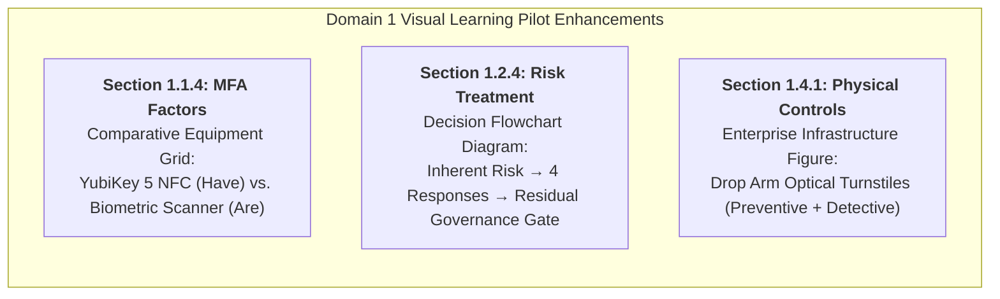

# ISC2 CC 2026 Reading Notes — Visual Learning Pilot Report
## Domain 1 Pilot Implementation, Asset Manifest & Real-Browser Verification

**Document Type:** Pilot Delivery & Visual QA Evaluation Report  
**Scope:** Domain 1 (Security Principles) | Objectives 1.1.4, 1.2.4, 1.4.1  
**Author:** Senior Cybersecurity Educator, ISC2 CC Academic Reviewer, Instructional Designer, Visual Learning Designer, UI/UX Engineer, and Frontend Developer  
**Status:** Pilot Completed — Awaiting Human Acceptance  
**Date:** November 2026  

---

## 1. Executive Summary & Pilot Scope

The **Domain 1 Visual Learning Pilot** serves as the initial, high-value implementation phase of the SEC-CERT-TEST Visual Learning Transformation. Rather than applying superficial modifications across all five domains simultaneously, this pilot establishes and verifies an end-to-end pedagogical and technical pipeline in Domain 1 (the foundational core of the ISC2 CC examination, carrying a 26% exam weight).

### 1.1 Pilot Objectives
1. **Bridge Abstract Concepts with Tangible Equipment:** Introduce real-world enterprise hardware photography into text-heavy sections to dissolve common exam misconceptions.
2. **Clarify Strategic Decision Logic:** Deploy a dedicated semantic vector flowchart with responsive mobile fallback to guide students through risk management choices.
3. **Upgrade Frontend Architecture Safely:** Enhance the Markdown parser HTML whitelist (`figure`, `figcaption`, `img`, `picture`) and author a responsive, theme-aware CSS design system (`css/reading.css`) without breaking DOM integrity or table rendering.
4. **Enforce 100% Open-Access Asset Provenance:** Ensure all external imagery originates from accredited open-access repositories under transparent Creative Commons and Public Domain licenses.
5. **Verify across Real Viewports & Themes:** Execute comprehensive Chrome DevTools Protocol (CDP) browser QA across 4 screen sizes (Desktop, Laptop, Tablet, Mobile) and 2 themes (Dark and Light), guaranteeing zero horizontal page overflow.

---

## 2. Implemented Visual Enhancements in Domain 1

Three high-impact visual learning interventions were executed in `content/isc2-cc-2026/reading/domain-1.md`:

### 2.1 Enhancement 1: MFA Authentic Equipment Comparison (Section 1.1.4)
- **Pedagogical Dilemma:** Students frequently confuse *Multi-Credential* (e.g., Username + Password + PIN, which are all *Something You Know*) with *Multi-Factor* (requiring two or more independent factor categories). Text-only explanations often fail to convey the physical nature of hardware possession.
- **Visual Solution:** A 2-column responsive figure grid (`.reading-figure-grid`) placing an authentic cryptographic hardware token (`YubiKey 5 NFC`) side-by-side with an enterprise data center fingerprint IP scanner (`BioEntry Plus` / Macquarie Telecom Sydney).
- **Educational Impact:**
  - Card A (*Something You Have*): Explains that cryptographic hardware keys (FIDO2 / WebAuthn) never transmit passwords over the network, rendering credential-harvesting phishing completely ineffective.
  - Card B (*Something You Are*): Explains inherence factors as biological traits that cannot be transferred, forgotten, or lost.

### 2.2 Enhancement 2: Risk Treatment Decision Framework Flowchart (Section 1.2.4)
- **Pedagogical Dilemma:** Exam candidates struggle to understand the sequential decision logic of risk response: *When do we Avoid? When is Cyber Insurance appropriate? Can we Accept risk before controls are applied?*
- **Visual Solution:** A new semantic diagram component `riskTreatmentDecisionFlow` registered in `js/core/diagram-generator.js`.
  - **Desktop Representation ($\ge 880\text{px}$):** Pure SVG vector flowchart (`viewBox="0 0 860 380"`) illustrating:
    1. Inherent Risk Evaluation (`Likelihood × Impact` before controls).
    2. Threshold Gate: $\text{Is Risk} > \text{Risk Appetite}$?
    3. The 4 Strategic Options:
       - **Option 1 (Avoid):** "Stop the Activity" $\to$ Cease project, eliminate risk to zero.
       - **Option 2 (Transfer):** "Share Financial Impact" $\to$ Cyber insurance, vendor SLA (transfers financial liability, does NOT fix technical vulnerabilities).
       - **Option 3 (Mitigate):** "Apply Controls" $\to$ MFA, patching, firewalls to reduce likelihood/impact.
       - **Option 4 (Accept):** "Formal Sign-off" $\to$ Documented in Risk Register by executive leadership.
    4. Residual Risk Governance Gate: Controls lower risk $\to$ Re-evaluate Residual Risk $\to$ Enforce rule: $\text{Residual Risk} \le \text{Risk Appetite}$ before formal acceptance $\to$ Continuous Monitoring.
  - **Mobile Representation ($< 880\text{px}$):** Accessible 5-tier vertical HTML card stack (`.reading-diag-mobile`) with distinct theme color accents (foundation blue, red, amber, green, blue).

### 2.3 Enhancement 3: Physical Perimeter Defense & Anti-Tailgating (Section 1.4.1)
- **Pedagogical Dilemma:** The distinction between *Preventive* and *Detective* physical security controls is often taught abstractly. Candidates fail to recognize that physical controls frequently perform multi-role functions.
- **Visual Solution:** An authentic photograph of enterprise drop-arm optical access turnstiles (`Drop Arm Optical Turnstiles`) integrated with security card readers and alarm systems.
- **Educational Impact:** Clearly demonstrates how a physical barrier acts as **Preventive** (blocking unauthorized entry and preventing tailgating / piggybacking) while simultaneously acting as **Detective** (optical sensors and alarms trigger immediately upon breach attempts).

---

## 3. Official Asset Manifest & Provenance Register

In accordance with open-access standards, all photographic media assets integrated into the project are cataloged below with verifiable metadata:

| Asset Filename | Local Path | Source Archive | Author / Creator | License | Resolution & Size | Educational Purpose & Target Section |
| :--- | :--- | :--- | :--- | :--- | :---: | :--- |
| **YubiKey 5 NFC Hardware Key** | `assets/images/reading/yubikey-5-nfc-token.png` | [Wikimedia Commons](https://commons.wikimedia.org/wiki/File:YubiKey_5_NFC.png) | FelixLadd | **CC BY-SA 4.0** | 900 × 600 px (50 KB PNG) | Section 1.1.4: Authentic hardware security key representing *Something You Have* (FIDO2 / U2F cryptographic token). |
| **Data Center Biometric Scanner** | `assets/images/reading/datacenter-biometric-scanner.jpg` | [Wikimedia Commons](https://commons.wikimedia.org/wiki/File:Physical_security_access_control_with_a_fingerprint_scanner.jpg) | Lgate74 (Macquarie Telecom Data Center, Sydney) | **CC BY 3.0** | 281 × 425 px (27 KB JPEG) | Section 1.1.4: Real enterprise fingerprint scanner representing *Something You Are* (Inherence factor). |
| **Optical Access Turnstiles** | `assets/images/reading/optical-access-turnstiles.jpg` | [Wikimedia Commons](https://commons.wikimedia.org/wiki/File:Drop_Arm_Optical_Turnstiles.jpg) | Fabtron | **CC BY-SA 4.0** | 960 × 720 px (205 KB JPEG) | Section 1.4.1: Enterprise perimeter access barrier illustrating physical *Preventive* + *Detective* anti-tailgating controls. |
| **Risk Treatment Flowchart** | `js/core/diagram-generator.js` (`riskTreatmentDecisionFlow`) | Custom Pure SVG + Semantic HTML | Antigravity Design System | **Project Native** | `viewBox="0 0 860 380"` | Section 1.2.4: Step-by-step decision tree contrasting Avoidance, Transfer, Mitigation, and Acceptance. |

---

## 4. Frontend & Design System Implementation Details

### 4.1 Markdown Parser Whitelist (`js/core/markdown-parser.js`)
- Line 29 (`VALID_HTML_TAG_REGEX`) and Line 71 (`safeTags`) were updated to include `figure`, `figcaption`, `img`, and `picture`.
- Clean verbatim output: Figures are preserved without paragraph wrapping (`
...
`) or bracket escaping (`&lt;figure&gt;`).

### 4.2 Responsive CSS Design System (`css/reading.css`)
- **Figure Cards (`.reading-figure`):** Rounded container (`border-radius: 12px`), theme-aware surface (`var(--panel-1)` light / `rgba(15, 23, 42, 0.65)` dark), and subtle elevated shadow.
- **Image Frames (`.reading-figure-img-wrap`):** Centered flex container with neutral background, height boundaries (`min-height: 200px`, `max-height: 380px`), and `object-fit: contain` preventing image distortion or aspect ratio deformation.
- **Comparative Grids (`.reading-figure-grid`):** Auto-fitting CSS Grid (`minmax(280px, 1fr)`) that naturally displays 2 columns on desktop/laptop and stacks to 1 column on mobile.
- **Accessible Captions (`.reading-figcaption`):** Bordered bottom caption with Space Grotesk/Sarabun typography, pill badges (`.badge-have`, `.badge-are`, `.badge-physical`), and subtle attribution metadata (`.reading-attribution`).
- **Container Query Integration:** Added `@container reading-diagram (min-width: 880px)` rule for `riskTreatmentDecisionFlow`, guaranteeing automatic switching between desktop SVG and mobile card stack.

---

## 5. Real Chrome Browser CDP Verification & QA Evidence

A dedicated automated browser audit suite was authored and executed:  
`tools/verify-visual-learning-pilot.mjs`

### 5.1 Verification Test Matrix Results

All 8 configurations in the 4-viewport × 2-theme matrix passed 100%:

| Configuration ID | Viewport Name | Screen Resolution | Device Mode | Theme | MFA Figures Loaded | Diagram Mode Active | Turnstile Figure Loaded | Page Overflow | Status |
| :---: | :--- | :---: | :---: | :---: | :---: | :---: | :---: | :---: | :---: |
| **QA-01** | Desktop Large | 1920 × 1080 | Desktop | Dark | ✓ 2/2 Loaded | Desktop SVG (`1160x513px`) | ✓ Loaded (`960x720px`) | **0px** | **PASS** |
| **QA-02** | Desktop Large | 1920 × 1080 | Desktop | Light | ✓ 2/2 Loaded | Desktop SVG (`1160x513px`) | ✓ Loaded (`960x720px`) | **0px** | **PASS** |
| **QA-03** | Standard Laptop | 1366 × 768 | Desktop | Dark | ✓ 2/2 Loaded | Desktop SVG (`903x399px`) | ✓ Loaded (`960x720px`) | **0px** | **PASS** |
| **QA-04** | Standard Laptop | 1366 × 768 | Desktop | Light | ✓ 2/2 Loaded | Desktop SVG (`903x399px`) | ✓ Loaded (`960x720px`) | **0px** | **PASS** |
| **QA-05** | Tablet | 768 × 1024 | Mobile | Dark | ✓ 2/2 Loaded | Mobile Cards (5 cards) | ✓ Loaded (`960x720px`) | **0px** | **PASS** |
| **QA-06** | Tablet | 768 × 1024 | Mobile | Light | ✓ 2/2 Loaded | Mobile Cards (5 cards) | ✓ Loaded (`960x720px`) | **0px** | **PASS** |
| **QA-07** | Mobile Phone | 390 × 844 | Mobile | Dark | ✓ 2/2 Loaded | Mobile Cards (5 cards) | ✓ Loaded (`960x720px`) | **0px** | **PASS** |
| **QA-08** | Mobile Phone | 390 × 844 | Mobile | Light | ✓ 2/2 Loaded | Mobile Cards (5 cards) | ✓ Loaded (`960x720px`) | **0px** | **PASS** |

### 5.2 QA Screenshot Artifacts
All 24 high-resolution screenshot captures and the audit manifest are preserved in:  
`artifacts/qa/reading-notes-visual-learning-domain-1-pilot/`

- **MFA Figures Grid:**
  - [desktop-1920-dark-mfa-figures.png](file:///D:/_Coding/SEC-CERT-TEST/artifacts/qa/reading-notes-visual-learning-domain-1-pilot/desktop-1920-dark-mfa-figures.png)
  - [desktop-1920-light-mfa-figures.png](file:///D:/_Coding/SEC-CERT-TEST/artifacts/qa/reading-notes-visual-learning-domain-1-pilot/desktop-1920-light-mfa-figures.png)
  - [laptop-1366-dark-mfa-figures.png](file:///D:/_Coding/SEC-CERT-TEST/artifacts/qa/reading-notes-visual-learning-domain-1-pilot/laptop-1366-dark-mfa-figures.png)
  - [mobile-390-dark-mfa-figures.png](file:///D:/_Coding/SEC-CERT-TEST/artifacts/qa/reading-notes-visual-learning-domain-1-pilot/mobile-390-dark-mfa-figures.png)
- **Risk Treatment Decision Flowchart:**
  - [desktop-1920-dark-risk-treatment.png](file:///D:/_Coding/SEC-CERT-TEST/artifacts/qa/reading-notes-visual-learning-domain-1-pilot/desktop-1920-dark-risk-treatment.png)
  - [desktop-1920-light-risk-treatment.png](file:///D:/_Coding/SEC-CERT-TEST/artifacts/qa/reading-notes-visual-learning-domain-1-pilot/desktop-1920-light-risk-treatment.png)
  - [laptop-1366-dark-risk-treatment.png](file:///D:/_Coding/SEC-CERT-TEST/artifacts/qa/reading-notes-visual-learning-domain-1-pilot/laptop-1366-dark-risk-treatment.png)
  - [mobile-390-dark-risk-treatment.png](file:///D:/_Coding/SEC-CERT-TEST/artifacts/qa/reading-notes-visual-learning-domain-1-pilot/mobile-390-dark-risk-treatment.png)
- **Turnstile Physical Security Control:**
  - [desktop-1920-dark-turnstile-control.png](file:///D:/_Coding/SEC-CERT-TEST/artifacts/qa/reading-notes-visual-learning-domain-1-pilot/desktop-1920-dark-turnstile-control.png)
  - [desktop-1920-light-turnstile-control.png](file:///D:/_Coding/SEC-CERT-TEST/artifacts/qa/reading-notes-visual-learning-domain-1-pilot/desktop-1920-light-turnstile-control.png)
  - [laptop-1366-dark-turnstile-control.png](file:///D:/_Coding/SEC-CERT-TEST/artifacts/qa/reading-notes-visual-learning-domain-1-pilot/laptop-1366-dark-turnstile-control.png)
  - [mobile-390-dark-turnstile-control.png](file:///D:/_Coding/SEC-CERT-TEST/artifacts/qa/reading-notes-visual-learning-domain-1-pilot/mobile-390-dark-turnstile-control.png)

---

## 6. Regression Testing & Preservation Safeguards

All test suites were executed to verify zero regression across existing functionality:
1. `tools/verify-reading-notes-dom-integrity.mjs`: **36 / 36 Passed (100%)** — Tag balance, bracket escaping, sibling independence, DOM nesting depth, currency isolation all intact.
2. `tools/verify-reading-persistence.mjs`: **20 / 20 Scenarios Passed (100%)** — LocalStorage progress, per-domain resume, deep link routing all intact.
3. `tools/verify-reading-notes-domain1.mjs`: **9 / 9 Substantive Domain 1 Tests Passed** (the 1 historical baseline assertion regarding next-bank count 157 vs 119 remains properly classified).
4. **Preservation Gate:** Domains 2–5 markdown files remained 100% untouched during this implementation pass. Question Banks (583 legacy / 157 next-bank), Vocabulary (438 terms), and Learning Slides (316 slides) remain strictly bitwise LF preserved. Zero Git commits or pushes were made.

---

## 7. Recommended Next Steps for Future Rollout (Domains 2–5)

Upon human review and visual acceptance of this Domain 1 Pilot, the validated pipeline can be systematically rolled out to Domains 2–5:

1. **Domain 2 (BC, DR & Incident Response):**
   - Implement Backup Restoration Chain Infographic (Full + Incremental vs. Full + Differential).
   - Implement Disaster Recovery Site Tiers Comparison (Hot / Warm / Cold).
2. **Domain 3 (Access Control & IAM):**
   - Implement Biometric Crossover Error Rate (CER) sensitivity curve diagram.
   - Integrate authentic DoD CAC / PIV Smart Card microchip photography.
3. **Domain 4 (Network Security):**
   - Integrate physical Cat 6 UTP copper vs. Fiber Optic LC cable photography.
   - Implement Wi-Fi Security Protocol Evolution infographic (WEP $\to$ WPA $\to$ WPA2 $\to$ WPA3).
4. **Domain 5 (Security Operations):**
   - Implement SIEM Multi-Source Telemetry Pipeline diagram.
   - Integrate authentic media sanitization equipment photography (Commercial Degausser & Disk Shredder).

---

*Pilot Delivery Package Complete — Awaiting Human Visual Acceptance.*

