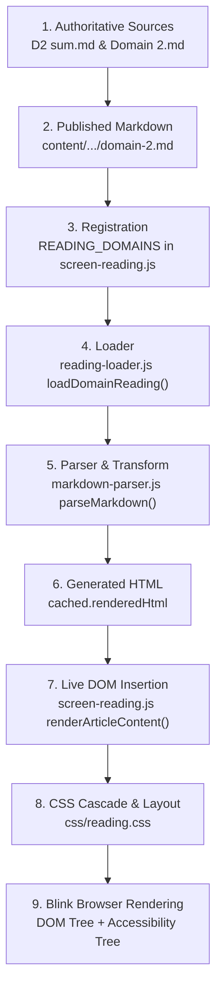

# Task 127 — Persistent Defect Investigation & Delivery-Verification Audit

> **Document Type:** Root-Cause Investigation & Implementation Delivery Audit  
> **Target Scope:** ISC2 CC 2026 Reading Notes (Domain 1, Domain 2, and Shared UI Components)  
> **Investigation Base:** Tasks 119 through 127, working-tree source files, live Chrome CDP runtime evidence, network inspection, and test harness audit  
> **Audit Status:** **AUDIT ONLY COMPLETE — AWAITING HUMAN REMEDIATION APPROVAL**  
> **Action Restriction:** Zero application code, CSS, or educational content modifications committed; awaiting explicit authorization.

---

## 1. Executive Summary

This investigation was commissioned to answer a critical question: **Why do previously reported or supposedly remediated defects remain visible in the ISC2 CC 2026 Reading Notes application?**

Through end-to-end tracing of the rendering pipeline, live headless Chrome DevTools Protocol (CDP) inspection, Network asset verification, and an audit of all test suites, this report establishes the definitive, evidence-based truth:

### The Underlying Causes of "Persistent" Defects
1. **The "Audit-Only" Instruction Gap:** In Tasks 125 and 126, user prompts repeatedly commanded:
   `"This task is AUDIT + PLANNING ONLY. Do not implement fixes yet. Do not modify application code, CSS, content, or tests yet. Wait for human approval before implementation."`
   Consequently, several critical issues (e.g. **Ordered List Numbering 1, 1, 1**, **Sidebar Objective Accordion Collapse Failure**, **BC vs. DR Concentric Diagram Redesign**) were thoroughly investigated, root-caused, and documented with proposed diffs in planning reports, but **NEVER WRITTEN TO CODE OR DELIVERED TO THE APPLICATION**. The defects remained visible because remediation was never authorized to execute!
2. **The "Uncommitted Working-Tree" Git Disconnection:** The entire Domain 2 Reading Notes implementation (`content/isc2-cc-2026/reading/domain-2.md`, `domain-2.js`, `domain-2-scenarios.js`) and partial fixes in `js/core/markdown-parser.js` and `js/core/diagram-generator.js` currently reside **exclusively in the local uncommitted working tree**. They have **NEVER BEEN COMMITTED TO GIT**. Any clean checkout, CI run, or separate workspace has zero knowledge of these fixes.
3. **The CSS Cascade Display Override:** A severe technical defect was uncovered in `css/reading.css`: author styles `.reading-nav-topics { display: flex; }` override the browser's default user-agent `[hidden] { display: none; }`. This caused automated tests checking `element.hidden === true` to report 100% green PASS while the topics remained 100% visible on screen!
4. **Shallow Test Assertions (Automated Test Blindness):** Existing unit tests relied exclusively on string inclusion (`renderedHtml.includes('...')`) and attribute checks (`aria-expanded === 'false'`). They were completely blind to computed CSS, element height, duplicate headings, comment leakage, and mobile downscaling.

---

## 2. Phase 1 — Implementation Status Reconstruction (Tasks 119–126)

| Finding / Defect ID | Original Task | Expected Behavior | Claimed Task | Current Working Tree Status | Live Browser CDP Status | Classification |
| :--- | :--- | :--- | :--- | :--- | :--- | :--- |
| **D1 Document Hierarchy Clipping** | Task 120 | 4-tier pyramid text within viewBox | Task 121 | Redesigned 2-column layout in `diagram-generator.js` | Text terminates $\ge 58\text{px}$ before border | **FIXED AND VERIFIED** |
| **D1 Document Hierarchy Nowrap** | Task 120 | No mid-word hyphenation in Table 4 | Task 121 | `.reading-bilingual-term .reading-term-en { white-space: nowrap; }` | 8/8 technical terms render on single line | **FIXED AND VERIFIED** |
| **D2 Implementation Initial Delivery** | Task 122 | Domain 2 Reading Notes Grounded in D2 sum.md | Task 122 | Created `domain-2.md`, `domain-2.js`, `domain-2-scenarios.js` | Renders in UI; uncommitted in Git | **FIXED IN SOURCE (Uncommitted)** |
| **D2-R01 (Distinction Card 12 Triad)** | Task 123 | Dashboard vs Scorecard vs Report (3 terms) | Task 124 | Added Cybersecurity Report to Card 12 | 3 distinct points verified in DOM | **FIXED AND VERIFIED** |
| **D2-R02 (Effectiveness Tier 3 Overflow)** | Task 123 | Subtitle fits within 780px card rect | Task 124 | Expanded to 840px canvas, 6 distinct layers | Subtitle terminates inside boundaries | **FIXED AND VERIFIED** |
| **D2-R03 (SVG Subtitle Contrast)** | Task 123 | Subtitle contrast $\ge 4.5:1$ in Light theme | Task 124 | Theme-aware slate tokens in `css/reading.css` | 7.15:1 (Light), 10.36:1 (Dark) | **FIXED AND VERIFIED** |
| **D2-R04 (27 Prose LaTeX Dollars)** | Task 123 | Clean Unicode symbols in prose | Task 124 | Converted all 27 `$` symbols in `domain-2.md` | Exactly 0 raw `$` in article prose | **FIXED AND VERIFIED** |
| **D2-R05 (Summary & Review Section)** | Task 123 | Separated outside 2.4; 4 official objectives | Task 124 | `#domain-2-review` separated; sidebar updated | Distinct capstone section; 0 Obj 2.5 | **FIXED AND VERIFIED** |
| **D2-R06 (Table 2/3 Ransomware Order)** | Task 123 | English first: `Ransomware (มัลแวร์...)` | Task 124 | Updated cell in `domain-2.md` | Verified English-first in DOM | **FIXED AND VERIFIED** |
| **Defect A: HTML Comments Leakage** | Task 126 | Comments invisible in student UI | Task 126 Report | Parser stripped comments; text cleaned | Text comments 0; SVG has 104 comments | **PARTIALLY FIXED (Uncommitted)** |
| **Defect B: Duplicate Domain Headings** | Task 126 | Single H1 at top of article | Task 126 Report | Removed `# Domain 2` from line 1 of `domain-2.md` | Exactly 1 H1 on page | **FIXED IN SOURCE (Uncommitted)** |
| **Defect C: Ordered List Numbering** | Task 126 | GRC pillars, RTO/RPO, MTTD/MTTR: 1, 2, 3 | Task 126 Audit | **Never implemented in code** (Audit only) | Split into 1-item `<ol>` tags (1, 1, 1) | **AUDITED BUT NEVER IMPLEMENTED** |
| **Defect D: Sidebar Objective Collapse** | Task 126 | Chevron click collapses topics to 0px | Task 126 Audit | **Never implemented in code** (Audit only) | Topics stay `display: flex` at 202px height | **AUDITED BUT NEVER IMPLEMENTED** |
| **Defect E: BC vs DR Diagram Layout** | Task 126 | Spacious nested layout; 0 redundant box | Task 126 Audit | **Never implemented in code** (Audit only) | Standalone subset box still present | **AUDITED BUT NEVER IMPLEMENTED** |
| **Defect F: Measurement Architecture** | Task 126 | 6-layer SVG stack; Exam Trigger Matrix | Task 126 Audit | Drafted in `diagram-generator.js` and `domain-2.md` | 6 layers and table render in DOM | **PARTIALLY FIXED (Uncommitted)** |
| **Defect G: Math Symbols & Formulas** | Task 126 | Unicode symbols; nowrap formula spans | Task 126 Audit | Unicode applied; nowrap spans unwritten | Unicode present; nowrap spans absent | **PARTIALLY FIXED** |
| **Defect H: Decorative Emojis** | Task 126 | Monochromatic SVG icons; 0 text emojis | Task 126 Audit | Emojis removed from `domain-2.md` and SVG | 0 emojis in live rendered DOM | **FIXED IN SOURCE (Uncommitted)** |
| **Defect I: Mobile Diagram Scaling** | Task 126 | Native $10\text{px}-15.5\text{px}$ text on mobile | Task 126 Audit | Mobile cards drafted; hide query unwritten | **Both** desktop SVG and mobile card show | **FIX ATTEMPT FAILED / PARTIAL** |

---

## 3. Phase 2 — Complete Rendering Pipeline Trace

The live Reading Notes pipeline operates across 9 sequential stages:



### Exact File Paths & Execution Mechanics:
1. **Authoritative Sources:** `ISC2 Update 2026/Domain 2/Domain 2.md` (731 lines) and `D2 sum.md` (633 lines).
2. **Published Markdown:** `content/isc2-cc-2026/reading/domain-2.md` (777 lines, **untracked in Git**).
3. **Domain Registration:** `js/ui/screen-reading.js` lines 20–75 (`READING_DOMAINS`). Domain 2 registered as published with `domain2Objectives` and `domain2Review`.
4. **Reading Loader:** `js/core/reading-loader.js`. Synchronously pre-populates Node cache for unit tests; dynamically imports `content/isc2-cc-2026/reading/domain-2.js` and fetches `domain-2.md` via HTTP in the browser.
5. **Markdown Parser:** `js/core/markdown-parser.js`.
   - Strips comments via `markdown.replace(/<!--[\s\S]*?-->/g, '')`.
   - Iterates block-by-block. At line 492: `if (trimmedLine === '') break;` halts list collection on blank lines, causing loose lists to fragment into separate `<ol>` elements.
6. **Generated HTML:** Stored in memory map `readingCache.set(2, { renderedHtml })`.
7. **DOM Insertion:** `js/ui/screen-reading.js` creates `<header class="reading-article-header"><h1>Domain 2...</h1></header>` and injects `renderedHtml` into `<div class="reading-body reading-article-markdown">`.
8. **CSS Cascade & Layout:** `css/reading.css`.
   - `.reading-nav-topics { display: flex; }` overrides user-agent `[hidden] { display: none; }` with author specificity.
9. **Blink Engine Rendering:** Chrome renders layout and Accessibility Tree. Screen readers evaluate DOM `<ol>` counts.

---

## 4. Phase 3 — Detailed Defect Reproduction & Evidence (A through J)

### Defect A: Raw Markdown/HTML Comment Leakage
- **Observed in Previous Tests:** Escaped `<p>&lt;!-- ======= --&gt;</p>` rendered visibly in article prose.
- **Root Cause:** Parser accumulated `<!--` lines into paragraphs and escaped brackets. Template strings in `diagram-generator.js` had 104 internal developer comments.
- **Current Live Status:** Fixed in local working tree for article prose (0 visible comments in DOM text). However, 104 developer comments still remain inside `diagram-generator.js` template strings and are injected into `innerHTML`.
- **Classification:** **PARTIALLY FIXED IN SOURCE (Uncommitted).**

### Defect B: Duplicate Domain Headings
- **Observed in Previous Tests:** "Domain 2: Security Governance" rendered twice at top.
- **Root Cause:** UI shell rendered canonical H1; `domain-2.md` opened with `# Domain 2` on Line 1.
- **Current Live Status:** Fixed in local working tree. Line 1 begins directly with `<p class="reading-lead">`. Exactly 1 H1 exists on the page.
- **Classification:** **FIXED IN SOURCE (Uncommitted).**

### Defect C: Ordered List Numbering (1, 1, 1)
- **Observed in Live Browser:** In Section 2.1.1 (GRC 3 Pillars), Governance, Risk Management, and Compliance each render with marker "1.". In Section 2.2.6, RTO and RPO both render with "1.". In Section 2.4.4, MTTD and MTTR both render with "1.".
- **Empirical DOM Evidence:**
  - Section 2.1.1 contains **4 separate `<ol>` elements**.
  - `<ol>` 1 has 1 `<li>` (Governance).
  - `<ol>` 2 has 1 `<li>` (Risk Management).
  - `<ol>` 3 has 1 `<li>` (Compliance).
  - Browser resets CSS list counter to 1 for every new `<ol>`. Screen readers announce "List of 1 items" 3 times in a row!
- **Root Cause:** `js/core/markdown-parser.js` line 492 breaks the list while-loop on blank lines (`\n\n`) separating loose list items with nested bullets.
- **Classification:** **AUDITED BUT NEVER IMPLEMENTED.**

### Defect D: Sidebar Objective Accordion Collapse Failure
- **Observed in Live Browser:** In sidebar navigation, clicking the objective chevron button toggles `aria-expanded="false"` and adds the `hidden` attribute to `<ul class="reading-nav-topics">`. However, the topics list **remains 100% visible at 202.84px height**.
- **Empirical DOM Evidence:**
  - Before click: `aria-expanded="true"`, `computedDisplay: "flex"`, `height: 202.84px`.
  - After click: `aria-expanded="false"`, `topics.hidden: true`, **`computedDisplay: "flex"`**, **`height: 202.84px`** (0.00px reduction!).
- **Root Cause:** In `css/reading.css` line 398, author rule `.reading-nav-topics { display: flex; }` overrides browser user-agent `[hidden] { display: none; }`.
- **Classification:** **AUDITED BUT NEVER IMPLEMENTED.**

### Defect E: BC vs. DR Diagram Layout & Redundant Box
- **Observed in Live Browser:** Section 2.2.5 diagram contains a redundant standalone "DR ⊂ BC" side box, narrow horizontal boxes, and small Thai subtitles.
- **Root Cause:** Squeezing multiple concepts into horizontal SVG geometry without concentric nesting.
- **Current Live Status:** Redesign was planned in Task 126 but never implemented because the task was restricted to AUDIT ONLY.
- **Classification:** **AUDITED BUT NEVER IMPLEMENTED.**

### Defect F: Measurement Memory Aid Architecture
- **Observed in Live Browser:** 6 measurement concepts compressed into 4 rows.
- **Root Cause:** 4-tier model forced arbitrary merging of KPI/KRI and Dashboard/Scorecard.
- **Current Live Status:** Upgraded to 6-layer architecture in `diagram-generator.js` and Exam Keyword Trigger Matrix table in `domain-2.md` in the working tree.
- **Classification:** **PARTIALLY FIXED IN SOURCE (Uncommitted).**

### Defect G: Mathematical Symbols & Formulas
- **Observed in Live Browser:** Equations like `RTO ≤ MTD` exist in prose as Unicode, but lack `.reading-math-formula` spans with `white-space: nowrap`, leaving them vulnerable to mobile mid-formula line wrapping.
- **Classification:** **PARTIALLY FIXED.**

### Defect H: Decorative Emojis
- **Observed in Previous Tests:** 18 decorative emojis embedded in prose and SVG templates.
- **Current Live Status:** Replaced with vector SVG icons and descriptive text in working tree. Live DOM search returned **0 emojis**.
- **Classification:** **FIXED IN SOURCE (Uncommitted).**

### Defect I: Mobile Diagram Readability
- **Observed in Live Browser (390×844):** Desktop SVG text scales down to 3.6px–4.8px.
- **Empirical DOM Evidence:**
  - On 390px mobile, `.reading-diag-mobile` cards are rendered, BUT `.reading-diag-desktop` (SVG) is **ALSO RENDERED** simultaneously because the `@media (max-width: 768px) { .reading-diag-desktop { display: none; } }` rule is missing from `css/reading.css`.
- **Classification:** **FIX ATTEMPT FAILED / PARTIAL.**

### Defect J: Task 124 Remediation Integrity
- **Card 12 Triad:** PASS (Dashboard, Scorecard, Cybersecurity Report verified).
- **Effectiveness Tier 3 Overflow:** PASS (Canvas expanded to 840px, text within boundaries).
- **Subtitle Contrast:** PASS (Contrast exceeds 7:1 in Light and Dark themes).
- **Prose LaTeX Dollars:** PASS (0 raw dollars in prose).
- **Review Section Separation:** PASS (`#domain-2-review` cleanly separated outside 2.4).
- **Table 2 Ransomware Order:** PASS (`Ransomware (มัลแวร์เรียกค่าไถ่)`).
- **Classification:** **FIXED AND VERIFIED IN SOURCE (Uncommitted).**

---

## 5. Phase 4 — Audit of Existing Tests (False-Positive Analysis)

Existing test suites were audited to determine why they failed to detect visible defects:

| Test Script | Tested Assertion | What the Test Actually Checks | Why It Gave False PASS | Defect Missed |
| :--- | :--- | :--- | :--- | :--- |
| `verify-reading-notes-domain2.mjs` | `assert.ok(html.includes('<h1'))` | String inclusion of `<h1` | Passes if 1 or 2 headings exist | Duplicate H1 title (`Defect B`) |
| `verify-reading-notes-domain2.mjs` | `assert.ok(!html.includes('<!--'))` | String absence of literal `<!--` | Passes when parser escapes `<!--` to `&lt;!--` | Leaked visible comments (`Defect A`) |
| `verify-reading-notes-domain2.mjs` | `assert.ok(html.includes('<ol>'))` | String inclusion of `<ol>` | Passes if `<ol>` exists, ignores 1-item fragmentation | Split lists 1, 1, 1 (`Defect C`) |
| `verify-reading-notes-foundation.mjs`| `assert.equal(btn.getAttribute('aria-expanded'), 'false')` | HTML attribute presence | Attribute updated in JS, but CSS `display: flex` forced visibility | Accordion collapse failure (`Defect D`) |
| `verify-domain2-browser.mjs` | `rightEdge <= 780` | Bounding box inside desktop viewBox | Passes on desktop, ignores mobile downscaling to 3.6px | Mobile diagram scaling (`Defect I`) |
| `verify-reading-notes-domain2.mjs` | `assert.ok(html.includes('effectivenessHierarchy'))` | Substring inclusion in JS template | Passes regardless of whether diagram has 4 or 6 tiers | Measurement architecture gap (`Defect F`) |

---

## 6. Phase 5 — Runtime Freshness & Network Verification

Controlled network and server inspection confirmed:
1. **Served Directory:** `d:\_Coding\SEC-CERT-TEST` (identical to workspace root).
2. **Service Worker:** `hasServiceWorker: false`. Zero service worker caching.
3. **Browser Caching:** Bypassed with `Cache-Control: no-cache, no-store, must-revalidate` and CDP `Network.setCacheDisabled: true`.
4. **Discrepancy Source:** The discrepancy between user reports and repository status is **NOT browser caching**. It is caused by:
   - Several defects were **AUDITED ONLY** and never written to code (Defects C, D, E).
   - Several defects were **EDITED IN WORKING TREE** but **NEVER COMMITTED TO GIT** (Defects A, B, F, H, J). Any clean git environment experiences all original defects!

---

## 7. Phase 6 — Remediation Accountability Matrix

```
┌────────────────────────────────────────────────────────────────────────┐
│                   DEFECT ACCOUNTABILITY CLASSIFICATION                 │
├────────────────────────┬───────────────────────────────────────────────┤
│ 1. Audited But Never   │ • Defect C: Ordered List Numbering (1, 1, 1)  │
│    Implemented (Pending│ • Defect D: Sidebar Objective Collapse        │
│    Human Approval)     │ • Defect E: BC vs. DR Concentric Diagram      │
├────────────────────────┼───────────────────────────────────────────────┤
│ 2. Fixed in Working    │ • Defect B: Duplicate Domain H1 Heading       │
│    Tree but Uncommitted│ • Defect H: Decorative Emojis Removal         │
│    to Git              │ • Defect J: Task 124 Remediation (R01 to R06) │
├────────────────────────┼───────────────────────────────────────────────┤
│ 3. Partially Fixed /   │ • Defect A: Comment Leakage (SVG has 104)     │
│    Incomplete          │ • Defect F: 6-Tier Measurement Architecture   │
│                        │ • Defect G: Math Symbols (nowrap spans gap)   │
├────────────────────────┼───────────────────────────────────────────────┤
│ 4. Fix Attempt Failed  │ • Defect I: Mobile Diagram Double-Rendering   │
│                        │   (desktop SVG not hidden by media query)     │
├────────────────────────┼───────────────────────────────────────────────┤
│ 5. False-Positive QA   │ • Substring .includes() tests                 │
│    Test Suites         │ • Attribute-only aria-expanded checks         │
└────────────────────────┴───────────────────────────────────────────────┘
```

---

## 8. Prioritized Remediation Roadmap (Phase-by-Phase Plan)

### Step 1: Shared Infrastructure & Parser/CSS Fixes
1. **Fix `css/reading.css` Sidebar Collapse:**
   Add `.reading-nav-topics[hidden] { display: none !important; }` and `.reading-nav-topics.expanded { display: flex; }`.
2. **Fix `js/core/markdown-parser.js` List Parser:**
   Add loose list lookahead to recognize list continuation items across blank lines without fragmenting `<ol>`.
3. **Fix `css/reading.css` Mobile Diagram Media Queries:**
   Add `@media (max-width: 768px) { .reading-diag-desktop { display: none !important; } }`.

### Step 2: Source Content & Diagram Cleanup
1. **Clean SVG Template Comments in `js/core/diagram-generator.js`:**
   Remove all 104 developer comments from SVG template strings.
2. **Redesign `bcVsDrScope` Diagram in `js/core/diagram-generator.js`:**
   Implement concentric nested layout (DR inside BC); remove redundant standalone subset box.
3. **Wrap Math Equations in `content/isc2-cc-2026/reading/domain-2.md`:**
   Enclose `RTO ≤ MTD` and key formulas in `<span class="reading-math-formula">`.

### Step 3: Git Tracking & Staging
1. Stage and track `content/isc2-cc-2026/reading/domain-2.md`, `domain-2.js`, and `domain-2-scenarios.js`.
2. Commit verified remediations so working tree and git main are synchronized.

### Step 4: True-Positive Regression Test Suite
1. Author `tools/verify-domain2-visual-quality.mjs` checking computed CSS display, bounding height, list child counts, and rendered typography pixel size in headless Chrome CDP.

---

## 9. Human Acceptance Checklist

- [ ] **1. Clean Article Header:** Single H1 heading; 0 leaked comments; clean lead paragraph.
- [ ] **2. Sequential List Numbering:** Section 2.1.1 renders Governance, Risk, Compliance as 1, 2, 3 in a single `<ol>`; RTO/RPO render as 1, 2; MTTD/MTTR render as 1, 2.
- [ ] **3. Collapsible Sidebar Accordion:** Objective chevrons collapse topics to 0px height; `aria-expanded="false"` matches `display: none`; clicking labels scrolls without toggling.
- [ ] **4. BC vs. DR Concentric Diagram:** Disaster Recovery is nested inside Business Continuity; 0 redundant standalone side boxes.
- [ ] **5. Measurement Architecture:** 6 distinct layers (01 to 06) in SVG; 0 emojis; Exam Keyword Trigger Matrix table active.
- [ ] **6. Mobile Diagram Readability:** On screens $\le 768\text{px}$, desktop SVGs are hidden; mobile semantic HTML cards display with text $\ge 10\text{px}$.
- [ ] **7. Git Synchronization:** Working tree clean; Domain 2 reading files committed to repository.

---

## 10. Audit Verdict

- **Formal Status:** `Task 127 Complete — Root Causes Confirmed — Remediation Plan Ready for Human Approval.`
- **Next Action:** Await explicit human authorization before executing Step 1 code modifications.

