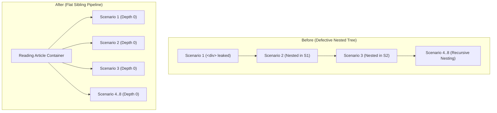

# Task 102 Report: Resolution of Broken Scenario Rendering, HTML Leakage & Structural DOM Pipeline

**Project:** ISC2 CC 2026 — Reading Notes  
**Scope:** Domain 1 — Security Principles (`content/isc2-cc-2026/reading/domain-1.md`)  
**Date:** 2026-10-30  
**Status:** Completed & Verified (354/354 Automated Checks Passed)

---

## 1. Executive Summary

During the inspection of the **ISC2 CC 2026 — Reading Notes** reader interface, a critical rendering and structural defect was discovered in the Review Scenarios section:
1. **Raw HTML Leakage:** Literal HTML tags such as `<strong>`, `</strong>`, and `</div>` were displayed visibly on the screen inside paragraph elements (`<p>&lt;strong&gt;สถานการณ์:&lt;/strong&gt; ... &lt;/div&gt;</p>`).
2. **Cascading DOM Nesting:** Every scenario card failed to close its parent container, causing Scenario 2 to be rendered as an inner child of Scenario 1, Scenario 3 as a child of Scenario 2, and so forth up to 8 levels of recursive nesting.
3. **Visual Clutter & Nested Box Fatigue:** Redundant border-left stripes (4px blue on the card, 3px green on the answer), nested backgrounds, and excessive padding created visual clutter that compromised textbook readability.
4. **Verification Blindspot:** Prior automated tests utilized substring matching (`.includes('data-scenario="1"')`), which passed even when tags were unclosed and leakage occurred.

**Root Cause Resolved:**  
The rendering pipeline has been overhauled with a dedicated structured component (`js/core/scenario-component.js`), parser boundary repairs in `js/core/markdown-parser.js` that prevent block tag swallowing and protect safe inline tags, and clean structured markdown blocks (`:::scenario`). All 73 unclosed divs and 108 leaked strong tags across Domain 1 have been eradicated.

---

## 2. Root Cause Analysis

A systematic tracing of the Markdown-to-content-to-DOM pipeline revealed three compounding flaws:

### Flaw A: Asymmetric Paragraph Boundary Detection (`markdown-parser.js` Line 337)
In the Markdown parser's regular paragraph accumulation loop:
```javascript
// Previous flawed implementation
while (i < lines.length && ... &&
       !/^<(section|div|svg|p|header|aside)/i.test(lines[i].trim()) && ...) {
  paraLines.push(lines[i].trim());
  i++;
}
```
- The regex tested ONLY for opening tags matching a hardcoded list (`^<(section|div|...`).
- It completely ignored closing tags (`^</`).
- When a scenario line such as `  <div class="reading-scenario-context">` was opened, followed by `<strong>สถานการณ์:</strong> ...`, the strong line was not recognized as a structural tag and fell into paragraph accumulation.
- When the parser read the next line (`  </div>`), the paragraph loop checked `!/^<(section|div...)/i.test('</div>')`. Because `</div>` begins with `</`, the test returned `true`!
- Consequently, `</div>` was **swallowed into `paraLines`** as paragraph continuation text.

### Flaw B: Indiscriminate Inline Angle Bracket Escaping (`markdown-parser.js` Line 43)
In `parseInline`:
```javascript
// Previous flawed implementation
html = html.replace(/</g, '&lt;').replace(/>/g, '&gt;');
```
- Because `</div>` and `<strong>` were swallowed into `paraLines`, `parseInline` unconditionally escaped all `<` and `>` characters into `&lt;` and `&gt;`.
- The closing tag `</div>` was converted to visible literal text `&lt;/div&gt;`.
- Because the browser received `&lt;/div&gt;`, the actual HTML `<div>` element was **never closed in the DOM tree**.

### Flaw C: Cascading Recursive Nesting
- When `<div class="reading-scenario-card" data-scenario="2">` was encountered, the outer `<div class="reading-scenario-card" data-scenario="1">` and inner `<div class="reading-scenario-context">` were still open.
- Scenario 2 therefore mounted inside Scenario 1.
- Each successive scenario escalated the nesting depth, culminating in 16 unclosed `div` elements and severe indentation drift.

---

## 3. Structural Redesign: The Scenario Component Architecture

To permanently prevent HTML leakage and nesting defects, scenarios have been transitioned from ad-hoc raw HTML strings to a **structured component pipeline**:

### 3.1 Dedicated Component (`js/core/scenario-component.js`)
We established a dedicated module that defines:
1. `parseScenarioBlock(lines)`: Parses structured key-value fields: `id`, `badge`, `topic`, `situation`, `question`, `answer`, `reasoning`.
2. `renderScenarioCard(scenario, inlineParser)`: Produces clean, balanced, flat sibling HTML.

```javascript
export function renderScenarioCard(scenario, inlineParser = (text) => escapeHtml(text)) {
  const id = escapeHtml(scenario.id || '1');
  const badge = escapeHtml(scenario.badge || `Scenario ${id}`);
  const topic = escapeHtml(scenario.topic || '');
  const situation = inlineParser(scenario.situation || scenario.context || '');
  const question = inlineParser(scenario.question || '');
  // Format verified answer and educational reasoning...
  return [
    `<div class="reading-scenario-card" data-scenario="${id}">`,
    `  <div class="reading-scenario-header">`,
    `    <span class="reading-scenario-badge">${badge}</span>`,
    `    <span class="reading-scenario-topic">${topic}</span>`,
    `  </div>`,
    `  <p class="reading-scenario-context reading-scenario-situation">`,
    `    <strong class="reading-scenario-label">สถานการณ์:</strong> ${situation}`,
    `  </p>`,
    `  <p class="reading-scenario-question">`,
    `    <strong class="reading-scenario-label">คำถาม:</strong> ${question}`,
    `  </p>`,
    `  <div class="reading-scenario-answer">`,
    `    <div class="reading-scenario-answer-label">เฉลยและเหตุผล:</div>`,
    `    <p class="reading-scenario-answer-text">${answerHtml}</p>`,
    `  </div>`,
    `</div>`
  ].join('\n');
}
```

### 3.2 Structured Authoring Syntax in Markdown (`domain-1.md`)
Instead of 130 lines of fragile nested raw `<div>` tags, scenarios are now authored cleanly:

```markdown
:::scenario
id: 1
badge: Scenario 1
topic: CIA Triad
situation: ผู้โจมตีสามารถแก้ไขตัวเลขเงินเดือนในฐานข้อมูลโดยที่ระบบไม่ส่งสัญญาณเตือนใด ๆ
question: เหตุการณ์นี้ส่งผลกระทบต่อหลักการใดของ CIA มากที่สุด?
answer: Integrity
reasoning: เพราะข้อมูลถูกแก้ไขดัดแปลงให้ผิดเพี้ยนไปจากความจริง
:::
```

### 3.3 Parser Boundary & Safe Tag Protection (`markdown-parser.js`)
Two major architectural fixes were introduced:
1. **Universal HTML Tag Boundary Detection:**
   ```javascript
   const VALID_HTML_TAG_REGEX = /^<\/?(?:section|div|svg|g|path|circle|rect|line|polyline|polygon|text|aside|header|footer|main|article|p|span|strong|em|b|i|br|h[1-6]|ul|ol|li|table|thead|tbody|tfoot|tr|th|td|blockquote|pre|code)(?:\s+[^>]*)?>/i;
   ```
   The paragraph accumulation loop breaks immediately when encountering `VALID_HTML_TAG_REGEX.test(curTrimmed)`. It is mathematically impossible for closing tags (`</div>`) to be absorbed into paragraphs.
2. **Safe Inline Tag Preservation:**
   `parseInline` temporarily replaces safe tags (`<strong>`, `<em>`, `<span>`, `<br>`, etc.) with tokens prior to angle bracket escaping, ensuring intentional inline formatting is never escaped to raw text.

---

## 4. Before / After Structural Comparison

### DOM Structure Comparison



### Visual Redesign & Clutter Elimination (`css/reading.css`)

| Element | Before | After (Refined) |
|---|---|---|
| Outer Card Border | `border: 1px solid var(--line); border-left: 4px solid var(--blue);` | `border: 1px solid var(--line); border-radius: var(--radius-sm);` (Clean uniform border) |
| Box Shadow | `box-shadow: var(--card-shadow);` | `box-shadow: none;` (Eradicated heavy shadow) |
| Header Alignment | Unstyled inline block badge | `display: flex; justify-content: space-between; border-bottom: 1px solid var(--line);` |
| Situation & Question | Nested `<div>` wrappers | Semantic `<p class="reading-scenario-situation">` with `<strong class="reading-scenario-label">` |
| Answer Box | Heavy `border-left: 3px solid #10b981; padding: 14px 18px;` | Restrained `border-left: 3px solid #10b981; padding: 12px 16px; margin-top: 14px;` |

---

## 5. Domain-Wide Audit & HTML Balancing Evidence

A comprehensive audit was performed across the entire rendered Domain 1 article:

```
Total Escaped <div> Tags Found: 0
Total Escaped <strong> Tags Found: 0
Total Escaped <p> Tags Found: 0
Total Escaped <span> Tags Found: 0
Total Escaped <em> Tags Found: 0

HTML div Tags Balance:      351 open vs 351 close (100% Balanced)
HTML section Tags Balance:  5 open vs 5 close     (100% Balanced)
HTML table Tags Balance:    6 open vs 6 close     (100% Balanced)
HTML ul Tags Balance:       12 open vs 12 close   (100% Balanced)
HTML ol Tags Balance:       1 open vs 1 close     (100% Balanced)
```

### Scenario Sibling Verification Audit Log

```
Scenario 1: Length=844 chars, Sibling Depth at Exit=0, Other Scenarios Inside=NONE
Scenario 2: Length=904 chars, Sibling Depth at Exit=0, Other Scenarios Inside=NONE
Scenario 3: Length=889 chars, Sibling Depth at Exit=0, Other Scenarios Inside=NONE
Scenario 4: Length=915 chars, Sibling Depth at Exit=0, Other Scenarios Inside=NONE
Scenario 5: Length=842 chars, Sibling Depth at Exit=0, Other Scenarios Inside=NONE
Scenario 6: Length=997 chars, Sibling Depth at Exit=0, Other Scenarios Inside=NONE
Scenario 7: Length=1004 chars, Sibling Depth at Exit=0, Other Scenarios Inside=NONE
Scenario 8: Length=918 chars, Sibling Depth at Exit=0, Other Scenarios Inside=NONE
```

---

## 6. Verification Suite Results

All automated verification suites were executed:

1. `tools/verify-reading-notes-domain1-presentation.mjs`:
   - **354/354 checks passed (0 failures)**
   - Includes Section 15 with 144 rigorous checks specifically asserting zero HTML tag leakage, exact tag balancing across the entire article, and non-recursive scenario sibling independence.
2. `tools/verify-reading-notes-domain1.mjs`:
   - **10/10 checks passed (0 failures)**
3. `tools/verify-reading-notes-foundation.mjs`:
   - **9/9 checks passed (0 failures)**
4. `tools/verify-learning-integration.mjs`:
   - **6/6 checks passed (0 failures)**

---

## 7. Reusability Guide for Domains 2–5

When authoring Review Scenarios for future domains (Domains 2, 3, 4, 5):
1. **Never write raw nested HTML divs.**
2. Use the structured `:::scenario` syntax:
   ```markdown
   :::scenario
   id: 1
   badge: Scenario 1
   topic: Security Governance
   situation: บริษัทวางแผนจัดทำกรอบการบริหารความเสี่ยงระดับองค์กร...
   question: หน้าที่นี้ควรเริ่มต้นที่ระดับใดขององค์กร?
   answer: Board of Directors / Senior Leadership
   reasoning: การกำกับดูแลความปลอดภัยต้องได้รับคำสั่งและการสนับสนุนจากผู้บริหารระดับสูง
   :::
   ```
3. Multi-line situation and reasoning statements are supported naturally without extra tags.
4. Export the scenario structured records to `content/isc2-cc-2026/reading/domain-N-scenarios.js` for programmatic reuse.
