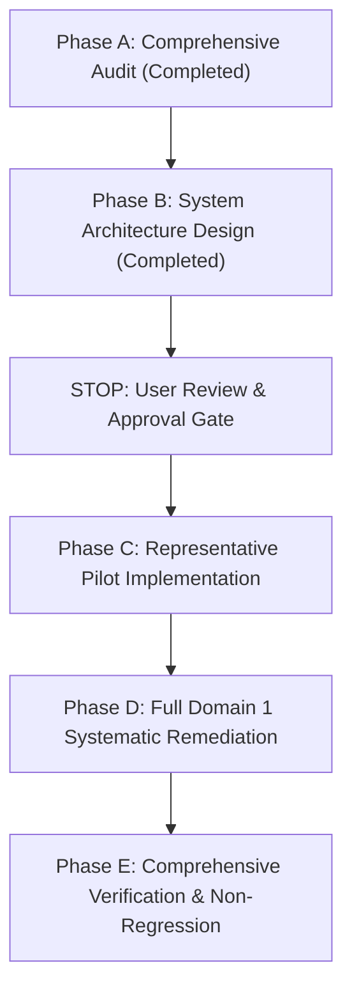

# Task 96 — ISC2 CC 2026 Reading Notes: Comprehensive Editorial, Semantic & Visual System Overhaul
## Pre-Implementation Audit, Systemic Root Cause Analysis & Architectural Proposal

**Date:** 2026-10-29  
**Repository:** `D:\_Coding\SEC-CERT-TEST`  
**Feature:** ISC2 Certified in Cybersecurity (CC) 2026 — Reading Notes  
**Domain:** Domain 1: Security Principles (Weight: 24%)  
**Status:** Audit & Architecture Proposal — Awaiting User Approval  

---

## 1. Executive Summary

The Reading Notes feature in `SEC-CERT-TEST` is envisioned as a **digital technical textbook** for ISC2 CC 2026, offering sustained reading comfort, rigorous academic accuracy, and semantic instructional design.

While Tasks 92–95 successfully built the UI shell, consolidated the raw study notes from `D1 sum.md` and `Domain 1.md`, and added initial SVG diagrams and math rendering, an extensive systemic audit reveals fundamental editorial, structural, typographical, and conceptual flaws:
1. **Semantic List Flattening:** Headings, definitions, explanations, and examples are flattened into sequential numbered lists (`<ol><li>...</li></ol>`). Concepts like the 4 Security Control Categories, the 7 Security Control Functions, and the 4 MFA Factor Groups are rendered as if they were multi-step procedural recipes.
2. **Pedagogically Misleading Diagrams:** 
   - Security Control Functions (`controlTimeline`) are illustrated with linear timeline arrows (`Deterrent ──> Preventive ──> Detective ──> Corrective`), implying an invariable chronological sequence where controls operate in only one fixed phase, contradicting the fundamental cybersecurity principle of overlapping, multi-role controls.
   - The ISC2 Code of Ethics (`ethicsCanons`) contains downward arrows (`↓`), implying a step-by-step procedural workflow rather than an **order of precedence** for ethical conflict resolution.
3. **Typography Inconsistencies & Over-Emphasis:**
   - Over 300 bold spans exist across Domain 1, frequently with redundant bolding (`- **สิ่งที่ต้องป้องกัน:** **Unauthorized Modification**`), leading to visual exhaustion.
   - Equal visual weight is given to English technical terms and Thai explanations, obscuring primary concepts.
4. **Cramped, Overflowing Comparison Tables:**
   - Multi-column tables (such as the 4-column Risk Treatment table and the 12-row Concept Distinctions Matrix) cram dense narrative paragraphs into narrow cells, causing mid-word breaks (`Re-` / `duce`) and requiring awkward horizontal scrolling on 1366×768 displays.
5. **Mathematical & Formula Nuances:**
   - Equations need explicit pedagogical separation between annual frequency ($ARO$, occurrences/year) and probability (0 to 1), with clean variable breakdowns and worked financial examples.

This document delivers **Phase A (Comprehensive Audit)** and **Phase B (Architectural System Design)**, establishes the **Representative Pilot Scope**, and explains all key technical trade-offs. 

**Per instructions, large-scale implementation is paused pending user approval.**

---

## 2. Comprehensive Editorial & Semantic Audit of Domain 1

### 2.1 Recurring Defect Matrix Across Objectives

| Objective | Affected Section | Current Defect | Educational Impact | Required Textbook Transformation |
|---|---|---|---|---|
| **1.1** | 1.1.4 Multi-Factor Authentication (MFA) | Factors rendered as an ordered list `1. Something You Know`, `2. Something You Have`, `3. Something You Are`, `4. Somewhere You Are` with nested bullets. | Implies a sequential hierarchy or mandatory 4-step checklist rather than independent authentication categories. | 4 distinct semantic factor cards with professional SVG icons (Key, Token, Fingerprint, Location Pin), plus a prominent exam contrast box for Multi-Factor vs Multi-Credential. |
| **1.1** | 1.1.6 Privacy & Data Roles | Controller vs Processor illustrated with a simple ASCII stack. | Fails to clearly convey the legal boundary (Controller determines purpose & means; Processor acts only on instructions). | Clear legal relationship diagram with explicit GDPR/PDPA data flow boundaries and rights breakdown. |
| **1.2** | 1.2.2 Quantitative Risk Analysis | Basic formula cards present, but $ARO$ frequency vs probability nuance is buried in bullet points. | Students confuse $ARO = 0.2$ (once every 5 years) with a 20% statistical probability, leading to exam calculation errors. | Dedicated Quantitative Formula Component with explicit mathematical definitions, units (occurrences/year vs $), and worked decision rules. |
| **1.2** | 1.2.4 Risk Treatment: The 4 Responses | Dense 4-column table (`กลยุทธ์`, `คำจำกัดความ`, `คำอธิบาย`, `คีย์เวิร์ด`). | Cells contain long paragraphs; on 1366×768 screens, text is squashed, forcing horizontal scroll and awkward wrapping. | 4 structured editorial response sections (Avoidance, Mitigation, Transfer, Acceptance) with mnemonic badges, real-world examples, and keyword tags. |
| **1.4** | 1.4.1 Security Control Categories | 4 categories rendered as an ordered list `1. Technical`, `2. Managerial`, `3. Operational`, `4. Physical` with sub-bullets. | Completely misrepresents categories as a 4-step sequence. | 4 distinct conceptual blocks, each with category name, Thai-English explanation, concrete examples, and clean SVG category icons. |
| **1.4** | 1.4.2 Security Control Functions | 7 functions rendered as an ordered list `1. Deterrent` to `7. Recovery`, preceded by a linear timeline arrow diagram. | **Academically misleading:** Controls do NOT operate strictly in a linear timeline. Detective controls run continuously; CCTV is both Deterrent and Detective. | Replaced with a Non-Linear Control Function Matrix showing roles across time without false workflow arrows; separate Corrective from Recovery. |
| **1.4** | 1.4.3 Contextual & Overlapping Controls | Buried in bullet points. | Does not adequately teach the 3-step question analysis method for ISC2 exam questions. | Structured Decision Guide: Step 1 (Category vs Function), Step 2 (Timing Context), Step 3 (Primary Intent). |
| **1.5** | 1.5.2 Due Care vs. Due Diligence | Reduced primarily to a "Scan $\to$ Patch $\to$ Verify" operational loop. | Over-simplifies Due Care (prudent person legal standard, DO) and Due Diligence (reasonable investigation, CHECK) to IT vulnerability scanning. | Broad conceptual definition first, followed by the IT operational cycle as an illustrative real-world case study. |
| **1.5** | 1.5.3 ISC2 Code of Ethics | Canons 1–4 diagrammed with downward arrows (`↓`). | **Academically misleading:** Implies Canon 1 is done first, then Canon 2, etc. In reality, they are **prioritized principles** (order of precedence in case of conflict). | Precedence Tier Stack (Precedence 1: Society $\gg$ Precedence 2: Honor $\gg$ Precedence 3: Principals $\gg$ Precedence 4: Profession) without workflow arrows. |
| **1.5** | 1.5.4 Concept Distinctions Matrix | 12 contrasting pairs crammed into a 2-column table with full sentences in cell 2. | Dense walls of text; hard to read and compare side-by-side. | Paired Concept Distinction Cards with explicit contrast points and exam trap alerts. |

---

### 2.2 Typographic & Visual Audit

1. **Emphasis Exhaustion:**
   - Over 300 `**bold**` tags in `domain-1.md`.
   - Examples of redundant bolding:
     - `**สิ่งที่ต้องป้องกัน:** **Unauthorized Modification / Tampering**` (double bold)
     - `**ความหมาย:** ความเสียหายทางการเงินที่คาดว่าจะเกิดขึ้นจาก **การเกิดเหตุการณ์ครั้งเดียว (Single Incident)**`
     - When everything is emphasized, nothing stands out.
2. **Dense Bilingual Text:**
   - Long paragraphs mix Thai and English with identical font weight and size, creating visual fatigue during sustained reading sessions.
3. **Table Formatting Defects:**
   - The Markdown table wrapper uses `overflow-x: auto`, but narrow column widths cause words like "Reduce" and "Shift" to break across lines or collide with adjacent borders.
4. **Emoji Absence / Icon Needs:**
   - Currently, zero emojis are present (which aligns with rules), but abstract concepts lack consistent visual anchor icons (e.g., distinguishing Physical from Technical controls, or Biometrics from Hardware tokens).

---

### 2.3 Source Material Coverage & Deduplication Traceability

We compared `ISC2 Update 2026/Domain 1/D1 sum.md` (1,733 lines) against `Domain 1.md` (406 lines):

| Content Domain Topic | Unique in `D1 sum.md` | Unique in `Domain 1.md` | Consolidation & Traceability Strategy |
|---|---|---|---|
| **Privacy & Data Governance** | Data Ownership, Data Inventory, Data Retention, Right to Be Forgotten details. | High-level GDPR summary. | Preserve all 4 specific data management concepts from `D1 sum.md`; structure under Objective 1.1.6. |
| **Standards & Frameworks** | ISO/IEC 27001 (ISMS continuous improvement), CIS Controls (prioritized safeguards). | NIST CSF 5/6 functions. | Synthesize into Objective 1.3.3: NIST CSF + ISO 27001 + CIS Controls without duplication. |
| **High Availability Hardware** | Load Balancer, Dual Power Supply (UPS), Redundant ISP. | General Availability definition. | Integrate hardware redundancy specifics into 1.1.2 under Availability controls. |
| **Risk Terminology** | Detailed Quantitative calculation steps (AV, EF, SLE, ARO, ALE). | Qualitative Risk Appetite vs Tolerance, Inherent vs Residual. | Unify in Objective 1.2: Quantitative formulas + Qualitative boundaries. |
| **Security Control Types** | Directive controls mentioned specifically. | 6 standard control functions. | Include Directive and Compensating as distinct functions alongside Deterrent, Preventive, Detective, Corrective, Recovery. |
| **ISC2 Canons** | Mnemonic "S-A-P-P" and exact Canon text. | Canons explanation. | Retain exact English ISC2 Canon wording + Thai explanatory context + strict order of precedence. |
| **Practice Scenarios** | Short summary bullets. | 8 complete Scenario-Question-Answer items + 12-pair Concept Distinctions Matrix. | Preserve all 8 scenarios in structured cards; convert the 12 distinction pairs into readable comparison cards. |

---

## 3. Systemic Root Causes

Why did previous iterations generate these defects?

1. **Parser-Centric Rather Than Educational Design:**
   The parser treats Markdown as a stream of line-based tokens. When source Markdown contains `1. **Topic**\n - detail`, the parser blindly outputs `<ol><li><strong>Topic</strong><ul><li>detail</li></ul></li></ol>`. It has no semantic knowledge of whether the numbered list represents an actual sequence or simply a numbered catalog of concepts.
2. **"Box Everything in a Card" Dashboard Fallacy:**
   Earlier attempts to polish the UI wrapped every paragraph or item in bordered container cards. This created a cluttered dashboard look. The true solution is **editorial structure through typography, vertical rhythm, and semantic grouping**, not arbitrary card wrappers.
3. **Diagram Semantics Misalignment:**
   When converting ASCII diagrams, the instinct was to replace text arrows with SVG arrows. But in cybersecurity pedagogy, arrows denote **flows and sequences**. Using arrows for *Categories* or *Ethics Canons* misleads students into thinking ethical rules or security controls are linear procedures.
4. **Table-as-Default Fallacy:**
   Markdown authors use tables because Markdown lacks flexible layout mechanisms. When converting to HTML, treating every Markdown table as a literal `<table>` forces complex narrative explanations into rigid, narrow columns that break on standard desktop and mobile screens.

---

## 4. The Smallest Maintainable Architecture

To ensure Domain 1 is authored as a professional textbook and to establish a robust foundation for Domains 2–5, we propose a lightweight, zero-dependency semantic architecture.

```
                           READING NOTES ARCHITECTURE
 ┌────────────────────────────────────────────────────────────────────────┐
 │                           domain-1.md                                  │
 │         (Semantic Markdown with Educational Custom Elements)            │
 └───────────────────────────────────┬────────────────────────────────────┘
                                     │
                                     ▼
 ┌────────────────────────────────────────────────────────────────────────┐
 │                      js/core/markdown-parser.js                        │
 │  - Lookbehind math parser (supports $...$ and $$...$$ with currency)   │
 │  - Semantic HTML passthrough for textbook component structures         │
 │  - XSS sanitization for script/iframe injection                        │
 └───────────┬───────────────────────┬────────────────────────┬───────────┘
             │                       │                        │
             ▼                       ▼                        ▼
 ┌──────────────────────┐ ┌──────────────────────┐ ┌──────────────────────┐
 │js/core/math-renderer │ │js/core/diagram-gen   │ │   css/reading.css    │
 │- KaTeX browser engine│ │- 12 semantic SVGs    │ │- Typography scale    │
 │- Semantic fallback   │ │- Accurate models     │ │- Editorial rhythms   │
 │- Variable semantics  │ │- Theme-adaptive CSS  │ │- Responsive grids    │
 └──────────────────────┘ └──────────────────────┘ └──────────────────────┘
```

### 4.1 Reusable Semantic Component Taxonomy

Instead of one-off HTML, we define **7 standardized semantic textbook components**:

#### Component 1: `concept-grid` & `concept-item`
Used for multi-concept categories without sequential order (e.g. 4 Control Categories, 4 MFA Factor Groups).
- **Structure:** A responsive CSS grid (`display: grid; grid-template-columns: repeat(auto-fit, minmax(280px, 1fr)); gap: 1rem;`).
- **Elements:** Category Header with inline SVG icon, Thai-English definition, bulleted realistic examples, and limitations.
- **Benefit:** Eradicates the false 1..4 sequential list.

#### Component 2: `editorial-card`
Used for concepts with substantial narrative depth (e.g. Risk Treatment: Avoid, Mitigate, Transfer, Accept).
- **Structure:** Left accent border, clear title, concise mnemonic tag, full explanation, concrete scenario, and exam keywords.
- **Benefit:** Replaces cramped 4-column tables with highly readable, natural-reading editorial sections.

#### Component 3: `distinction-pair`
Used for comparing easily confused terms (e.g. Due Care vs Due Diligence, Hashing vs Encryption, Inherent vs Residual Risk).
- **Structure:** 2-column comparative card with clear contrast headers (e.g., `Due Care: DO / Take Action` vs `Due Diligence: CHECK / Investigate`), followed by parallel concrete examples and trigger verbs.
- **Benefit:** Replaces squished 12-row tables with clean, focused comparative study blocks.

#### Component 4: `scenario-card`
Used for exam practice scenarios.
- **Structure:** Header badge (`Scenario 1 • CIA Triad`), scenario statement, highlighted question box, verified answer and rationale block. Open by default.
- **Benefit:** Groups context, question, and rationale into a single cohesive educational unit.

#### Component 5: `formula-card`
Used for mathematical concepts ($SLE$, $ARO$, $ALE$).
- **Structure:** Formula title, equation display, variable breakdown table with units ($ or frequency/year), worked numeric example, and economic decision rule ($Cost \le ALE$).
- **Benefit:** Renders math as true mathematical concepts, avoiding raw LaTeX leakage.

#### Component 6: `precedence-stack`
Used for hierarchies with strict order of precedence (e.g. ISC2 Code of Ethics Canons).
- **Structure:** Tiered stack with numbered precedence levels (`Precedence 1: Highest`), explicit precedence badges, full Canon text, and Thai explanations. **No sequential arrows.**
- **Benefit:** Teaches conflict resolution priority without implying a procedural workflow.

#### Component 7: `control-matrix`
Used for Security Control Functions (Deterrent, Preventive, Detective, Corrective, Compensating, Directive, Recovery).
- **Structure:** Functional classification matrix showing intent (Discourage, Block, Detect, Repair, Substitute) and timing without false sequential arrows. Includes the CCTV and Firewall multi-role contextual examples.
- **Benefit:** Clarifies that controls overlap and operate simultaneously.

---

### 4.2 Professional Typography System

We establish strict typographic conventions in `css/reading.css`:

```css
/* Reading Notes Typography Scale */
:root {
  --reading-font-sans: 'Inter', -apple-system, BlinkMacSystemFont, 'Segoe UI', Roboto, sans-serif;
  --reading-font-mono: 'JetBrains Mono', 'Fira Code', monospace;
  --reading-line-height-body: 1.75;
  --reading-line-height-heading: 1.3;
}

/* Headings */
.reading-article h1 { font-size: 2.1rem; font-weight: 800; letter-spacing: -0.02em; margin: 2rem 0 1rem; }
.reading-article h2 { font-size: 1.55rem; font-weight: 700; border-bottom: 1px solid var(--border-subtle); padding-bottom: 0.5rem; margin: 2.5rem 0 1.25rem; }
.reading-article h3 { font-size: 1.25rem; font-weight: 600; color: var(--color-primary); margin: 2rem 0 0.85rem; }
.reading-article h4 { font-size: 1.05rem; font-weight: 600; margin: 1.5rem 0 0.65rem; }

/* Body Paragraphs */
.reading-article p {
  font-size: 1rem;
  line-height: var(--reading-line-height-body);
  color: var(--text-color);
  margin-bottom: 1.15rem;
}

/* Disciplined Bold Rule: Terminology & Critical Distinctions Only */
.reading-article strong {
  font-weight: 600;
  color: var(--text-heading);
}

/* Code spans: Reserved strictly for technical identifiers / commands */
.reading-article code {
  font-family: var(--reading-font-mono);
  font-size: 0.88em;
  padding: 0.15em 0.4em;
  background: var(--bg-card-subtle);
  border-radius: 4px;
}
```

#### Bold Emphasis Rules:
1. **Never bold an entire sentence.** Bold only the key term (e.g., `- **Hashing:** เป็นฟังก์ชันทางเดียว...`).
2. **No redundant bolding:** If a list item label is bold (`- **เป้าหมาย:**`), the following text must be regular font unless it introduces a critical term.
3. **No bold within headings:** Heading text is already bold by nature.

---

### 4.3 Iconography Strategy (Zero Emojis)

To meet the requirement of professional visual symbols without emojis or heavy external dependencies, we use clean, semantic **Inline SVG Icons** (20×20 viewbox, 2px stroke, `currentColor`):

| Domain Concept | SVG Icon Symbol | Pedagogical Purpose |
|---|---|---|
| **Something You Know** | Key (`<path d="M21 2l-2 2m-2-2l-4 4 ..."/>`) | Knowledge / credentials |
| **Something You Have** | Smartphone / Hardware Token | Physical possession |
| **Something You Are** | Fingerprint / Biometric sensor | Biological characteristics |
| **Somewhere You Are** | Map Pin / Network Subnet | Contextual / geographic location |
| **Technical Controls** | Terminal / Code brackets | Hardware and software mechanisms |
| **Managerial Controls** | Clipboard / Governance gavel | Policies and management oversight |
| **Operational Controls** | User group / Refresh cycle | People and daily operational procedures |
| **Physical Controls** | Lock / Security portal | Tangible facilities and physical barriers |
| **Exam Alert / Trap** | Alert Triangle | Critical distinction or common test trap |
| **Verified Rationale** | Check Circle | Correct answer explanation |

---

## 5. Representative Pilot Scope & Implementation Plan

### 5.1 Phase Breakdown



### 5.2 Representative Pilot Scope (Phase C)

To prove that the reusable architecture solves the systemic issues without overengineering, we will implement and verify a **focused 6-section pilot**:

1. **Section 1.1.4: Multi-Factor Authentication (MFA)**
   - Reconstruct from flattened 9-item list into 4 Semantic Factor Cards with SVG icons (Key, Token, Fingerprint, Map Pin).
   - Dedicated Exam Distinction Callout for Multi-Factor vs Multi-Credential (Password + PIN vs Password + Fingerprint).
2. **Section 1.2.4: Risk Treatment (The 4 Responses)**
   - Reconstruct from squished 4-column table into 4 structured Editorial Response Cards (Avoid, Mitigate, Transfer, Accept) with mnemonics, examples, and exam keywords.
3. **Section 1.4.1: Security Control Categories**
   - Reconstruct from 12-item ordered list into a 4-Category Concept Grid (Technical, Managerial, Operational, Physical) with SVG icons and practical examples.
4. **Section 1.4.2: Security Control Functions**
   - Eliminate the misleading linear workflow timeline arrows.
   - Present a functional matrix distinguishing Deterrent, Preventive, Detective, Corrective, Compensating, Directive, and Recovery, with multi-role examples (CCTV, Firewall).
5. **Section 1.5.3: ISC2 Code of Ethics (The 4 Canons)**
   - Replace downward arrows (`↓`) with an Order-of-Precedence Stack showing priority hierarchy for ethical conflicts.
6. **Section 1.5.4: Concept Distinctions Matrix**
   - Replace the 12-row table with Paired Distinction Cards that allow comfortable reading without line-break artifacts.

### 5.3 Full Domain 1 Remediation (Phase D)
Upon successful validation of the pilot:
- Reconcile and author all remaining sections across Objectives 1.1, 1.2, 1.3, 1.4, and 1.5.
- Apply disciplined bolding rules across all 300+ emphasis locations.
- Verify all 24 topic anchors and sidebar navigation links.

### 5.4 Verification Suite (Phase E)
- Update and execute `tools/verify-reading-notes-domain1-presentation.mjs` with specific checks for the new semantic components (no ordered list flattening, no workflow arrows in ethics/controls, no cramped tables).
- Run full regression suites (`verify-reading-notes-domain1.mjs`, `verify-reading-notes-foundation.mjs`, `verify-learning-integration.mjs`).

---

## 6. Meaningful Trade-offs & Dependency Decisions

| Decision | Selected Approach | Alternatives Considered | Justification |
|---|---|---|---|
| **UI Framework** | **Vanilla HTML + CSS + JS** | React, Vue, Tailwind | Zero additional bundle weight, zero compilation step, perfect compatibility with existing vanilla SPA architecture. |
| **Icons** | **Curated Inline SVG** | Lucide package, FontAwesome, Emojis | Inline SVGs require 0 network calls, adapt automatically to dark/light theme via `currentColor`, and strictly follow the "no emojis" directive. |
| **Tables vs. Editorial Cards** | **Content-Aware Presentation** | Global horizontal scroll for all tables | Tables are reserved for truly tabular comparison data (e.g. short 2-word cells). Narrative comparisons are rendered as responsive editorial cards to prevent mid-word hyphenation and squashed columns. |
| **Diagram Generation** | **Semantic Responsive SVG** | Mermaid.js, HTML canvas | Pure SVG gives 100% control over layout, typography, accessibility (`aria-label`, `role="img"`), and theme adaptation without external library overhead. |
| **Math Typesetting** | **Dual KaTeX + Fallback** | Pure MathJax, static images | KaTeX via CDN provides instantaneous math typesetting in browser; semantic HTML fallback ensures offline and Node.js testing environments never break. |

---

## 7. Current Tracker State & Next Steps

Task 96 has been added to [`docs/plans/task.md`](file:///d:/_Coding/SEC-CERT-TEST/docs/plans/task.md) and is marked:
`In Progress — Awaiting Approval on Audit & Architecture Proposal`.

### Recommendation
We recommend approving this architecture and proceeding with **Phase C: Representative Pilot Implementation** covering the 6 representative sections. Once the pilot is validated, we will proceed immediately to **Phase D (Full Domain 1 Rollout)** and **Phase E (Verification)**.

